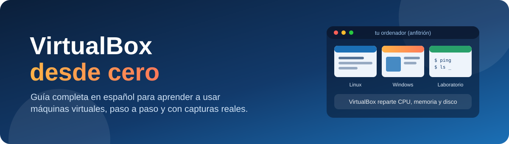
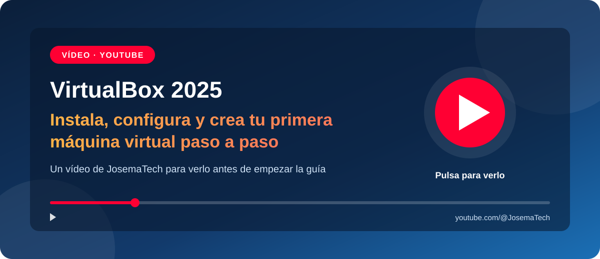

  

  
  
  
  

# VirtualBox desde cero

Esta guía está pensada para alguien que **nunca ha usado VirtualBox** y que, además, no se siente cómodo con los ordenadores. No da nada por sabido: empieza explicando qué es un ordenador por dentro y qué significa "virtualizar", y termina recorriendo **todos los apartados, menús y ajustes** de VirtualBox con capturas de pantalla reales.

Al terminarla sabrás:

- Qué es una máquina virtual y para qué sirve.
- Instalar VirtualBox y entender su ventana principal.
- Crear, importar, exportar, añadir, clonar y eliminar máquinas virtuales.
- Configurar cada apartado de una máquina: memoria, procesador, discos, red, USB, carpetas compartidas...
- Usar las herramientas globales: **Extensiones, Medio, Red, Cloud y Actividades**.
- Usar las herramientas de cada máquina: **Detalles, Instantáneas, Trazas, Actividad y Administrador de archivos**.
- Reconocer cada tipo de archivo que vas a encontrar: `.vbox`, `.vdi`, `.vmdk`, `.iso`, `.ova`, `.sav`, `.log`...
- Resolver los problemas más habituales.

> [!TIP]
> Si es tu primera vez, sigue los capítulos **en orden**. Cada página termina con un enlace al siguiente capítulo, así que solo tienes que ir avanzando.

---

## 🎬 ¿Prefieres empezar viéndolo?

  

En este vídeo de [JosemaTech](https://www.youtube.com/@JosemaTech) se ve de principio a fin cómo **instalar VirtualBox**, **configurarlo** y **crear una primera máquina virtual**. Es un buen complemento de los capítulos [2 · Instalar VirtualBox](docs/02-instalar-virtualbox.md) y [6 · Crear una máquina nueva](docs/06-crear-una-maquina.md), que explican esos mismos pasos con más detalle y con capturas.

---

## Índice

### Parte 1 · Primeros pasos

| | Capítulo | De qué trata |
|:-:|---|---|
| 1 | [Conceptos básicos](docs/01-conceptos-basicos.md) | Qué hay dentro de un ordenador, qué es virtualizar, anfitrión e invitado |
| 2 | [Instalar VirtualBox](docs/02-instalar-virtualbox.md) | Requisitos, descarga, instalación y activar la virtualización |
| 3 | [La ventana principal](docs/03-ventana-principal.md) | Cada zona, botón y menú del administrador de VirtualBox |
| 4 | [Preferencias](docs/04-preferencias.md) | Cómo configurar VirtualBox a tu gusto (modo básico y experto) |

### Parte 2 · Herramientas globales

| | Herramienta | De qué trata |
|:-:|---|---|
| 5 | [Qué son las herramientas globales](docs/05-herramientas-globales/README.md) | El menú "Herramientas" y para qué sirve cada una |
| 5.1 | [Extensiones](docs/05-herramientas-globales/01-extensiones.md) | El paquete de extensiones: qué añade y cómo se instala |
| 5.2 | [Medio](docs/05-herramientas-globales/02-medio.md) | Discos duros, discos ópticos (ISO) y disquetes virtuales |
| 5.3 | [Red](docs/05-herramientas-globales/03-red.md) | Redes solo-anfitrión, redes NAT y redes en la nube |
| 5.4 | [Cloud](docs/05-herramientas-globales/04-cloud.md) | Perfiles de Oracle Cloud Infrastructure |
| 5.5 | [Actividades](docs/05-herramientas-globales/05-actividades.md) | Cuántos recursos consumen tus máquinas encendidas |

### Parte 3 · Máquinas virtuales

| | Capítulo | De qué trata |
|:-:|---|---|
| 6 | [Crear una máquina nueva](docs/06-crear-una-maquina.md) | El asistente "Nueva", en modo guiado y en modo experto |
| 7 | [Añadir, importar, exportar, clonar y eliminar](docs/07-anadir-importar-exportar.md) | Mover máquinas entre ordenadores y gestionarlas |
| 8 | [La configuración de una máquina](docs/08-configuracion/README.md) | Los 10 apartados: General, Sistema, Pantalla, Almacenamiento, Audio, Red, Puertos serie, USB, Carpetas compartidas e Interfaz de usuario |
| 9 | [Las herramientas de una máquina](docs/09-herramientas-de-la-maquina/README.md) | Detalles, Instantáneas, Trazas, Actividad y Administrador de archivos |
| 10 | [Usar una máquina virtual](docs/10-usar-una-maquina.md) | Arrancarla, la tecla anfitrión, los menús de su ventana y cómo apagarla bien |

### Parte 4 · Referencia

| | Capítulo | De qué trata |
|:-:|---|---|
| 11 | [Las redes explicadas](docs/11-redes-explicadas.md) | NAT, Red NAT, Puente, Red interna, Solo-anfitrión... con esquemas |
| 12 | [Tipos de archivo](docs/12-tipos-de-archivo.md) | Todos los archivos que crea o usa VirtualBox y qué hacer con cada uno |
| 13 | [Problemas frecuentes](docs/13-problemas-frecuentes.md) | Errores típicos y cómo solucionarlos |
| 14 | [Glosario](docs/14-glosario.md) | Las palabras técnicas de la guía explicadas en una línea |

---

## Cómo leer esta guía

**Las capturas.** Todas son reales y están hechas con VirtualBox 7.1.8 en Windows 11, con la interfaz en español. Cuando una captura tiene **números rojos**, el texto de debajo explica cada número.

**Los avisos de colores.** A lo largo de la guía verás cajas como estas:

> [!NOTE]
> Información útil que conviene saber.

> [!TIP]
> Un consejo para hacerlo más fácil o más rápido.

> [!IMPORTANT]
> Algo que tienes que hacer sí o sí para que funcione.

> [!WARNING]
> Cuidado: si te equivocas aquí puedes perder tiempo o datos.

**Los nombres de los botones.** Cuando la guía dice "pulsa **Configuración**", el texto en negrita es exactamente lo que pone en el botón o en el menú de VirtualBox. Algunos textos de VirtualBox 7.1 aparecen en inglés aunque tengas la interfaz en español (por ejemplo `Choose a Disk File...`), la guía te avisa cuando pasa.

**Las rutas de archivos.** Las rutas como `C:\Users\TuUsuario\VirtualBox VMs` cambian en tu ordenador según tu nombre de usuario. En las capturas aparece el usuario del equipo donde se hicieron.

> [!NOTE]
> La guía está hecha con **VirtualBox 7.1**. En versiones posteriores (7.2 y siguientes) algunos menús cambian de sitio o de aspecto, pero las ideas y casi todas las opciones siguen siendo las mismas.

---

  <b>¿Listo?</b> Empieza por el principio: <a href="docs/01-conceptos-basicos.md"><b>Capítulo 1 · Conceptos básicos</b></a> ➡️

