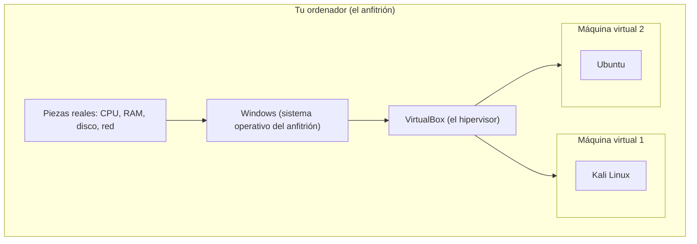

# 1 · Conceptos básicos

Antes de abrir VirtualBox conviene entender **qué hace** y **por qué existe**. Este capítulo no tiene capturas porque todavía no tocamos el programa: explica con palabras sencillas las ideas que vas a necesitar en el resto de la guía.

**En este capítulo:**
- [Qué hay dentro de un ordenador](#qué-hay-dentro-de-un-ordenador)
- [Sistema operativo, programas y archivos](#sistema-operativo-programas-y-archivos)
- [Qué es virtualizar](#qué-es-virtualizar)
- [Anfitrión e invitado](#anfitrión-e-invitado)
- [De qué está hecha una máquina virtual](#de-qué-está-hecha-una-máquina-virtual)
- [Para qué sirve una máquina virtual](#para-qué-sirve-una-máquina-virtual)
- [Qué es VirtualBox](#qué-es-virtualbox)

---

## Qué hay dentro de un ordenador

Un ordenador, sea un portátil o un PC de sobremesa, tiene siempre las mismas piezas básicas. Las vas a ver una y otra vez en VirtualBox, porque una máquina virtual tiene **las mismas piezas, pero de mentira**.

| Pieza | Para qué sirve |
|---|---|
| **Procesador** (CPU) | Hace todos los cálculos. Cada programa que usas le pide trabajo. |
| **Memoria RAM** | Guarda lo que estás usando **ahora mismo** (programas abiertos, la página web que lees...). Se borra al apagar. |
| **Disco duro** (HDD o SSD) | Guarda tus archivos y programas **para siempre**, aunque apagues. |
| **Tarjeta gráfica** | Dibuja lo que ves en la pantalla. |
| **Tarjeta de red** | Conecta el ordenador a Internet o a otros equipos, por cable o por Wi-Fi. |
| **Unidad óptica** | Lee CD y DVD. Hoy casi no se usa, pero en VirtualBox es muy importante (ya verás por qué). |
| **USB, audio, puertos...** | Conectan pendrives, ratón, altavoces, micrófono... |

Los tamaños se miden en **bytes**. Cada unidad es unas mil veces la anterior (exactamente 1024 veces): 1 **KB** (kilobyte), 1 **MB** (megabyte) = 1024 KB, 1 **GB** (gigabyte) = 1024 MB y 1 **TB** (terabyte) = 1024 GB. Un ordenador normal hoy tiene entre 8 y 32 GB de RAM y entre 256 GB y 2 TB de disco. VirtualBox suele mostrar la memoria en MB: **2048 MB son 2 GB** y **8192 MB son 8 GB**.

> [!TIP]
> Para ver cuánta RAM y qué procesador tiene tu ordenador con Windows, pulsa a la vez **Ctrl + Mayúsculas + Esc** para abrir el **Administrador de tareas** y entra en la pestaña **Rendimiento**.

## Sistema operativo, programas y archivos

- El **sistema operativo** es el programa principal que hace funcionar el ordenador: Windows, macOS o Linux (Ubuntu, Kali, Debian...). Se encarga de repartir el procesador, la memoria y el disco entre todos los demás programas.
- Los **programas** (o aplicaciones) son todo lo demás: el navegador, Word, VirtualBox...
- Los **archivos** son los documentos guardados en el disco. Su nombre termina en una **extensión** que dice qué tipo de archivo es: `informe.docx` es un documento de Word, `foto.jpg` es una imagen. VirtualBox usa sus propias extensiones (`.vbox`, `.vdi`, `.ova`...), todas explicadas en el [capítulo 12](12-tipos-de-archivo.md).
- Las **carpetas** agrupan archivos. La dirección completa de un archivo se llama **ruta**, por ejemplo `C:\Users\Ana\Desktop\ISOs\DVWA-1.0.7.iso`.

> [!NOTE]
> Windows a veces **oculta las extensiones**. Para verlas, abre el Explorador de archivos, entra en el menú **Ver**, después **Mostrar** y marca **Extensiones de nombre de archivo**. Te será muy útil para distinguir los archivos de VirtualBox.

### Qué es una imagen ISO

Antes, para instalar un sistema operativo, se metía un CD o un DVD en el ordenador. Una **imagen ISO** (un archivo que termina en `.iso`) es una **copia exacta de ese disco, guardada en un solo archivo**. Así no hace falta grabar ningún disco: VirtualBox "mete" el archivo ISO en la unidad de CD de la máquina virtual, como si fuera un disco de verdad.

Casi todos los sistemas operativos se descargan como ISO: Windows, Ubuntu, Kali, Debian...

## Qué es virtualizar

**Virtualizar** es usar un programa para crear un **ordenador de mentira dentro de tu ordenador de verdad**. Ese ordenador de mentira se llama **máquina virtual** (en inglés *virtual machine*, abreviado **VM** o, en español, **MV**).

La máquina virtual cree que tiene su propio procesador, su propia memoria, su propio disco y su propia tarjeta de red. En realidad todo eso es un **préstamo**: el programa de virtualización toma una parte de los recursos de tu ordenador y se la presta.

El programa que crea y controla las máquinas virtuales se llama **hipervisor**. VirtualBox es un hipervisor **de tipo 2**: se instala como un programa más encima de tu sistema operativo (por ejemplo, encima de Windows). Los de **tipo 1** se instalan directamente sobre el hardware, sin sistema operativo debajo, y se usan sobre todo en servidores (por ejemplo VMware ESXi o Proxmox).

## Anfitrión e invitado

Estas dos palabras aparecen en muchísimas pantallas de VirtualBox:

| Palabra | Qué es | Ejemplo |
|---|---|---|
| **Anfitrión** (*host*) | Tu ordenador de verdad y su sistema operativo. | Tu portátil con Windows 11. |
| **Invitado** (*guest*) | El sistema operativo que corre **dentro** de la máquina virtual. | El Kali Linux que arrancas dentro de VirtualBox. |

> [!IMPORTANT]
> Lo que haces dentro de una máquina virtual **no afecta a tu ordenador** (salvo que tú lo conectes a propósito, por ejemplo con carpetas compartidas). Si rompes el sistema invitado, tu Windows sigue intacto. Por eso las máquinas virtuales son tan útiles para practicar.

## De qué está hecha una máquina virtual

Aunque parezca un ordenador completo, una máquina virtual son, básicamente, **dos archivos** dentro de una carpeta:

1. **Un archivo de configuración** (`.vbox`): dice cuánta memoria tiene, cuántos procesadores, qué discos, qué tarjeta de red... Es la "ficha técnica" de la máquina.
2. **Uno o varios discos virtuales** (normalmente `.vdi`): un archivo grande que hace de disco duro. Dentro está instalado el sistema invitado con todos sus archivos.

Además, VirtualBox va añadiendo otros archivos: registros (`.log`), instantáneas, estados guardados... Todos están explicados en el [capítulo 12](12-tipos-de-archivo.md).

### Los recursos se prestan, no se multiplican

Si tu ordenador tiene 16 GB de RAM y le das 8 GB a una máquina virtual, **mientras esa máquina esté encendida** a Windows le quedan solo 8 GB. Lo mismo pasa con los núcleos del procesador. Cuando apagas la máquina, los recursos vuelven a tu ordenador.

> [!WARNING]
> No le des a una máquina virtual más de la mitad de tu RAM ni más de la mitad de los núcleos de tu procesador. Si lo haces, tu ordenador y la propia máquina virtual irán muy lentos.

## Para qué sirve una máquina virtual

- **Practicar sin miedo.** Puedes instalar, romper y volver a empezar. Con las [instantáneas](09-herramientas-de-la-maquina/02-instantaneas.md) vuelves atrás en segundos.
- **Laboratorios de ciberseguridad.** Montar una máquina atacante (Kali) y otra vulnerable (DVWA, Metasploitable) conectadas entre sí, sin tocar la red de casa ni de clase.
- **Probar otros sistemas.** Usar Linux sin quitar Windows, o probar una versión nueva de Windows antes de instalarla de verdad.
- **Programas antiguos o desconfiados.** Abrir un archivo sospechoso o un programa viejo dentro de una máquina aislada.
- **Llevarte un entorno completo.** Exportas la máquina a un archivo `.ova` y la abres en otro ordenador tal cual estaba.

## Qué es VirtualBox

**Oracle VirtualBox** es un hipervisor **gratuito** y de **código abierto** (la parte principal se publica con licencia GPL versión 3). Funciona en Windows, Linux, macOS (incluidos los Mac con procesador Apple desde la versión 7.1) y Solaris.

Hay dos piezas que se descargan por separado:

| Pieza | Qué es | ¿Es obligatoria? |
|---|---|---|
| **VirtualBox** (paquete base) | El programa en sí. | Sí. |
| **Extension Pack** (paquete de extensiones) | Funciones extra: escritorio remoto, webcam del anfitrión, cifrado de discos... | No. Tiene otra licencia, se explica en [Extensiones](05-herramientas-globales/01-extensiones.md). |

En el siguiente capítulo lo instalamos.

---

<!-- nav -->

[⬅️ Inicio](../README.md) &nbsp;·&nbsp; [🏠 Índice](../README.md) &nbsp;·&nbsp; [2 · Instalar VirtualBox ➡️](02-instalar-virtualbox.md)

