# 3 · La ventana principal

La ventana principal de VirtualBox se llama **Oracle VirtualBox Administrador**. Desde aquí se crean, se configuran y se arrancan todas las máquinas virtuales. En este capítulo la recorremos zona por zona.

**En este capítulo:**
- [Las 7 zonas de la ventana](#las-7-zonas-de-la-ventana)
- [1 · La barra de menús](#1--la-barra-de-menús)
- [2 · El elemento Herramientas](#2--el-elemento-herramientas)
- [3 · La lista de máquinas](#3--la-lista-de-máquinas)
- [4 · La barra de botones](#4--la-barra-de-botones)
- [5 · El panel de detalles](#5--el-panel-de-detalles)
- [6 · La previsualización](#6--la-previsualización)
- [7 · El botón de herramientas de la máquina](#7--el-botón-de-herramientas-de-la-máquina)

---

## Las 7 zonas de la ventana

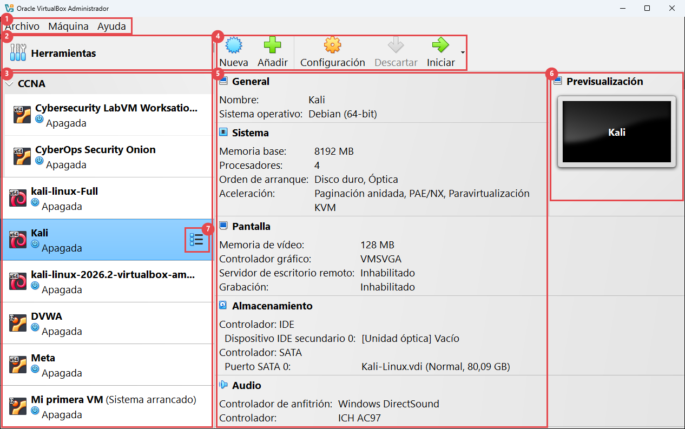

| Nº | Zona | Para qué sirve |
|:-:|---|---|
| 1 | **Barra de menús** | Todas las acciones del programa, ordenadas en menús. |
| 2 | **Herramientas** | Da acceso a las herramientas globales (las que no son de una máquina concreta). |
| 3 | **Lista de máquinas** | Todas tus máquinas virtuales, con su estado (apagada, corriendo...). |
| 4 | **Barra de botones** | Los botones de las acciones más usadas. Cambian según lo que tengas seleccionado. |
| 5 | **Panel de detalles** | La "ficha técnica" de la máquina seleccionada. |
| 6 | **Previsualización** | Una miniatura de la pantalla de la máquina. |
| 7 | **Botón de herramientas de la máquina** | Cambia el panel derecho entre Detalles, Instantáneas, Trazas, Actividad y Administrador de archivos. |

---

## 1 · La barra de menús

La barra tiene siempre **Archivo**, **Máquina** y **Ayuda**. Además, cuando abres una herramienta aparece un menú extra con sus acciones: **Medio**, **Red**, **Extensión**, **Cloud**, **Recursos**, **Instantánea**, **Traza**, **Actividad** o **Administrador de archivos**.

### Menú Archivo

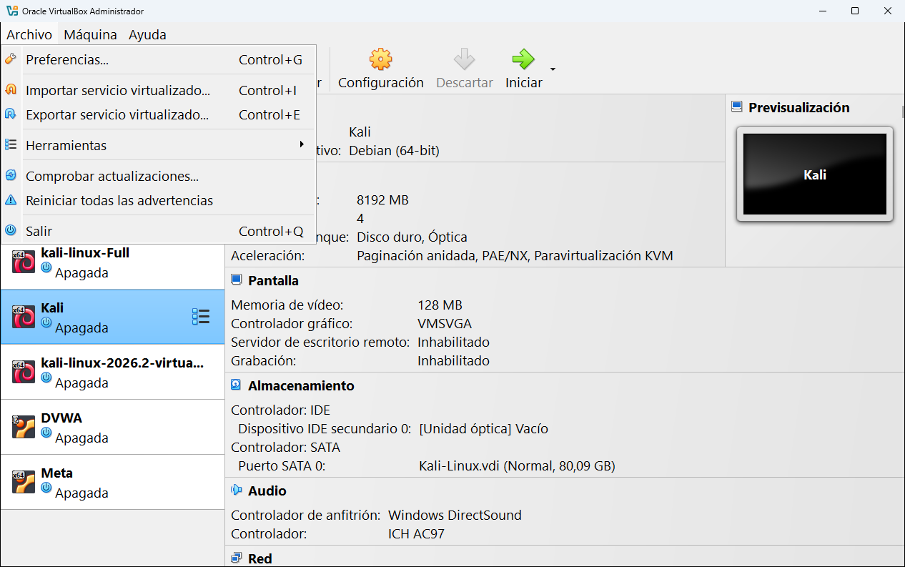

| Opción | Qué hace | Dónde se explica |
|---|---|---|
| **Preferencias...** | Abre la configuración general de VirtualBox (idioma, carpeta de máquinas, actualizaciones...). | [Capítulo 4](04-preferencias.md) |
| **Importar servicio virtualizado...** | Trae una máquina desde un archivo `.ova` u `.ovf`. "Servicio virtualizado" es la traducción de *appliance*: una máquina empaquetada. | [Capítulo 7](07-anadir-importar-exportar.md#importar-una-máquina-ova) |
| **Exportar servicio virtualizado...** | Empaqueta una o varias máquinas en un archivo `.ova` para llevarlas a otro ordenador. | [Capítulo 7](07-anadir-importar-exportar.md#exportar-una-máquina-a-ova) |
| **Herramientas** | Submenú para abrir las herramientas globales (ver la imagen siguiente). | [Parte 2](05-herramientas-globales/README.md) |
| **Comprobar actualizaciones...** | Pregunta a la web de VirtualBox si hay una versión nueva. | |
| **Reiniciar todas las advertencias** | Vuelve a mostrar los avisos en los que marcaste "no volver a mostrar". | |
| **Salir** | Cierra el administrador. Las máquinas encendidas **siguen funcionando** en su propia ventana. | |

El submenú **Herramientas** abre las mismas herramientas que el elemento Herramientas de la zona 2, con su nombre largo:

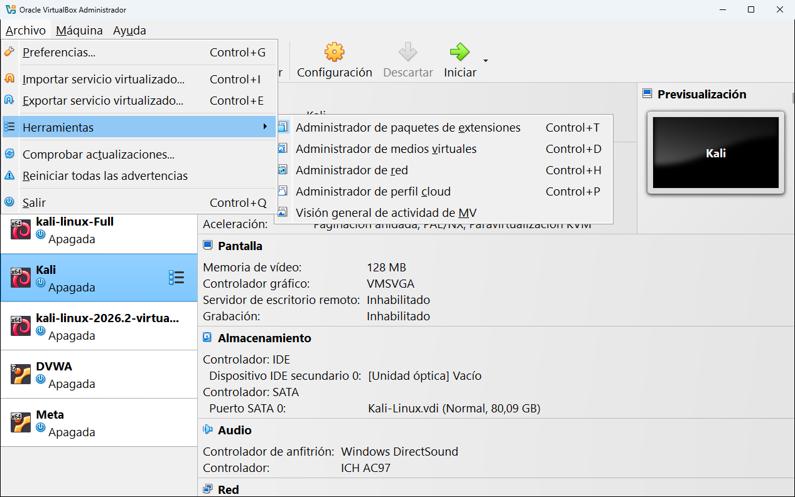

| Nombre en el menú | Herramienta |
|---|---|
| Administrador de paquetes de extensiones | [Extensiones](05-herramientas-globales/01-extensiones.md) |
| Administrador de medios virtuales | [Medio](05-herramientas-globales/02-medio.md) |
| Administrador de red | [Red](05-herramientas-globales/03-red.md) |
| Administrador de perfil cloud | [Cloud](05-herramientas-globales/04-cloud.md) |
| Visión general de actividad de MV | [Actividades](05-herramientas-globales/05-actividades.md) |

### Menú Máquina

Actúa sobre la máquina seleccionada en la lista. Las opciones en gris no se pueden usar en ese momento (por ejemplo, **Pausar** solo funciona si la máquina está encendida).

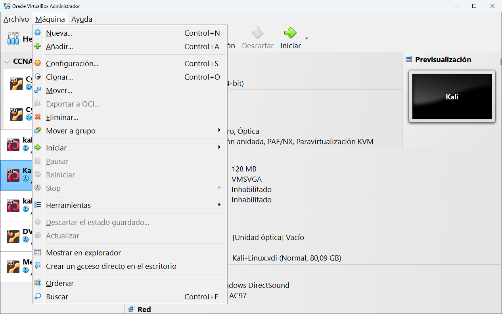

| Opción | Atajo | Qué hace |
|---|---|---|
| **Nueva...** | Ctrl+N | Crea una máquina desde cero ([capítulo 6](06-crear-una-maquina.md)). |
| **Añadir...** | Ctrl+A | Añade a la lista una máquina que ya existe en el disco (su archivo `.vbox`). |
| **Configuración...** | Ctrl+S | Abre todos los ajustes de la máquina ([capítulo 8](08-configuracion/README.md)). |
| **Clonar...** | Ctrl+O | Hace una copia de la máquina ([capítulo 7](07-anadir-importar-exportar.md#clonar-una-máquina)). |
| **Mover...** | | Mueve la carpeta de la máquina a otro sitio (por ejemplo, a otro disco). |
| **Exportar a OCI...** | | Sube la máquina a Oracle Cloud Infrastructure. Necesita una cuenta de Oracle Cloud. |
| **Eliminar...** | | Quita la máquina de la lista y, si quieres, borra sus archivos ([capítulo 7](07-anadir-importar-exportar.md#eliminar-una-máquina)). |
| **Mover a grupo** | | Mete la máquina en un grupo existente o en uno **[Nuevo]**. |
| **Iniciar** | | Enciende la máquina. Tiene tres formas de arranque (ver más abajo). |
| **Pausar** | | Congela la máquina encendida. Vuelve a pulsarlo para continuar. |
| **Reiniciar** | | Reinicia la máquina de golpe, como pulsar el botón de reset. |
| **Stop** | | Submenú para guardar el estado, enviar la señal de apagado o apagar de golpe ([capítulo 10](10-usar-una-maquina.md#apagar-una-máquina-correctamente)). |
| **Herramientas** | | Cambia la herramienta de la máquina (igual que la zona 7). |
| **Descartar el estado guardado...** | | Borra el estado guardado de una máquina. Al arrancarla, empezará como si la hubieras apagado de golpe. |
| **Actualizar** | | Vuelve a leer la configuración de la máquina (útil si una máquina aparece como inaccesible y ya has arreglado el problema). |
| **Mostrar en explorador** | | Abre la carpeta de la máquina en el Explorador de Windows. |
| **Crear un acceso directo en el escritorio** | | Pone un icono en el escritorio que arranca la máquina directamente. |
| **Ordenar** | | Ordena la lista de máquinas alfabéticamente. |
| **Buscar** | Ctrl+F | Muestra una barra para buscar una máquina por su nombre. |

Los submenús de **Iniciar**, **Herramientas** y **Mover a grupo**:

| Iniciar | Herramientas | Mover a grupo |
|:-:|:-:|:-:|
| 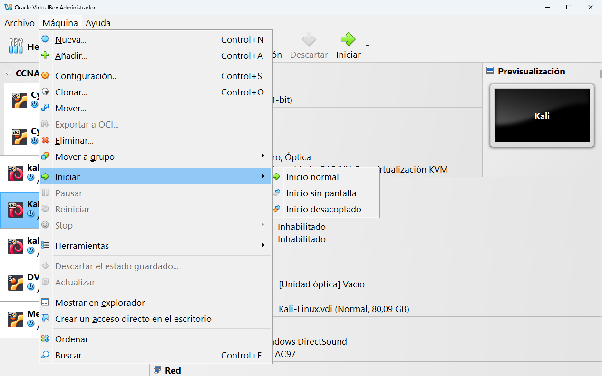 | 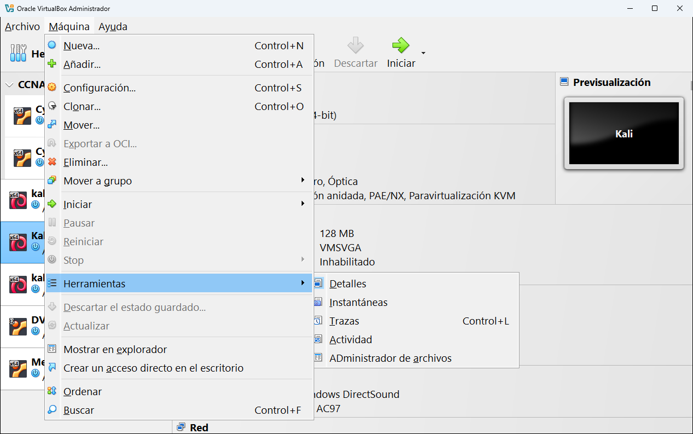 | 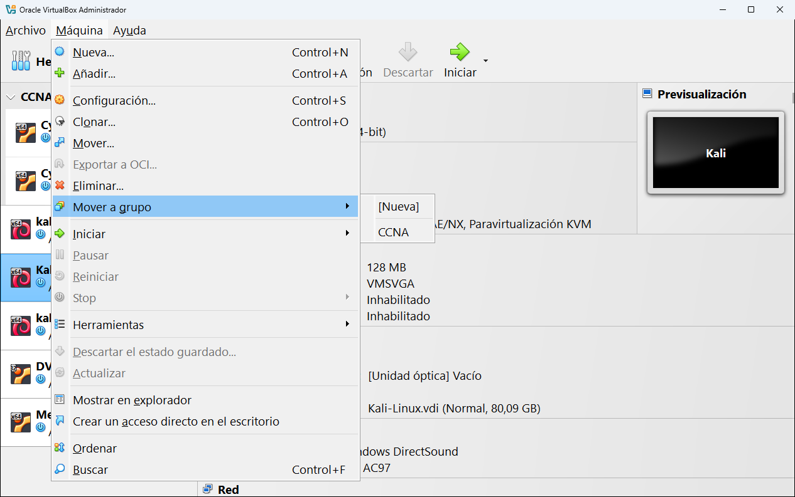 |

---

## 2 · El elemento Herramientas

Es la primera fila de la lista. Al seleccionarlo, la parte derecha muestra la **herramienta global** que tengas elegida. Tiene dos iconos a la derecha:

- La **chincheta** fija el elemento Herramientas arriba, para que no se desplace cuando bajas por una lista larga de máquinas.
- El icono de **lista** abre el menú con las seis herramientas globales:

Cada una tiene su propia página en la [Parte 2 de la guía](05-herramientas-globales/README.md).

---

## 3 · La lista de máquinas

Aquí aparecen todas las máquinas que VirtualBox conoce. Cada fila muestra:

- El **icono** del sistema operativo invitado (Kali, Debian, Ubuntu...) con una etiqueta **x64** o **32** que indica si el sistema es de 64 o de 32 bits.
- El **nombre** de la máquina. Si tiene instantáneas, entre paréntesis aparece el nombre de la última, por ejemplo **Mi primera VM (Sistema arrancado)**.
- El **estado**, con su icono:

| Estado | Qué significa |
|---|---|
| **Apagada** | La máquina está apagada. Puedes cambiar toda su configuración. |
| **Corriendo** | Está encendida y funcionando. |
| **Pausada** | Está congelada en memoria. No avanza hasta que la reanudes. |
| **Guardada** | Se guardó su estado en el disco al cerrarla. Al arrancarla, sigue exactamente donde la dejaste. |
| **Abortada** | Se cerró de golpe por un error o porque se cerró el programa a la fuerza. |
| **Inaccesible** | VirtualBox no encuentra su archivo `.vbox` o uno de sus discos (por ejemplo, porque está en un disco externo desconectado). |

### Grupos

Los **grupos** sirven para ordenar las máquinas, como carpetas. En la captura hay un grupo llamado **CCNA** con dos máquinas dentro. La flecha que hay junto al nombre del grupo lo pliega o lo despliega.

Para crear un grupo:
- Arrastra una máquina encima de otra, o
- Selecciona una máquina y usa **Máquina** → **Mover a grupo** → **[Nueva]**.

Si haces clic derecho sobre el nombre del grupo aparece su menú. Desde él puedes **Renombrar grupo**, **Desagrupar** (sacar las máquinas y quitar el grupo) o arrancar y apagar todas sus máquinas a la vez:

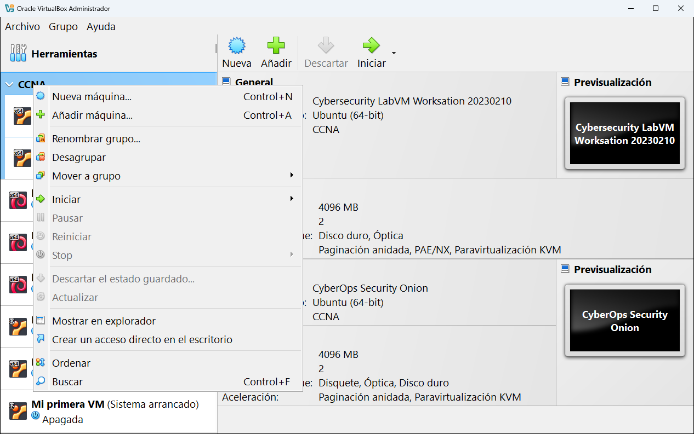

### El menú contextual de una máquina

Si haces **clic derecho** sobre una máquina aparece un menú con casi las mismas opciones que el menú **Máquina**:

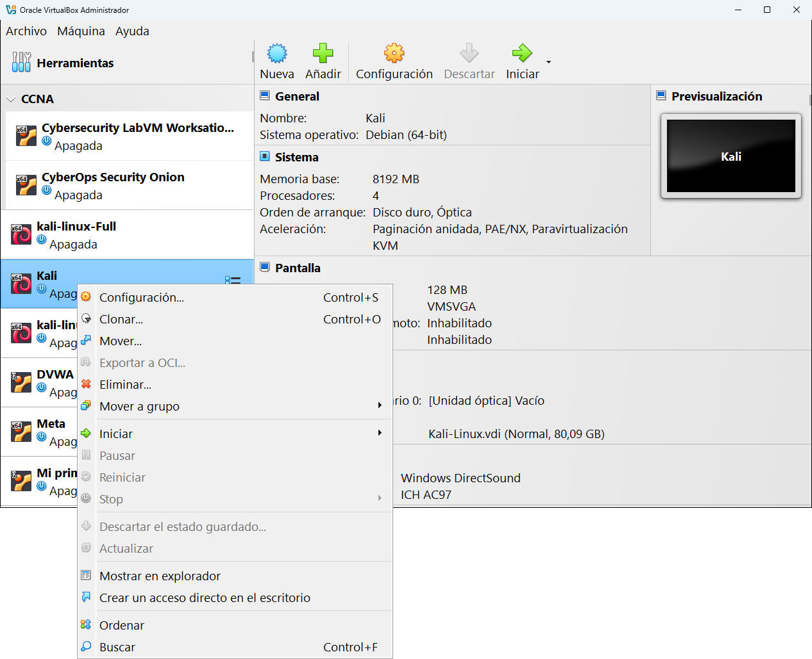

---

## 4 · La barra de botones

Los botones cambian según lo que tengas seleccionado en la lista.

**Con una máquina seleccionada:**

| Botón | Qué hace |
|---|---|
| **Nueva** | Crea una máquina nueva. |
| **Añadir** | Añade una máquina que ya existe en el disco. |
| **Configuración** | Abre los ajustes de la máquina seleccionada. |
| **Descartar** | Borra el estado guardado (solo se activa si la máquina está **Guardada**). |
| **Iniciar** | Arranca la máquina. Si ya está encendida, el botón cambia a **Mostrar** y trae su ventana al frente. |

La flechita pequeña junto a **Iniciar** despliega las tres formas de arranque:

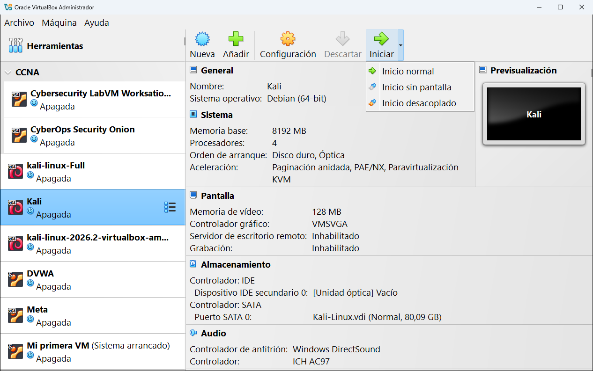

| Forma de arranque | Qué hace | Cuándo usarla |
|---|---|---|
| **Inicio normal** | Arranca la máquina y abre su ventana. | Casi siempre. |
| **Inicio sin pantalla** | Arranca la máquina **sin ventana**, en segundo plano. | Servidores a los que te conectas por red (por ejemplo, una web vulnerable de laboratorio). |
| **Inicio desacoplado** | Arranca en segundo plano, pero puedes abrir y cerrar su ventana cuando quieras sin apagarla. | Cuando quieres mirar la pantalla de vez en cuando. |

**Con el elemento Herramientas seleccionado** los botones son **Preferencias**, **Importar**, **Exportar**, **Nueva** y **Añadir**.

---

## 5 · El panel de detalles

Muestra la configuración de la máquina seleccionada, agrupada en secciones: **General**, **Sistema**, **Pantalla**, **Almacenamiento**, **Audio**, **Red**, **USB**, **Carpetas compartidas** y **Descripción**. Es una forma rápida de ver cómo está configurada sin abrir la ventana de configuración.

Se explica con detalle en [Herramientas de la máquina · Detalles](09-herramientas-de-la-maquina/01-detalles.md).

## 6 · La previsualización

Es una miniatura de la pantalla de la máquina. Si está apagada solo se ve su nombre, si está encendida, se ve lo que muestra su pantalla en ese momento, actualizado cada pocos segundos.

## 7 · El botón de herramientas de la máquina

Aparece a la derecha de la máquina seleccionada. Al pulsarlo se despliegan las herramientas de esa máquina:

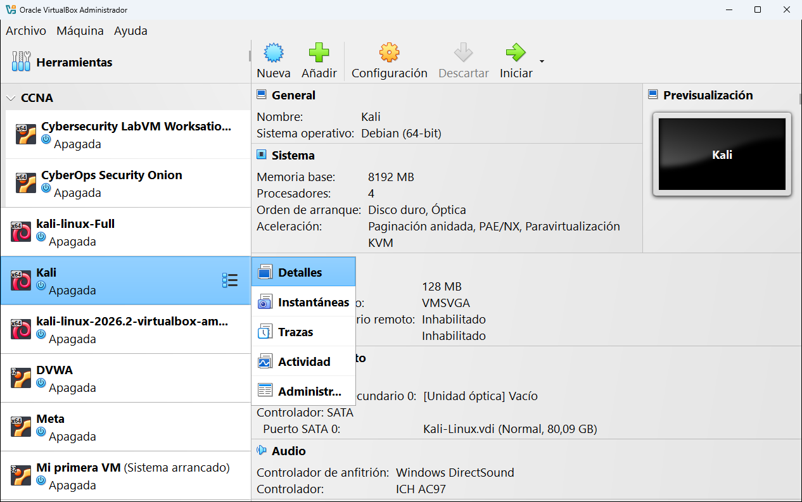

| Herramienta | Para qué sirve |
|---|---|
| [Detalles](09-herramientas-de-la-maquina/01-detalles.md) | La ficha técnica (la vista por defecto). |
| [Instantáneas](09-herramientas-de-la-maquina/02-instantaneas.md) | Guardar "fotos" de la máquina para volver atrás. |
| [Trazas](09-herramientas-de-la-maquina/03-trazas.md) | Los registros (*logs*) de lo que ha pasado en la máquina. |
| [Actividad](09-herramientas-de-la-maquina/04-actividad.md) | Gráficas de CPU, memoria, red y disco. |
| [Administrador de archivos](09-herramientas-de-la-maquina/05-administrador-de-archivos.md) | Copiar archivos entre tu ordenador y la máquina. |

---

<!-- nav -->

[⬅️ 2 · Instalar VirtualBox](02-instalar-virtualbox.md) &nbsp;·&nbsp; [🏠 Índice](../README.md) &nbsp;·&nbsp; [4 · Preferencias ➡️](04-preferencias.md)

