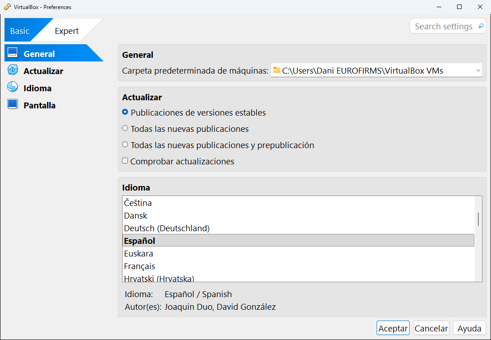
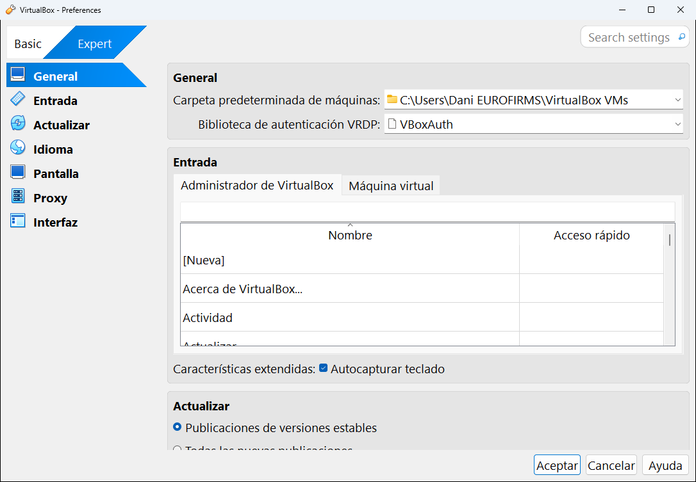
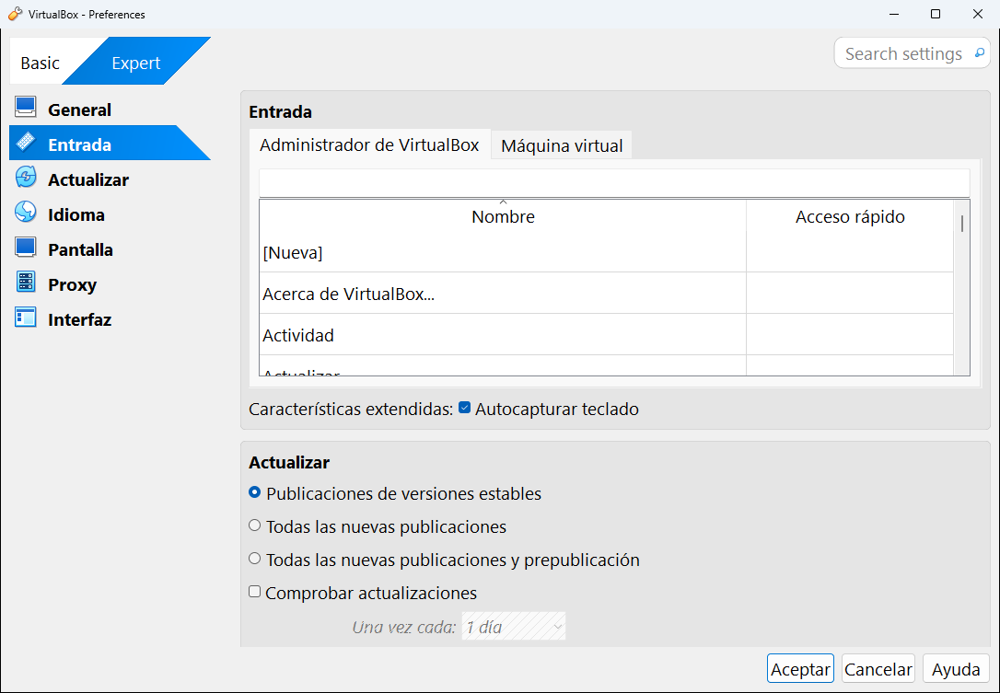
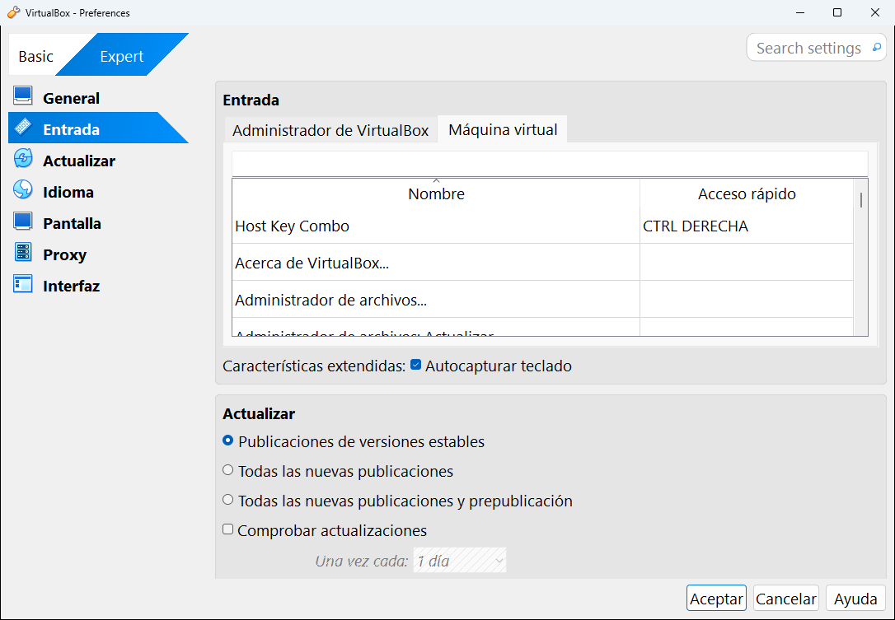
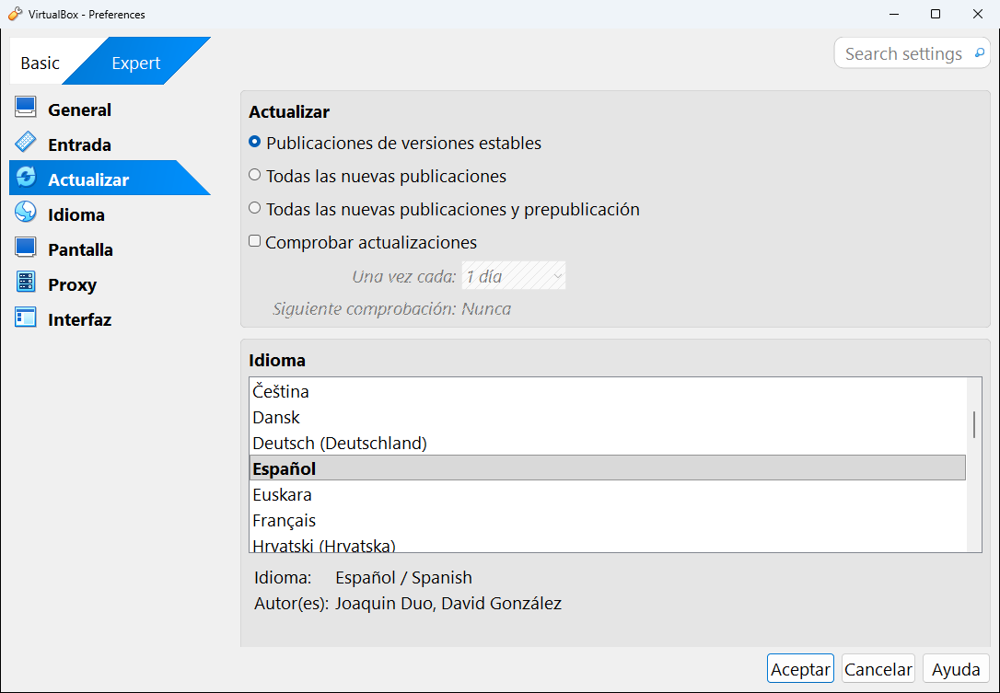
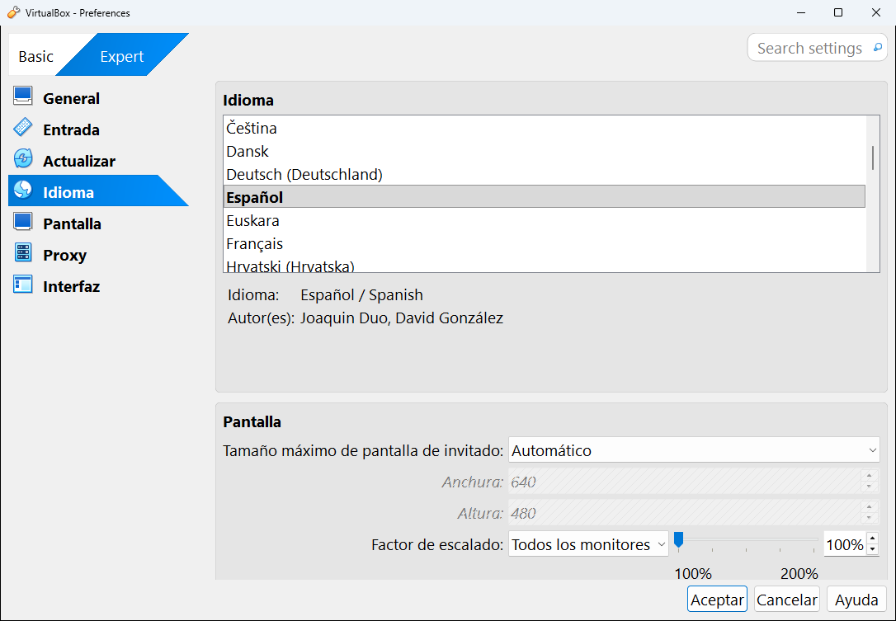
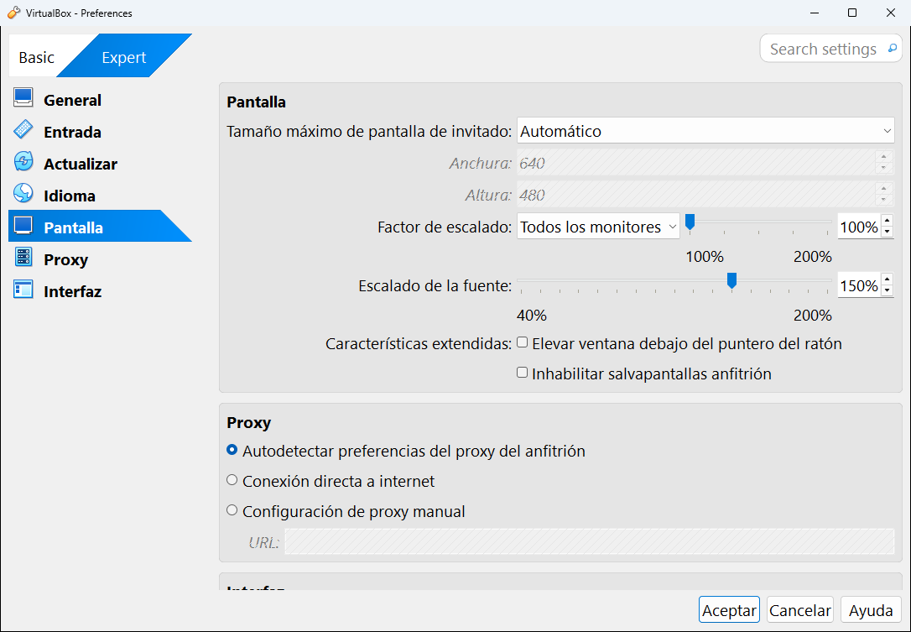
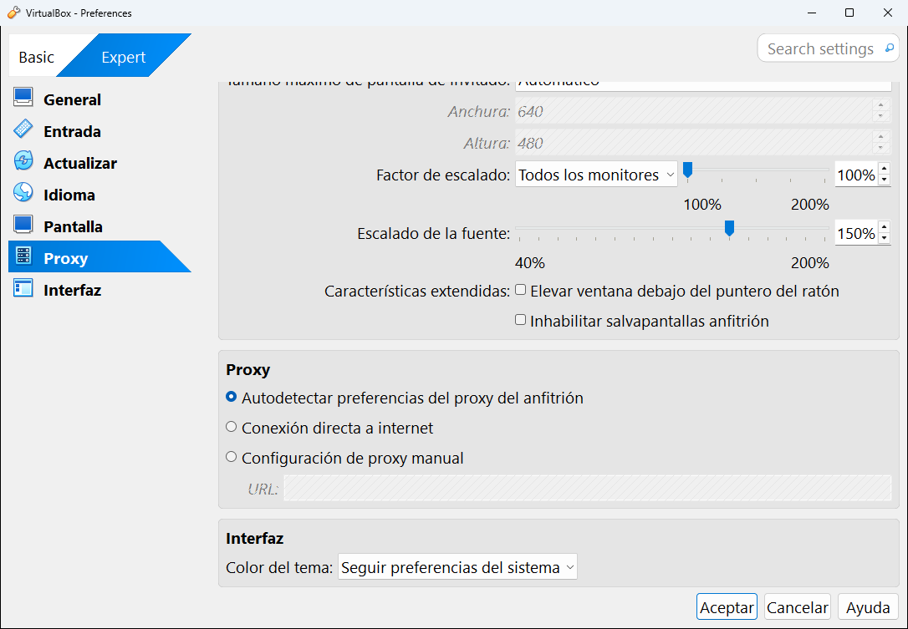

# 4 · Preferencias

Las **Preferencias** son la configuración de **VirtualBox en sí**, no de una máquina concreta: dónde se guardan las máquinas, el idioma, los atajos de teclado, las actualizaciones...

Se abren de tres maneras:
- Menú **Archivo** → **Preferencias...**
- Selecciona **Herramientas** en la lista y pulsa el botón **Preferencias**.
- Desde la ventana de una máquina encendida: **Archivo** → **Preferencias...**

**En este capítulo:**
- [Modo básico y modo experto](#modo-básico-y-modo-experto)
- [General](#general)
- [Entrada](#entrada)
- [Actualizar](#actualizar)
- [Idioma](#idioma)
- [Pantalla](#pantalla)
- [Proxy](#proxy)
- [Interfaz](#interfaz)
- [Guardar o descartar los cambios](#guardar-o-descartar-los-cambios)

---

## Modo básico y modo experto

Arriba a la izquierda hay un interruptor con dos posiciones: **Basic** (básico) y **Expert** (experto). La opción que está en azul es la activa.

| Modo | Qué muestra |
|---|---|
| **Basic** | Solo los ajustes imprescindibles. Los asistentes van paso a paso. Es el modo por defecto al instalar VirtualBox por primera vez. |
| **Expert** | Todos los ajustes. Los asistentes muestran todas las opciones en una sola página. |

Este interruptor cambia el modo de **todo VirtualBox**, no solo de esta ventana. Así se ve Preferencias en **modo básico**, con solo cuatro categorías:

En **modo experto** aparecen siete: General, Entrada, Actualizar, Idioma, Pantalla, Proxy e Interfaz. Las capturas siguientes están en modo experto.

> [!TIP]
> Arriba a la derecha está la caja **Search settings** (buscar ajustes). Escribe una palabra, por ejemplo "carpeta", y VirtualBox te lleva al ajuste correspondiente.

---

## General

| Ajuste | Qué hace | Recomendación |
|---|---|---|
| **Carpeta predeterminada de máquinas** | La carpeta donde se crean las máquinas nuevas. Por defecto es `C:\Users\TuUsuario\VirtualBox VMs`. | Si tu disco `C:` va justo de espacio y tienes otro disco más grande, cámbiala a ese otro disco. Las máquinas que ya existen **no se mueven**: solo afecta a las nuevas. |
| **Biblioteca de autenticación VRDP** | El sistema que comprueba usuario y contraseña cuando alguien se conecta a una máquina por escritorio remoto (VRDP). | Déjalo en **VBoxAuth**. Solo se usa con el [paquete de extensiones](05-herramientas-globales/01-extensiones.md). |

## Entrada

Aquí se configuran el **teclado** y los **atajos**. Tiene dos pestañas.

**Administrador de VirtualBox**: los atajos de la ventana principal. Cada fila es una acción y, a la derecha, su atajo. Para cambiarlo, haz doble clic en la columna **Acceso rápido** y pulsa la nueva combinación.

**Máquina virtual**: los atajos que funcionan dentro de la ventana de una máquina encendida. La primera fila es la más importante de todas, la **Host Key Combo** o **tecla anfitrión**:

> [!IMPORTANT]
> La **tecla anfitrión** es **Ctrl derecha** (la tecla Ctrl que está a la derecha de la barra espaciadora). Sirve para "recuperar" el teclado y el ratón cuando la máquina virtual los ha capturado, y para todos los atajos de la máquina: **Ctrl derecha + F** pone la pantalla completa, **Ctrl derecha + Q** cierra la máquina, etc. Lo verás en el [capítulo 10](10-usar-una-maquina.md#la-tecla-anfitrión).
>
> Si tu teclado (por ejemplo, el de algunos portátiles) no tiene Ctrl derecha, cámbiala aquí: doble clic en **Host Key Combo** y pulsa la tecla que quieras usar.

Debajo de las pestañas está la casilla **Autocapturar teclado**. Si está marcada, cuando la ventana de una máquina está delante, **todo lo que escribes va a la máquina**, incluidas combinaciones como **Alt + Tab** o la tecla de Windows. Si la desmarcas, tendrás que hacer clic dentro de la máquina para que reciba el teclado.

## Actualizar

| Ajuste | Qué hace |
|---|---|
| **Publicaciones de versiones estables** | Solo avisa de versiones estables. **Es la opción recomendada.** |
| **Todas las nuevas publicaciones** | Avisa también de versiones nuevas que aún tienen poco tiempo. |
| **Todas las nuevas publicaciones y prepublicación** | Avisa incluso de versiones de prueba (beta). No las instales en el ordenador donde trabajas. |
| **Comprobar actualizaciones** | Si está marcada, VirtualBox mira solo si hay versiones nuevas cada cierto tiempo. |
| **Una vez cada** | Cada cuánto lo comprueba (1 día, 2 días, 1 semana...). |
| **Siguiente comprobación** | Cuándo será la próxima comprobación. Pone **Nunca** si la casilla está desmarcada. |

> [!NOTE]
> VirtualBox **no se actualiza solo**: como mucho te avisa. Para actualizar tienes que descargar e instalar la versión nueva tú mismo (ver el [capítulo 2](02-instalar-virtualbox.md#actualizar-a-una-versión-nueva)).

## Idioma

La categoría **Idioma** es una lista con todos los idiomas disponibles. El que está en **negrita** es el que se usa ahora. Debajo aparece el nombre del idioma elegido y sus traductores.

Si eliges **Por defecto**, VirtualBox usa el idioma de tu Windows. El cambio se aplica al pulsar **Aceptar**.

## Pantalla

| Ajuste | Qué hace |
|---|---|
| **Tamaño máximo de pantalla de invitado** | Limita la resolución que la máquina virtual puede pedir. **Automático** deja que VirtualBox la ajuste a tu monitor, con **Sugerencia** pones tú la **Anchura** y la **Altura** máximas, **Ninguno** no pone límite. |
| **Factor de escalado** | Agranda la pantalla de las máquinas virtuales (100 % es tamaño real, 200 % es el doble). Útil en monitores de alta resolución donde todo se ve diminuto. Puedes aplicarlo a **todos los monitores** o a uno concreto. |
| **Escalado de la fuente** | Agranda o reduce las letras de **las ventanas de VirtualBox** (de 40 % a 200 %). En las capturas de esta guía está al **150 %**, por eso los textos se ven grandes. |
| **Elevar ventana debajo del puntero del ratón** | En sistemas con varias ventanas, trae al frente la ventana de la máquina al pasar el ratón por encima. |
| **Inhabilitar salvapantallas anfitrión** | Evita que tu ordenador active el salvapantallas o apague el monitor mientras una máquina está encendida. |

## Proxy

Un **proxy** es un ordenador intermediario por el que pasa la conexión a Internet. Muchas empresas y centros de estudio lo usan. Aquí solo afecta a las conexiones del **propio VirtualBox** (comprobar actualizaciones, descargar los complementos del invitado), no a las máquinas virtuales.

| Opción | Cuándo usarla |
|---|---|
| **Autodetectar preferencias del proxy del anfitrión** | La normal. Usa la misma configuración que tu Windows. |
| **Conexión directa a internet** | Si sabes que no hay ningún proxy. |
| **Configuración de proxy manual** | Si tu informático te ha dado una dirección de proxy. Escríbela en el campo **URL**. |

## Interfaz

Es la última categoría y aparece al final de la página:

**Color del tema** elige el aspecto de las ventanas de VirtualBox: **Seguir preferencias del sistema** (claro u oscuro según tu Windows), **Claro** u **Oscuro**.

## Guardar o descartar los cambios

Abajo a la derecha hay tres botones:

| Botón | Qué hace |
|---|---|
| **Aceptar** | Guarda todos los cambios y cierra la ventana. |
| **Cancelar** | Cierra la ventana **sin guardar nada**. |
| **Ayuda** | Abre la página del manual que explica esta ventana. |

---

<!-- nav -->

[⬅️ 3 · La ventana principal](03-ventana-principal.md) &nbsp;·&nbsp; [🏠 Índice](../README.md) &nbsp;·&nbsp; [5 · Herramientas globales ➡️](05-herramientas-globales/README.md)

