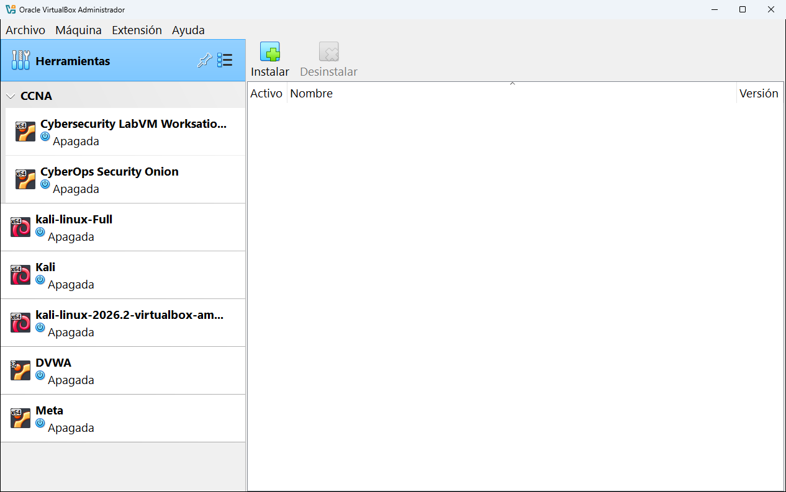

# 5.1 · Extensiones

Esta herramienta sirve para instalar y desinstalar el **Oracle VirtualBox Extension Pack** (paquete de extensiones): un complemento oficial que añade funciones que no vienen en el VirtualBox normal.

En la captura la lista está **vacía**: en ese ordenador no hay ningún paquete instalado. Es lo normal y VirtualBox funciona perfectamente así.

## Las partes de la pantalla

| Elemento | Qué es |
|---|---|
| Botón **Instalar** | Abre un archivo `.vbox-extpack` y lo instala. |
| Botón **Desinstalar** | Quita el paquete seleccionado. |
| Columna **Activo** | Una marca verde indica que el paquete está instalado y funcionando. |
| Columna **Nombre** | Normalmente `Oracle VirtualBox Extension Pack`. |
| Columna **Versión** | Tiene que ser **exactamente la misma** que la de VirtualBox. |

## Qué añade el paquete de extensiones

Según la documentación oficial de VirtualBox 7.1, el paquete añade:

| Función | Para qué sirve |
|---|---|
| **VRDP** (VirtualBox Remote Desktop Protocol) | Ver y manejar una máquina virtual desde otro ordenador, con un programa de escritorio remoto. Sin el paquete, la pestaña **Pantalla remota** de la configuración aparece desactivada (ver [Pantalla](../08-configuracion/03-pantalla.md)). |
| **Webcam del anfitrión** | Usar la cámara de tu ordenador dentro de la máquina virtual. |
| **Arranque PXE de Intel** | Arrancar una máquina desde la red con tarjetas de red Intel. Se usa en empresas para instalar sistemas automáticamente. |
| **Cifrado de discos con AES** | Proteger con contraseña los discos virtuales. |
| **Integración con la nube** | Trabajar con máquinas de Oracle Cloud Infrastructure (ver [Cloud](04-cloud.md)). |

> [!NOTE]
> El **USB 2.0 y 3.0** ya **no** necesita el paquete de extensiones: desde hace varias versiones viene incluido en VirtualBox normal. Si lees en Internet que hace falta para USB 3.0, es información antigua.

## La licencia: léela antes de instalarlo

VirtualBox es gratuito y de código abierto, pero el paquete de extensiones tiene **otra licencia**, llamada **PUEL** (*Personal Use and Evaluation License*). En resumen:

- Es **gratis** para uso **personal**, **educativo** y para **evaluación** (probarlo).
- En una **empresa** se considera uso comercial y requiere comprar una licencia a Oracle.

> [!WARNING]
> Si vas a usar VirtualBox en un ordenador de tu trabajo, consulta con tu empresa antes de instalar el paquete de extensiones. Al instalarlo tienes que aceptar su licencia, y aceptarla es responsabilidad tuya.

## Cómo instalarlo (si lo necesitas)

1. Comprueba tu versión exacta en **Ayuda** → **Acerca de VirtualBox...** (por ejemplo, 7.1.8).
2. En [virtualbox.org/wiki/Downloads](https://www.virtualbox.org/wiki/Downloads) descarga el **Extension Pack** de **esa misma versión**. Es un archivo que termina en `.vbox-extpack`.
3. En esta herramienta pulsa **Instalar** y elige el archivo descargado.
4. VirtualBox te muestra la licencia. Léela hasta el final (el botón de aceptar se activa al llegar abajo) y acéptala solo si tu caso de uso está permitido.
5. Windows pedirá permiso de administrador. Al terminar, el paquete aparece en la lista con la marca de **Activo**.

> [!TIP]
> También puedes instalarlo haciendo doble clic en el archivo `.vbox-extpack`: VirtualBox se abre y empieza la instalación solo.

## Cómo desinstalarlo

Selecciónalo en la lista y pulsa **Desinstalar**. Las máquinas virtuales no se borran, solo dejan de tener las funciones que daba el paquete.

---

<!-- nav -->

[⬅️ 5 · Herramientas globales](README.md) &nbsp;·&nbsp; [🏠 Índice](../../README.md) &nbsp;·&nbsp; [5.2 · Medio ➡️](02-medio.md)

