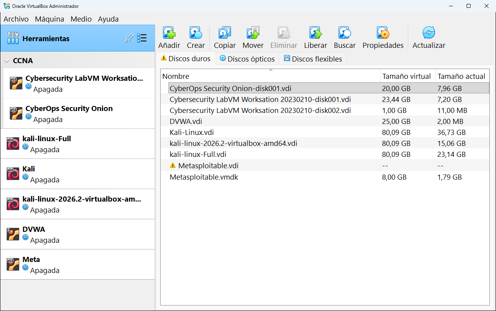
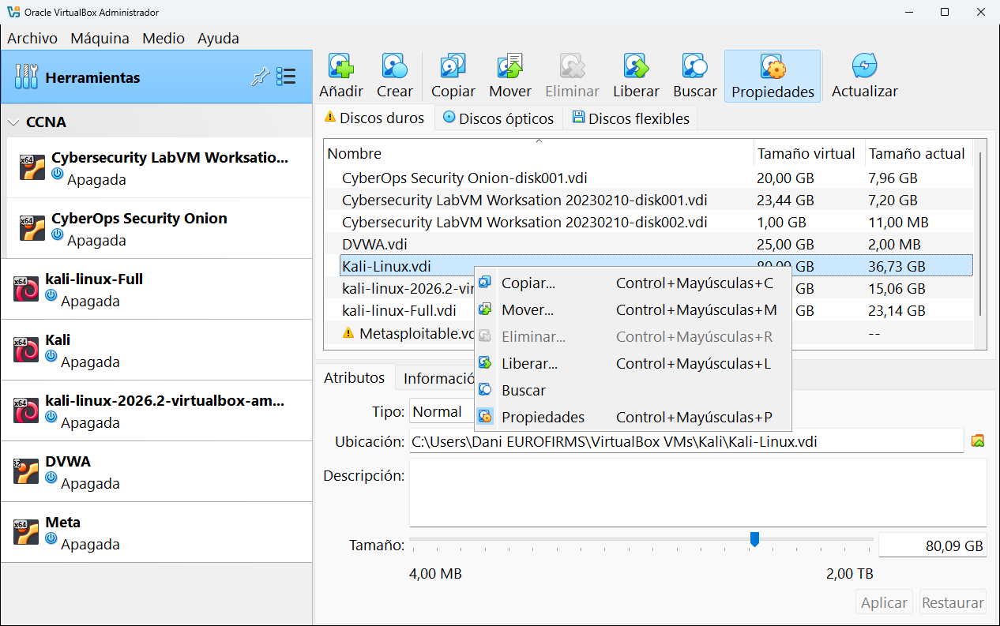
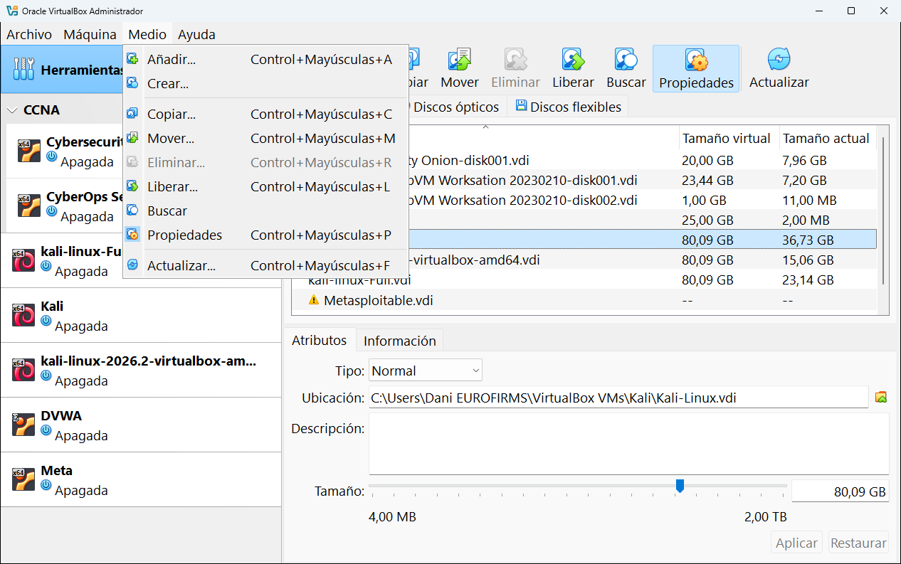
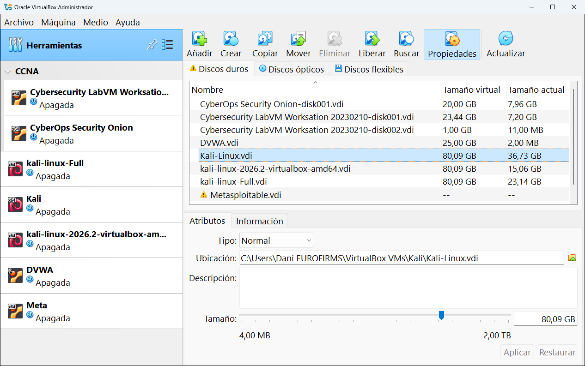
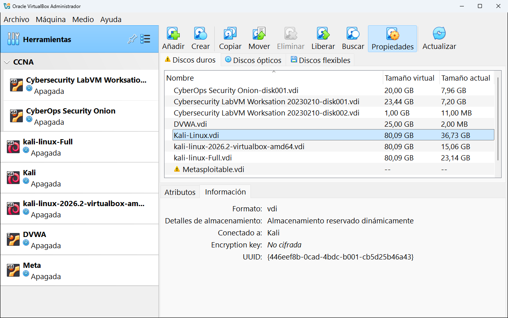
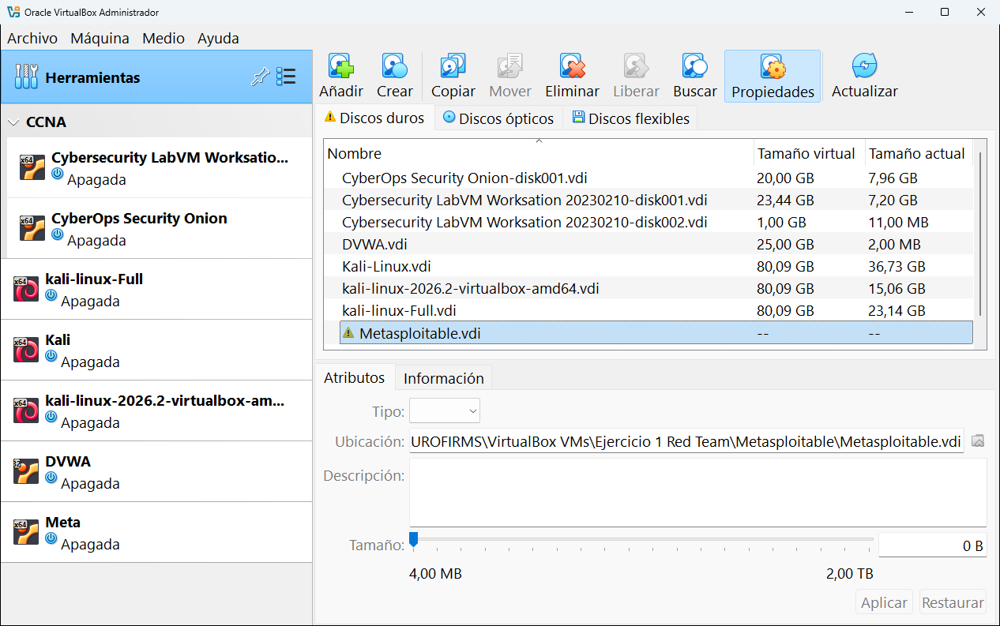
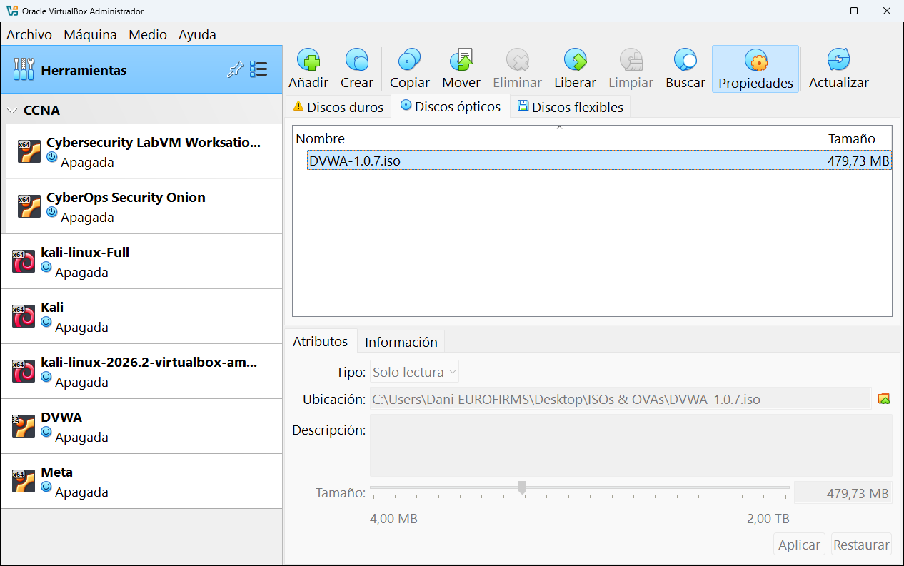
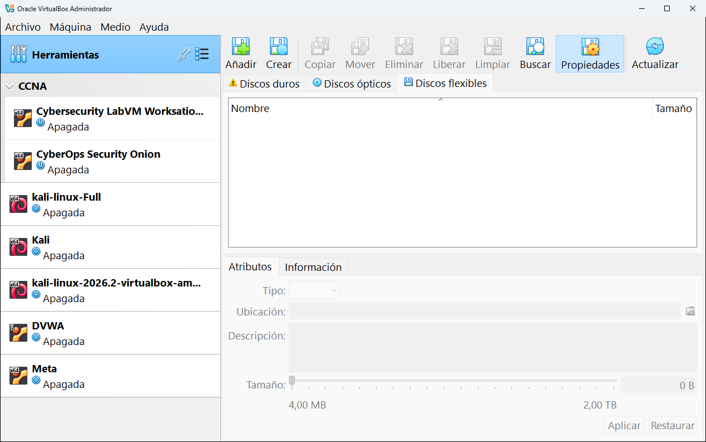

# 5.2 · Medio

En VirtualBox se llama **medio** a cualquier "disco" que se le puede poner a una máquina virtual: **discos duros virtuales**, **discos ópticos** (imágenes ISO) y **disquetes**. Esta herramienta, cuyo nombre largo es **Administrador de medios virtuales**, muestra **todos** los medios que VirtualBox conoce, sean de la máquina que sean.

**En esta página:**
- [Las tres pestañas](#las-tres-pestañas)
- [Tamaño virtual y tamaño actual](#tamaño-virtual-y-tamaño-actual)
- [Los botones](#los-botones)
- [Las propiedades de un disco](#las-propiedades-de-un-disco)
- [Los tipos de disco](#los-tipos-de-disco)
- [Un disco inaccesible](#un-disco-inaccesible)
- [Discos ópticos y disquetes](#discos-ópticos-y-disquetes)

---

## Las tres pestañas

| Pestaña | Qué muestra | Archivos típicos |
|---|---|---|
| **Discos duros** | Los discos virtuales donde está instalado el sistema de cada máquina. | `.vdi`, `.vmdk`, `.vhd` |
| **Discos ópticos** | Las imágenes de CD o DVD que has usado alguna vez. | `.iso` |
| **Discos flexibles** | Las imágenes de disquete. Hoy casi no se usan. | `.img`, `.flp` |

## Tamaño virtual y tamaño actual

La lista tiene dos columnas de tamaño, y entender la diferencia es muy importante:

- **Tamaño virtual**: el tamaño que **la máquina cree** que tiene su disco. Es el máximo que puede llegar a ocupar.
- **Tamaño actual**: lo que **ocupa de verdad** el archivo en tu disco duro ahora mismo.

Fíjate en los ejemplos de la captura:

| Disco | Tamaño virtual | Tamaño actual | Qué significa |
|---|---:|---:|---|
| `DVWA.vdi` | 25,00 GB | 2,00 MB | La máquina cree tener 25 GB, pero como no tiene casi nada instalado solo ocupa 2 MB. |
| `Kali-Linux.vdi` | 80,09 GB | 36,73 GB | Kali tiene muchos programas instalados: ya ocupa casi 37 GB de los 80 posibles. |
| `Metasploitable.vmdk` | 8,00 GB | 1,79 GB | Un disco en formato de VMware, que VirtualBox también entiende. |

Esto pasa porque, por defecto, VirtualBox crea los discos **dinámicos**: el archivo empieza pequeño y va creciendo a medida que la máquina guarda cosas, hasta el tamaño virtual como máximo.

> [!WARNING]
> El tamaño actual **crece, pero no se reduce solo**: si dentro de la máquina borras archivos, el `.vdi` sigue ocupando lo mismo. Ten en cuenta el **tamaño virtual** al calcular cuánto espacio necesitas en tu disco.

## Los botones

| Botón | Qué hace |
|---|---|
| **Añadir** | Registra en la lista un archivo de disco que ya existe (por ejemplo, un `.vmdk` que te has descargado). |
| **Crear** | Crea un disco nuevo y vacío. Abre un asistente para elegir formato, tamaño y si es dinámico o fijo. |
| **Copiar** | Hace una copia del disco con un identificador nuevo, de forma que se puedan usar las dos copias a la vez. |
| **Mover** | Mueve el archivo del disco a otra carpeta y actualiza todas las máquinas que lo usan. |
| **Eliminar** | Quita el disco de la lista y, si lo confirmas, **borra el archivo**. Solo funciona si ninguna máquina lo está usando. |
| **Liberar** | Desconecta el disco de todas las máquinas que lo usan, sin borrarlo. |
| **Limpiar** | Aparece en algunas pestañas: quita de la lista los medios que ya no existen. |
| **Buscar** | Muestra una barra para filtrar la lista por nombre. |
| **Propiedades** | Muestra u oculta el panel de propiedades del disco seleccionado. |
| **Actualizar** | Vuelve a comprobar todos los medios (útil si has movido archivos a mano). |

> [!IMPORTANT]
> Para tener dos copias de un disco usa siempre el botón **Copiar** (o clona la máquina entera). Si copias el `.vdi` con el Explorador de Windows, las dos copias tendrán el **mismo identificador** (UUID) y VirtualBox no te dejará usar las dos a la vez.

Haciendo **clic derecho** sobre un disco aparecen las mismas acciones. El menú **Medio** de la barra de menús también las contiene:

| Menú contextual | Menú Medio |
|:-:|:-:|
|  |  |

## Las propiedades de un disco

Selecciona un disco y pulsa **Propiedades**. Abajo aparece un panel con dos pestañas.

**Atributos**: lo que puedes cambiar.

| Atributo | Qué es |
|---|---|
| **Tipo** | Cómo se comporta el disco con las instantáneas y con varias máquinas (ver [los tipos de disco](#los-tipos-de-disco)). |
| **Ubicación** | Dónde está el archivo. El botón de la derecha permite elegir otra ubicación. |
| **Descripción** | Una nota libre para recordar qué hay en ese disco. |
| **Tamaño** | El tamaño virtual. Con la barra o escribiendo un número puedes **agrandar** el disco (de 4 MB a 2 TB). |

Los cambios se guardan con **Aplicar**. **Restaurar** deshace lo que hayas cambiado sin aplicar.

> [!WARNING]
> Un disco se puede **agrandar pero no achicar** desde aquí. Además, después de agrandarlo tienes que ampliar la partición **dentro** del sistema invitado (en Windows con *Administración de discos*, en Linux con herramientas como GParted). Si no, el sistema no verá el espacio nuevo.

**Información**: datos que solo se pueden consultar.

| Dato | Qué significa | En la captura |
|---|---|---|
| **Formato** | El formato del archivo. | `vdi` |
| **Detalles de almacenamiento** | Si es dinámico (crece) o de tamaño fijo. | Almacenamiento reservado dinámicamente |
| **Conectado a** | Qué máquinas usan este disco. | Kali |
| **Encryption key** | Si el disco está cifrado. | No cifrada |
| **UUID** | El identificador único del disco. Nunca puede haber dos discos con el mismo. | `{446eef8b-...}` |

## Los tipos de disco

El atributo **Tipo** tiene cinco opciones. Para empezar, deja siempre **Normal**.

| Tipo | Cómo se comporta | Cuándo se usa |
|---|---|---|
| **Normal** | Funciona como un disco de verdad y entra en las instantáneas. | Siempre, salvo que sepas lo que haces. |
| **Inmutable** | Cada vez que apagas la máquina, se descartan todos los cambios: arranca siempre igual que la primera vez. | Aulas o laboratorios que deben empezar siempre limpios. |
| **Escritura directa** | Los cambios se escriben siempre y **no** se ven afectados por las instantáneas. | Un disco de datos que no quieres que vuelva atrás al restaurar una instantánea. |
| **Compartible** | Varias máquinas pueden usarlo **a la vez**. Tiene que ser de tamaño fijo. | Entornos avanzados (clústeres de servidores). |
| **Multiconexión** | Un mismo disco base para varias máquinas, cada una guarda sus cambios en un archivo propio. | Muchas máquinas iguales a partir de una sola instalación. |

El tipo solo se puede cambiar si el disco no tiene instantáneas y la máquina está apagada.

## Un disco inaccesible

En la lista aparece `Metasploitable.vdi` con un **triángulo amarillo** y sin tamaño. La pestaña **Discos duros** también muestra el triángulo para avisar.

Significa que VirtualBox tiene apuntado ese disco, pero **el archivo ya no está donde estaba**: se borró, se movió a mano o estaba en un disco externo que ahora no está conectado.

Cómo arreglarlo:

- **Si el archivo existe en otro sitio**: en **Propiedades** → **Atributos** pulsa el botón de **Ubicación** y elige el archivo en su sitio nuevo. También puedes volver a conectar el disco externo y pulsar **Actualizar**.
- **Si el archivo ya no existe**: selecciónalo y pulsa **Eliminar** para quitarlo de la lista. Si lo usaba alguna máquina, antes tendrás que quitarlo de su [Almacenamiento](../08-configuracion/04-almacenamiento.md).

## Discos ópticos y disquetes

La pestaña **Discos ópticos** muestra las imágenes ISO. En la captura está `DVWA-1.0.7.iso`, de 479,73 MB, usada en el [capítulo 6](../06-crear-una-maquina.md) para crear una máquina. Su tipo es **Solo lectura**, porque un CD no se puede modificar.

Las ISO aparecen aquí automáticamente en cuanto las usas en alguna máquina. Quitar una ISO de esta lista **no borra** el archivo de tu ordenador (salvo que elijas borrarlo expresamente).

La pestaña **Discos flexibles** está vacía, que es lo normal hoy en día:

---

<!-- nav -->

[⬅️ 5.1 · Extensiones](01-extensiones.md) &nbsp;·&nbsp; [🏠 Índice](../../README.md) &nbsp;·&nbsp; [5.3 · Red ➡️](03-red.md)

