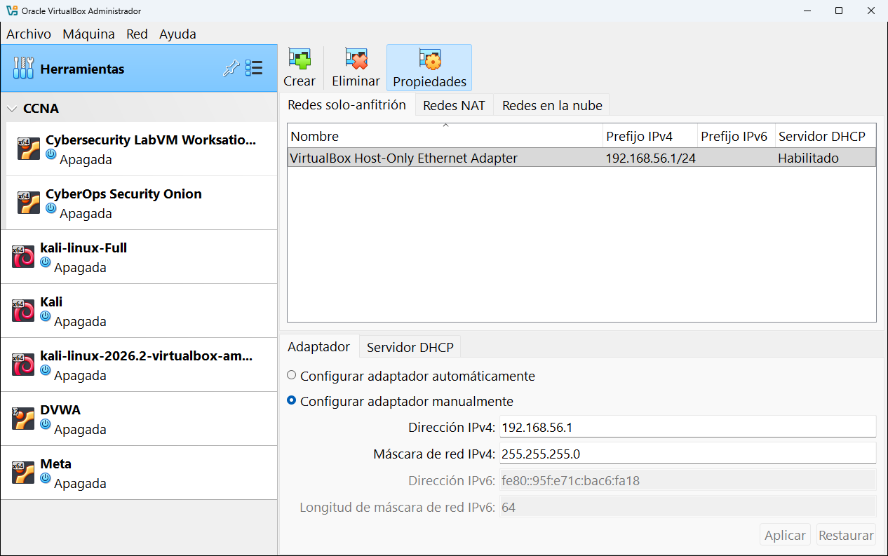
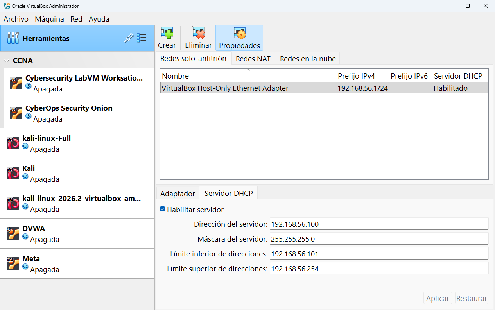
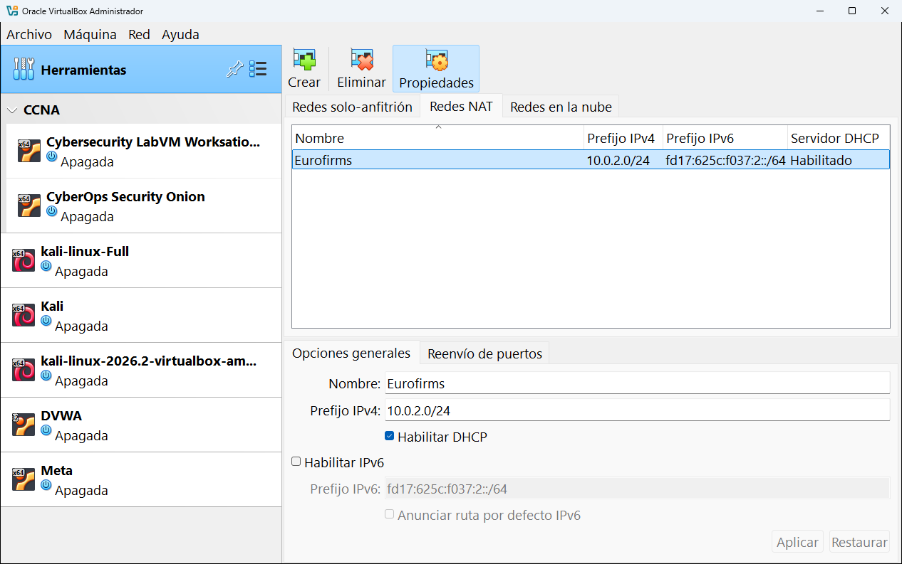
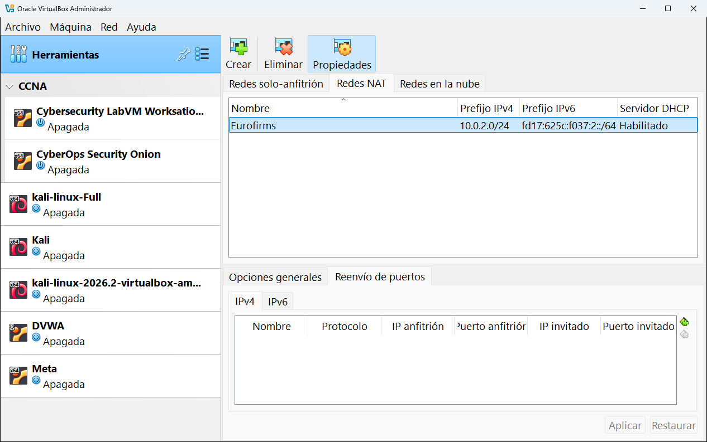
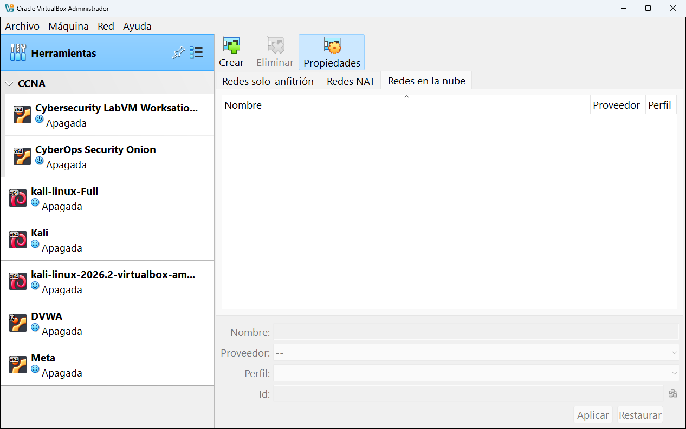

# 5.3 · Red

La herramienta **Red** (nombre largo: **Administrador de red**) crea y configura las **redes virtuales que pueden compartir varias máquinas**. Aquí no se configura la tarjeta de red de una máquina concreta: eso se hace en su [Configuración → Red](../08-configuracion/06-red.md). Lo que se hace aquí es crear las "redes" a las que luego conectas esas tarjetas.

> [!TIP]
> Si todavía no tienes claro qué es una red NAT o una red solo-anfitrión, lee primero [Las redes explicadas](../11-redes-explicadas.md). Tiene esquemas y una tabla comparativa.

**En esta página:**
- [Los botones y las pestañas](#los-botones-y-las-pestañas)
- [Redes solo-anfitrión](#redes-solo-anfitrión)
- [Redes NAT](#redes-nat)
- [Redes en la nube](#redes-en-la-nube)

---

## Los botones y las pestañas

| Botón | Qué hace |
|---|---|
| **Crear** | Crea una red nueva del tipo de la pestaña en la que estás. |
| **Eliminar** | Borra la red seleccionada. Las máquinas conectadas a ella se quedarán sin red hasta que las cambies. |
| **Propiedades** | Muestra u oculta el panel de ajustes de la red seleccionada. |

| Pestaña | Para qué sirve |
|---|---|
| **Redes solo-anfitrión** | Redes entre tu ordenador y tus máquinas, **sin salida a Internet**. |
| **Redes NAT** | Redes donde varias máquinas se ven entre sí **y además salen a Internet**. |
| **Redes en la nube** | Redes que conectan máquinas locales con Oracle Cloud Infrastructure. |

## Redes solo-anfitrión

Una red **solo-anfitrión** (*host-only*) conecta tus máquinas virtuales **con tu ordenador y entre ellas**, pero no con Internet ni con otros ordenadores de tu red. Es perfecta para laboratorios: las máquinas se ven, tú puedes entrar en ellas desde Windows y nada sale fuera.

Al instalar VirtualBox se crea una automáticamente, llamada **VirtualBox Host-Only Ethernet Adapter**. En Windows aparece como una tarjeta de red más (puedes verla en *Panel de control → Centro de redes → Cambiar configuración del adaptador*).

### Pestaña Adaptador

Configura la dirección que tiene **tu ordenador** dentro de esa red.

| Ajuste | Qué es | En la captura |
|---|---|---|
| **Configurar adaptador automáticamente** | Deja que VirtualBox elija la dirección. | |
| **Configurar adaptador manualmente** | Escribes tú la dirección. | Marcada |
| **Dirección IPv4** | La dirección IP de tu ordenador en esta red. | `192.168.56.1` |
| **Máscara de red IPv4** | El tamaño de la red. `255.255.255.0` significa que caben las direcciones de `192.168.56.1` a `192.168.56.254`. | `255.255.255.0` |
| **Dirección IPv6** y **Longitud de máscara de red IPv6** | Lo mismo para IPv6, el sistema de direcciones moderno. Para empezar no lo necesitas. | Máscara `64` |

### Pestaña Servidor DHCP

Un **servidor DHCP** reparte direcciones IP automáticamente a las máquinas que se conectan, igual que el router de tu casa le da una IP a tu móvil.

| Ajuste | Qué es | En la captura |
|---|---|---|
| **Habilitar servidor** | Si está marcado, las máquinas reciben IP solas. | Marcado |
| **Dirección del servidor** | La IP del propio servidor DHCP. | `192.168.56.100` |
| **Máscara del servidor** | El tamaño de la red. | `255.255.255.0` |
| **Límite inferior de direcciones** | La primera IP que se repartirá. | `192.168.56.101` |
| **Límite superior de direcciones** | La última IP que se repartirá. | `192.168.56.254` |

Con esta configuración, la primera máquina que conectes a esta red recibirá normalmente la IP `192.168.56.101`, la segunda la `192.168.56.102`, etc. Tu ordenador será siempre `192.168.56.1`.

> [!NOTE]
> Los cambios no se aplican hasta que pulsas **Aplicar**. **Restaurar** deshace lo que hayas cambiado.

## Redes NAT

Una **red NAT** es como una pequeña red de casa con su propio router: las máquinas conectadas a ella **se ven entre sí** y **pueden salir a Internet**, pero desde fuera nadie puede entrar en ellas (salvo que lo abras con el reenvío de puertos).

En este ordenador hay una red NAT llamada **Eurofirms**:

### Pestaña Opciones generales

| Ajuste | Qué es | En la captura |
|---|---|---|
| **Nombre** | El nombre con el que la eliges luego en la configuración de cada máquina. | `Eurofirms` |
| **Prefijo IPv4** | El rango de direcciones de la red. `10.0.2.0/24` significa de `10.0.2.1` a `10.0.2.254`. | `10.0.2.0/24` |
| **Habilitar DHCP** | Reparte direcciones automáticamente a las máquinas. | Marcado |
| **Habilitar IPv6** | Activa también direcciones IPv6. | Desmarcado |
| **Prefijo IPv6** y **Anunciar ruta por defecto IPv6** | Ajustes de IPv6. | |

En una red NAT el "router" virtual tiene la dirección `.1` del rango (aquí `10.0.2.1`), el servidor DHCP la `.3` (`10.0.2.3`) y las máquinas reciben direcciones a partir de la `.4` (`10.0.2.4`, `10.0.2.5`...).

### Pestaña Reenvío de puertos

El **reenvío de puertos** abre una "puerta" desde tu ordenador hacia una máquina de la red NAT. Cada fila es una regla con estas columnas:

| Columna | Qué es |
|---|---|
| **Nombre** | Un nombre para recordar la regla, por ejemplo `ssh-kali`. |
| **Protocolo** | **TCP** (lo normal: webs, SSH...) o **UDP**. |
| **IP anfitrión** | La IP de tu ordenador por la que se entra. `127.0.0.1` significa "solo desde este mismo ordenador". |
| **Puerto anfitrión** | El puerto de tu ordenador que se abre, por ejemplo `2222`. |
| **IP invitado** | La IP de la máquina virtual dentro de la red NAT, por ejemplo `10.0.2.4`. |
| **Puerto invitado** | El puerto del servicio en la máquina, por ejemplo `22` para SSH. |

**Ejemplo:** con la regla `TCP · 127.0.0.1 · 2222 → 10.0.2.4 · 22`, escribiendo en Windows `ssh -p 2222 kali@127.0.0.1` te conectas a la máquina `10.0.2.4`.

Los botones de la derecha de la tabla sirven para **añadir**, **modificar** y **borrar** reglas.

## Redes en la nube

Sirven para conectar una tarjeta de red de una máquina local con una red de **Oracle Cloud Infrastructure** (OCI). Necesitas una cuenta de Oracle Cloud y un [perfil cloud](04-cloud.md) configurado. En la configuración de las máquinas esta opción aparece como **Red en la nube [EXPERIMENTAL]**.

| Ajuste | Qué es |
|---|---|
| **Nombre** | El nombre de la red. |
| **Proveedor** | El proveedor de nube (Oracle Cloud Infrastructure). |
| **Perfil** | El perfil cloud con el que se conecta. |
| **Id** | El identificador de la red en la nube. |

Si no usas Oracle Cloud, puedes ignorar esta pestaña.

---

<!-- nav -->

[⬅️ 5.2 · Medio](02-medio.md) &nbsp;·&nbsp; [🏠 Índice](../../README.md) &nbsp;·&nbsp; [5.4 · Cloud ➡️](04-cloud.md)

