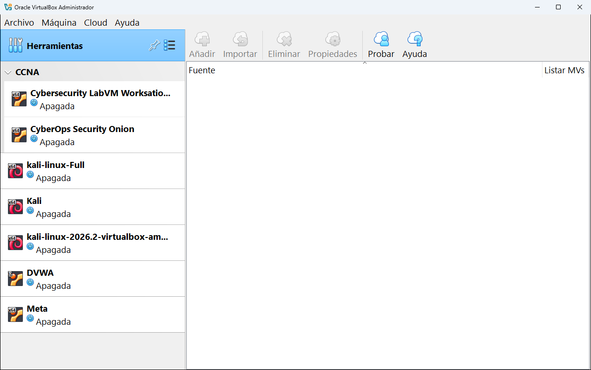

# 5.4 · Cloud

La herramienta **Cloud** (nombre largo: **Administrador de perfil cloud**) conecta VirtualBox con **Oracle Cloud Infrastructure** (OCI), el servicio de servidores en la nube de Oracle. Con un perfil configurado puedes ver tus máquinas de la nube en la lista de VirtualBox, arrancarlas y pararlas, subir máquinas locales a la nube y descargar máquinas de la nube.

> [!NOTE]
> Si no tienes una cuenta de Oracle Cloud, esta herramienta no te sirve de nada y puedes saltártela. Para aprender VirtualBox no hace falta.

## Qué es un perfil cloud

Un **perfil** guarda los datos con los que VirtualBox se identifica en tu cuenta de Oracle Cloud. Esos datos se obtienen en la consola web de OCI, en el apartado de claves de API de tu usuario:

| Dato | Qué es |
|---|---|
| **user** | El identificador (OCID) de tu usuario de OCI. |
| **tenancy** | El identificador de tu cuenta (el "inquilino"). |
| **region** | La región de Oracle donde están tus servidores, por ejemplo `eu-madrid-1`. |
| **fingerprint** | La huella de tu clave de API. |
| **key_file** | La ruta al archivo de tu clave privada en tu ordenador. |

## Los botones

| Botón | Qué hace |
|---|---|
| **Añadir** | Crea un perfil nuevo y vacío para rellenar los datos a mano. |
| **Importar** | Lee los perfiles del archivo de configuración de OCI que ya tengas en tu ordenador (el que crean las herramientas oficiales de Oracle). |
| **Eliminar** | Borra el perfil seleccionado. |
| **Propiedades** | Muestra los datos del perfil para editarlos. |
| **Probar** | Comprueba que VirtualBox puede conectarse a tu cuenta con ese perfil. |
| **Ayuda** | Abre la ayuda de esta herramienta. |

## Las columnas de la lista

| Columna | Qué es |
|---|---|
| **Fuente** | El proveedor de nube y, debajo, cada perfil. |
| **Listar MVs** | Si la marcas, las máquinas de ese perfil aparecen en la lista principal de VirtualBox, en su propio grupo. |

## Dónde más aparece la nube en VirtualBox

- **Máquina** → **Exportar a OCI...**: sube una máquina local a Oracle Cloud.
- **Archivo** → **Importar servicio virtualizado...**: en **Fuente** puedes elegir **Oracle Cloud Infrastructure** en lugar de un archivo local.
- **Configuración** → **Red**: el modo **Red en la nube [EXPERIMENTAL]**, y la pestaña [Redes en la nube](03-red.md#redes-en-la-nube) de la herramienta Red.

> [!IMPORTANT]
> Según la documentación de VirtualBox 7.1, la integración con la nube forma parte del [paquete de extensiones](01-extensiones.md). Si lo vas a usar, instálalo primero.

---

<!-- nav -->

[⬅️ 5.3 · Red](03-red.md) &nbsp;·&nbsp; [🏠 Índice](../../README.md) &nbsp;·&nbsp; [5.5 · Actividades ➡️](05-actividades.md)

