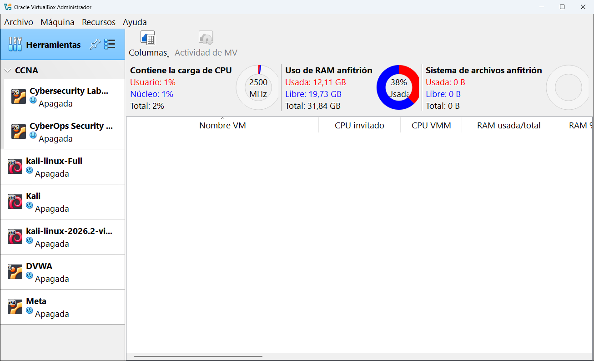
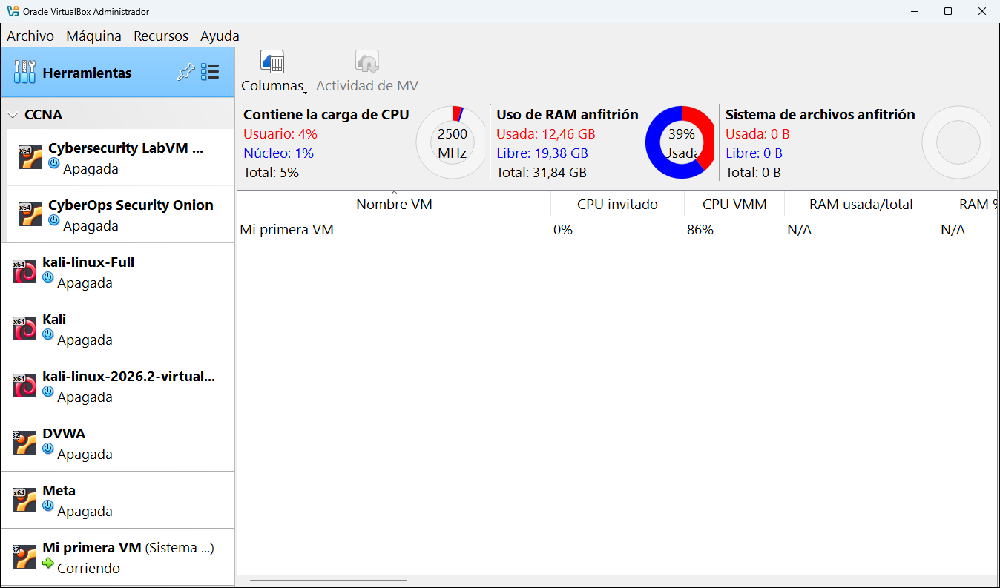

# 5.5 · Actividades

La herramienta **Actividades** (nombre largo: **Visión general de actividad de MV**) muestra de un vistazo **cuántos recursos de tu ordenador** se están usando y **cuánto consume cada máquina encendida**. Es como el Administrador de tareas de Windows, pero solo para VirtualBox.

> [!NOTE]
> Esta herramienta ensancha la ventana y estrecha la lista de máquinas para que quepan todas sus columnas. Es normal.

## Sin ninguna máquina encendida

La parte de arriba muestra siempre el estado de **tu ordenador** (el anfitrión):

| Bloque | Qué muestra | En la captura |
|---|---|---|
| **Carga de CPU** | Cuánto trabaja el procesador de tu ordenador. **Usuario** es lo que usan los programas, **Núcleo** lo que usa el propio Windows, **Total** la suma. El círculo indica la velocidad del procesador. | 2 % total, 2500 MHz |
| **Uso de RAM anfitrión** | La memoria de tu ordenador: usada, libre y total, con el porcentaje en el círculo. | 12,11 GB usados de 31,84 GB (38 %) |
| **Sistema de archivos anfitrión** | El espacio en disco. | |

La tabla de abajo está vacía porque no hay ninguna máquina encendida.

## Con una máquina encendida

Ahora la tabla tiene una fila por cada máquina en marcha. Las columnas principales son:

| Columna | Qué significa |
|---|---|
| **Nombre VM** | El nombre de la máquina. |
| **CPU invitado** | Cuánto procesador usa el sistema **dentro** de la máquina. |
| **CPU VMM** | Cuánto procesador gasta **VirtualBox** en hacer funcionar esa máquina (el *Virtual Machine Monitor*). |
| **RAM usada/total** | La memoria que usa el sistema invitado frente a la que tiene asignada. |
| **RAM %** | Lo mismo en porcentaje. |

Desplazándote a la derecha hay más columnas: tráfico de red recibido y enviado, lecturas y escrituras de disco, etc.

> [!IMPORTANT]
> Las columnas de **RAM** muestran **N/A** (no disponible) si la máquina no tiene instalados los **complementos del invitado** (*Guest Additions*). En la captura pasa justo eso: la máquina arrancó desde un CD "live" que no los trae. Cómo instalarlos se explica en el [capítulo 10](../10-usar-una-maquina.md#los-complementos-del-invitado).

## Los botones

| Botón | Qué hace |
|---|---|
| **Columnas** | Elige qué columnas se muestran en la tabla. |
| **Actividad de MV** | Abre la herramienta [Actividad](../09-herramientas-de-la-maquina/04-actividad.md) de la máquina seleccionada en la tabla, con gráficas detalladas. |

El menú **Recursos** de la barra de menús contiene las mismas acciones.

> [!TIP]
> Si tu ordenador va lento con varias máquinas encendidas, mira esta herramienta: la máquina con la CPU o la RAM más altas es la que está "tirando" de tu equipo.

---

<!-- nav -->

[⬅️ 5.4 · Cloud](04-cloud.md) &nbsp;·&nbsp; [🏠 Índice](../../README.md) &nbsp;·&nbsp; [6 · Crear una máquina nueva ➡️](../06-crear-una-maquina.md)

