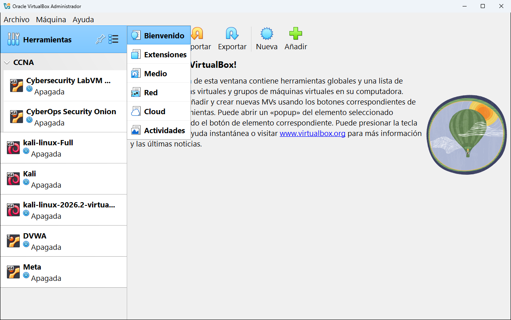

# 5 · Las herramientas globales

Las **herramientas globales** son las que no pertenecen a ninguna máquina concreta: sirven para todo VirtualBox. Por ejemplo, la herramienta **Medio** muestra **todos** los discos virtuales de **todas** tus máquinas, y la herramienta **Red** gestiona redes que pueden usar varias máquinas a la vez.

## Cómo se abren

1. En la lista de la izquierda, haz clic en **Herramientas** (la primera fila).
2. Pulsa el icono de **lista** que aparece a su derecha.
3. Elige la herramienta en el menú:

También puedes abrirlas desde **Archivo** → **Herramientas**, donde aparecen con su nombre largo (por ejemplo, **Medio** se llama allí *Administrador de medios virtuales*).

> [!NOTE]
> VirtualBox recuerda la última herramienta que usaste. Si al hacer clic en **Herramientas** no ves la pantalla de bienvenida, es que la última vez abriste otra herramienta.

Cuando abres una herramienta, en la barra de menús aparece un **menú nuevo** con sus acciones (**Extensión**, **Medio**, **Red**, **Cloud** o **Recursos**). Contiene lo mismo que los botones de la herramienta.

## Las seis herramientas

| Herramienta | Nombre largo | Para qué sirve |
|---|---|---|
| Bienvenido | | La pantalla de inicio: solo muestra un texto de bienvenida y los botones Preferencias, Importar, Exportar, Nueva y Añadir. No tiene ajustes propios. |
| [Extensiones](01-extensiones.md) | Administrador de paquetes de extensiones | Instalar y quitar el **Extension Pack**. |
| [Medio](02-medio.md) | Administrador de medios virtuales | Ver, crear, copiar, mover, redimensionar y borrar discos duros, imágenes ISO y disquetes virtuales. |
| [Red](03-red.md) | Administrador de red | Crear y configurar redes **solo-anfitrión**, redes **NAT** y redes **en la nube**. |
| [Cloud](04-cloud.md) | Administrador de perfil cloud | Conectar VirtualBox con una cuenta de **Oracle Cloud Infrastructure**. |
| [Actividades](05-actividades.md) | Visión general de actividad de MV | Ver de un vistazo cuánta CPU, memoria y disco usan las máquinas encendidas. |

---

<!-- nav -->

[⬅️ 4 · Preferencias](../04-preferencias.md) &nbsp;·&nbsp; [🏠 Índice](../../README.md) &nbsp;·&nbsp; [5.1 · Extensiones ➡️](01-extensiones.md)

