# 6 · Crear una máquina nueva

En este capítulo creamos una máquina virtual desde cero con el asistente **Nueva**. La máquina de ejemplo se llama **Mi primera VM** y arranca desde la imagen `DVWA-1.0.7.iso`, un Linux "live" (que funciona directamente desde el CD, sin instalarlo) con una web vulnerable para practicar.

**En este capítulo:**
- [Antes de empezar](#antes-de-empezar)
- [Qué recursos darle a la máquina](#qué-recursos-darle-a-la-máquina)
- [El asistente en modo guiado](#el-asistente-en-modo-guiado)
- [El asistente en modo experto](#el-asistente-en-modo-experto)
- [La instalación desatendida](#la-instalación-desatendida)
- [El disco duro virtual: formatos y opciones](#el-disco-duro-virtual-formatos-y-opciones)
- [La máquina creada](#la-máquina-creada)

---

## Antes de empezar

Necesitas:

1. **La imagen ISO** del sistema que quieres instalar, descargada de su web oficial (Ubuntu, Kali, Windows...). Guárdala en una carpeta fácil de encontrar, por ejemplo `Escritorio\ISOs & OVAs`.
2. **Espacio libre en disco**: al menos el tamaño del disco virtual que vas a crear (ver la tabla siguiente).
3. **Un nombre** para la máquina. Que sea descriptivo: `Kali-atacante`, `Windows11-pruebas`, `Ubuntu-servidor`...

El asistente se abre con el botón **Nueva**, con **Máquina** → **Nueva...** o con **Ctrl + N**.

## Qué recursos darle a la máquina

Valores orientativos para que funcione con soltura:

| Sistema invitado | Memoria | Procesadores | Disco | Notas |
|---|---:|:-:|---:|---|
| Windows 11 | 4096 a 8192 MB | 2 | 64 GB | Necesita EFI, TPM 2.0 y Secure Boot. VirtualBox los activa solo al elegir Windows 11. |
| Windows 10 | 4096 MB | 2 | 50 GB | |
| Ubuntu, Lubuntu, Debian con escritorio | 2048 a 4096 MB | 2 | 25 GB | |
| Kali Linux | 4096 MB | 2 | 40 a 80 GB | Con más memoria, las herramientas van mucho mejor. |
| Linux de laboratorio sin escritorio (DVWA, Metasploitable) | 512 a 1024 MB | 1 | 8 a 10 GB | |

> [!WARNING]
> La suma de la memoria de **todas las máquinas que tengas encendidas a la vez** no debería pasar de la mitad de la RAM de tu ordenador. Si tienes 16 GB, no enciendas a la vez máquinas que sumen más de 8 GB.

---

## El asistente en modo guiado

Así lo verás si VirtualBox está en **modo básico**, que es como viene al instalarlo. Avanza página a página con **Siguiente**.

### Paso 1 · Nombre y sistema operativo

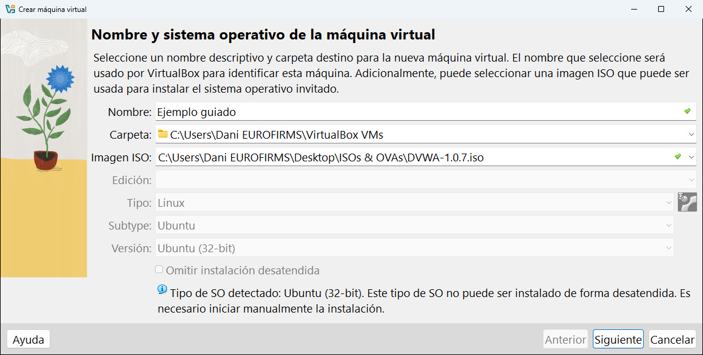

| Campo | Qué poner |
|---|---|
| **Nombre** | El nombre de la máquina. Se usa también para la carpeta y el archivo `.vbox`. |
| **Carpeta** | Dónde se guardará. Por defecto, la [carpeta predeterminada de máquinas](04-preferencias.md#general). Dentro se creará otra carpeta con el nombre de la máquina. |
| **Imagen ISO** | La ISO del sistema que vas a instalar. Despliega la lista y elige **Otro...** para buscarla en tu ordenador. |
| **Edición** | Solo se activa si la ISO trae varias ediciones (por ejemplo, Windows Home y Pro). |
| **Tipo**, **Subtype** y **Versión** | El sistema operativo. Si eliges una ISO, VirtualBox **lo detecta solo** y rellena estos campos. Si no, elígelos tú. |
| **Omitir instalación desatendida** | Solo se activa si la ISO admite la [instalación desatendida](#la-instalación-desatendida). Márcala si prefieres instalar el sistema a mano. |

En la captura, VirtualBox ha detectado **Linux · Ubuntu · Ubuntu (32-bit)** y avisa debajo: *"Este tipo de SO no puede ser instalado de forma desatendida. Es necesario iniciar manualmente la instalación"*. Es normal: la ISO de DVWA no es un instalador, es un sistema que arranca directamente.

> [!TIP]
> Los campos **Tipo** y **Versión** sirven para que VirtualBox proponga unos valores por defecto adecuados (memoria, tipo de disco, tarjeta de red...) y ponga el icono correcto. Lo que **sí tiene que coincidir** es si el sistema es de **32 o de 64 bits**: un sistema de 64 bits no arranca en una máquina configurada como de 32.

### Paso 2 · Hardware

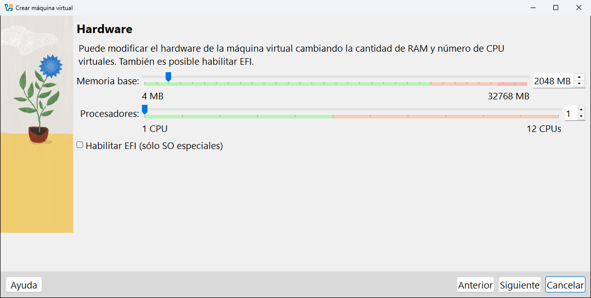

| Campo | Qué es |
|---|---|
| **Memoria base** | La RAM de la máquina, en MB. Aquí 2048 MB (2 GB). |
| **Procesadores** | Cuántos núcleos de tu procesador le prestas. Aquí 1. |
| **Habilitar EFI (sólo SO especiales)** | Arranque moderno UEFI en lugar de la BIOS clásica. Hace falta para Windows 11 y algunos Linux recientes. VirtualBox lo marca solo cuando es necesario. |

Las barras se colorean: **verde** es un valor seguro, **naranja** empieza a quitarle demasiado a tu ordenador y **rojo** es demasiado.

### Paso 3 · Disco duro virtual

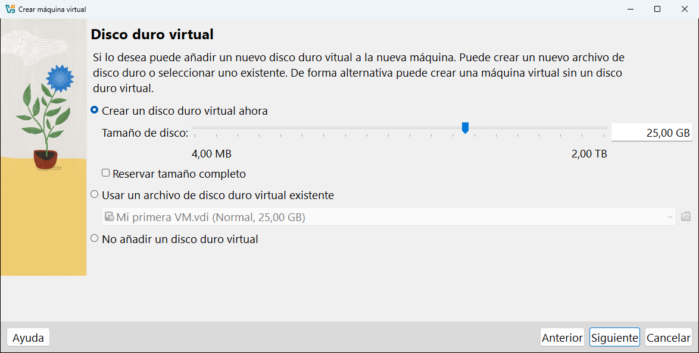

| Opción | Qué hace |
|---|---|
| **Crear un disco duro virtual ahora** | Crea un disco nuevo del **tamaño de disco** indicado (aquí 25 GB). Es lo normal. |
| **Reservar tamaño completo** | Si la marcas, el archivo ocupa los 25 GB desde el primer momento (disco **fijo**). Si no, empieza pequeño y crece (disco **dinámico**). Ver [más abajo](#dinámico-o-fijo). |
| **Usar un archivo de disco duro virtual existente** | Usa un disco que ya tienes (por ejemplo, un `.vmdk` descargado). |
| **No añadir un disco duro virtual** | Crea la máquina sin disco. Útil para sistemas "live" que no se instalan. |

### Paso 4 · Resumen

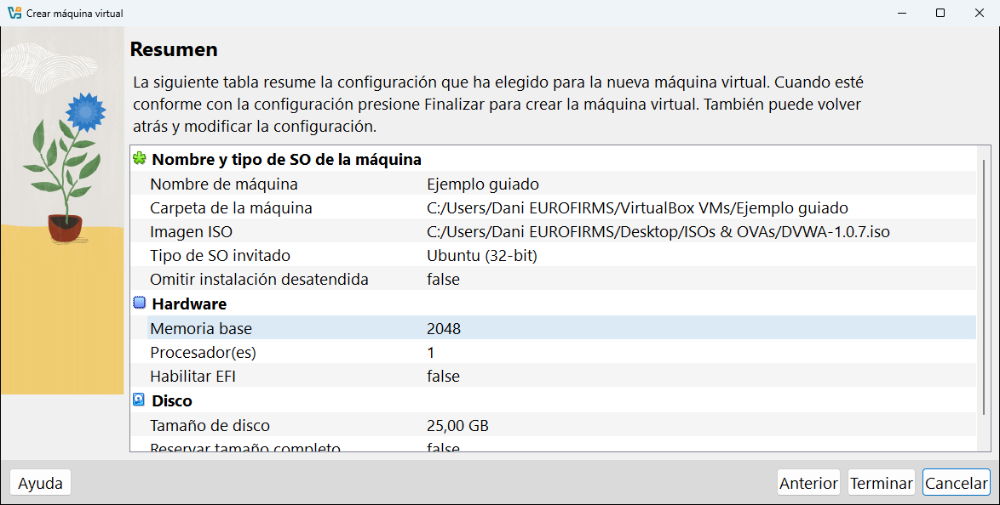

Una tabla con todo lo que has elegido. Si algo no está bien, pulsa **Anterior** para volver. Si está todo correcto, pulsa **Terminar** y la máquina aparecerá en la lista.

---

## El asistente en modo experto

En **modo experto** el asistente muestra todo en **una sola página** con cuatro secciones desplegables: **Nombre y sistema operativo**, **Instalación desatendida**, **Hardware** y **Disco duro**. Haz clic en la barra azul de cada sección para abrirla. Las opciones son las mismas que en el modo guiado, con alguna más.

Así se ve al abrirlo, todavía vacío. El icono rojo junto a **Nombre** indica que ese campo es obligatorio:

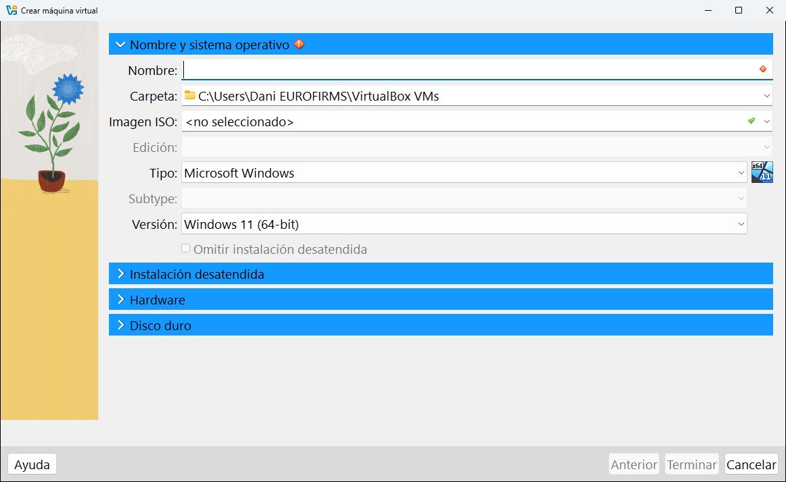

Escribimos el nombre **Mi primera VM** y elegimos la ISO en el desplegable **Imagen ISO**, donde aparecen las ISO usadas recientemente y la opción **Otro...** para buscar una nueva:

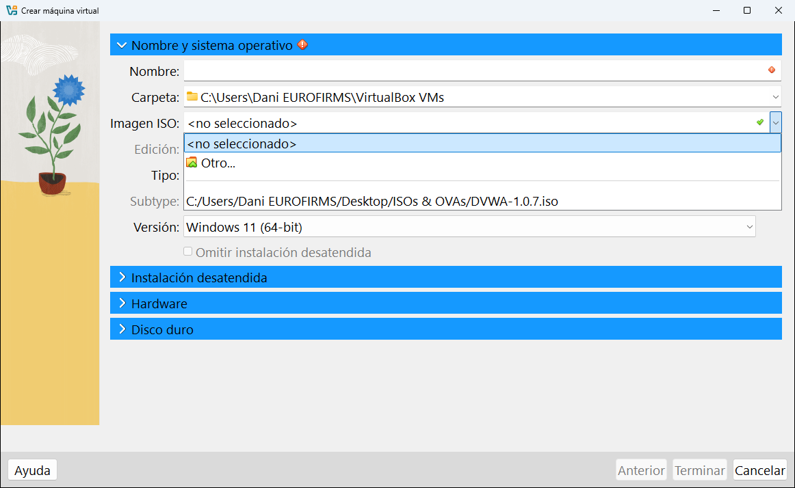

Al elegir la ISO, VirtualBox rellena **Tipo**, **Subtype** y **Versión**:

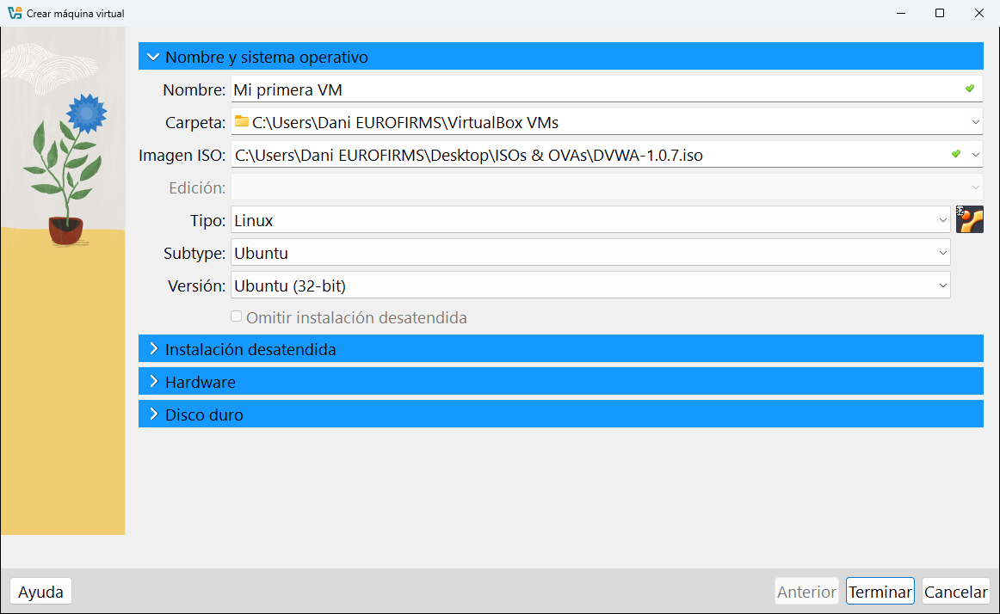

La sección **Hardware** es igual que en el modo guiado:

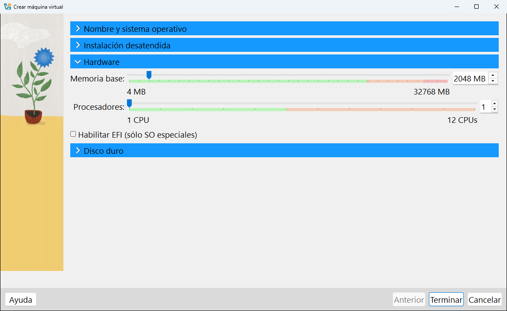

Y la sección **Disco duro** tiene opciones extra (formato y división en partes), explicadas [más abajo](#el-disco-duro-virtual-formatos-y-opciones):

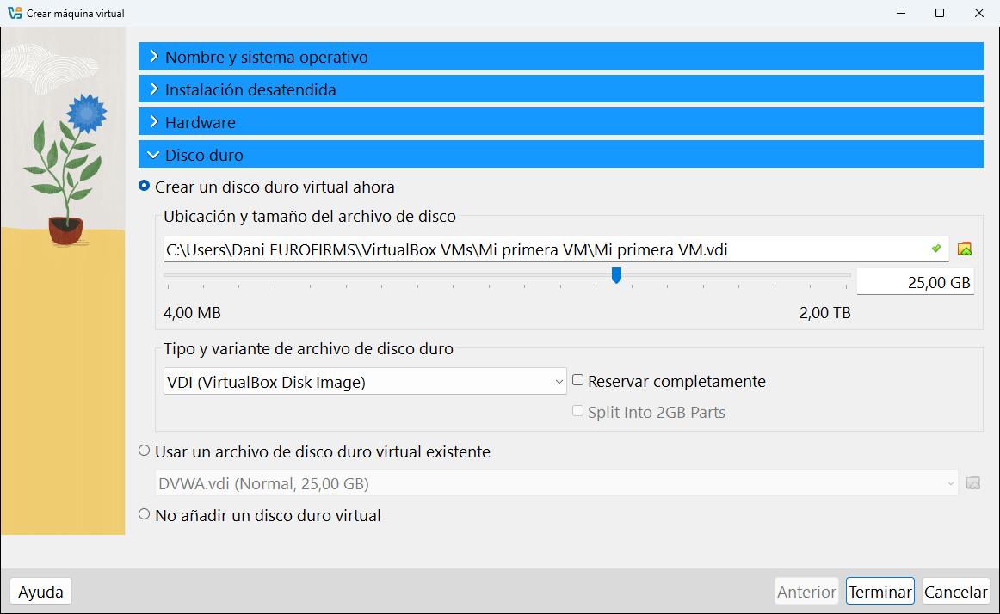

Cuando esté todo, pulsa **Terminar**.

---

## La instalación desatendida

La **instalación desatendida** hace que VirtualBox **instale el sistema operativo él solo**: crea el usuario, pone la contraseña y configura el idioma sin que tengas que contestar a las preguntas del instalador. Solo funciona con las ISO de instalación que VirtualBox reconoce (Windows y algunas versiones de Ubuntu, Debian, Fedora, Oracle Linux...).

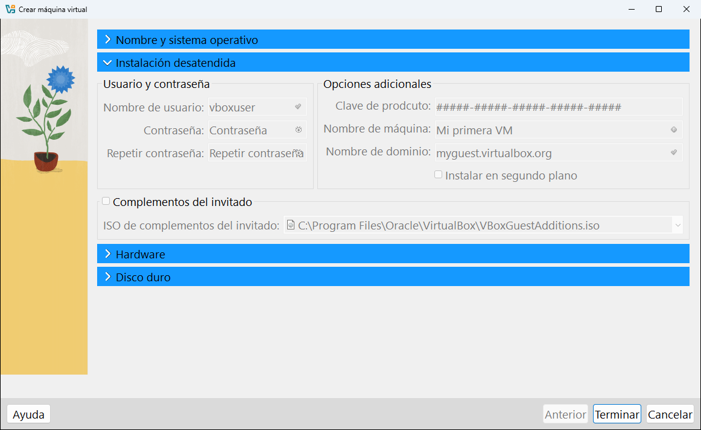

En la captura todos los campos están en gris porque la ISO de DVWA no es un instalador. Con una ISO compatible se activarían:

| Campo | Qué es |
|---|---|
| **Nombre de usuario** | El usuario que se creará en el sistema invitado. Por defecto `vboxuser`. |
| **Contraseña** y **Repetir contraseña** | La contraseña de ese usuario. |
| **Clave de producto** | La clave de licencia (solo para Windows). |
| **Nombre de máquina** | El nombre del equipo dentro de la red. |
| **Nombre de dominio** | El dominio de red. Si no sabes qué es, deja el que viene. |
| **Instalar en segundo plano** | Instala sin abrir la ventana de la máquina. |
| **Complementos del invitado** | Si la marcas, instala también los [complementos del invitado](10-usar-una-maquina.md#los-complementos-del-invitado) al terminar. Es muy recomendable. |

> [!TIP]
> Si es la primera vez que instalas un sistema, marca **Omitir instalación desatendida** y haz la instalación a mano: así aprendes qué pregunta cada instalador.

---

## El disco duro virtual: formatos y opciones

### Los formatos

| Formato | Nombre completo | Cuándo usarlo |
|---|---|---|
| **VDI** | VirtualBox Disk Image | El formato propio de VirtualBox. **Úsalo siempre**, salvo que vayas a abrir la máquina en otro programa. |
| **VHD** | Virtual Hard Disk | El formato de Microsoft (Hyper-V). |
| **VMDK** | Virtual Machine Disk | El formato de VMware. Muchas máquinas de laboratorio descargables vienen así (como `Metasploitable.vmdk`). |

VirtualBox puede **usar** los tres, aunque crees la máquina con VDI.

### Dinámico o fijo

| | Dinámico (por defecto) | Fijo (**Reservar completamente**) |
|---|---|---|
| Espacio que ocupa al principio | Muy poco | Todo el tamaño elegido |
| Velocidad | Algo más lento al escribir mucho | Algo más rápido |
| Tiempo en crearse | Instantáneo | Tarda (tiene que escribir todo el archivo) |
| Recomendado para | Casi todo | Máquinas que van a trabajar mucho con el disco |

### Split Into 2GB Parts

La opción **Split Into 2GB Parts** (dividir en partes de 2 GB, solo para VMDK) parte el disco en varios archivos de 2 GB. Solo sirve para guardarlo en memorias USB formateadas en FAT32, que no admiten archivos de más de 4 GB. Normalmente no hace falta.

---

## La máquina creada

Al pulsar **Terminar**, la máquina aparece en la lista con el estado **Apagada** y su ficha en el panel de detalles:

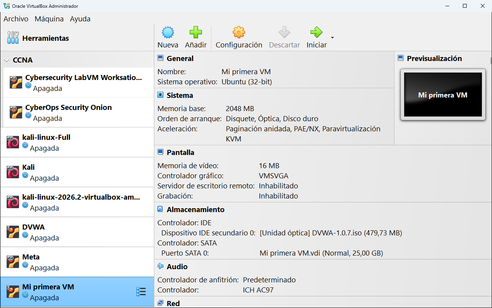

Fíjate en lo que ha preparado VirtualBox:

- **Sistema**: 2048 MB de memoria y orden de arranque **Disquete, Óptica, Disco duro**. Como el disco está vacío, la máquina arrancará desde la ISO.
- **Almacenamiento**: la ISO está metida en la unidad óptica del controlador **IDE**, y el disco `Mi primera VM.vdi` de 25 GB está conectado al controlador **SATA**.
- **Red** (más abajo en el panel): una tarjeta conectada en modo **NAT**, así que la máquina tendrá Internet desde el primer momento.

En el disco se ha creado la carpeta `C:\Users\TuUsuario\VirtualBox VMs\Mi primera VM` con dos archivos: `Mi primera VM.vbox` (la configuración) y `Mi primera VM.vdi` (el disco). Todos los archivos que irán apareciendo están explicados en [Tipos de archivo](12-tipos-de-archivo.md).

> [!NOTE]
> **¿Y ahora qué?** Si la ISO es un instalador (Ubuntu, Windows...), al arrancar la máquina se abrirá el instalador del sistema como en un ordenador de verdad. Cuando termine, quita la ISO de la unidad óptica para que no vuelva a arrancar desde ella. Cómo arrancar y manejar la máquina está en el [capítulo 10](10-usar-una-maquina.md).

---

<!-- nav -->

[⬅️ 5.5 · Actividades](05-herramientas-globales/05-actividades.md) &nbsp;·&nbsp; [🏠 Índice](../README.md) &nbsp;·&nbsp; [7 · Añadir, importar y exportar ➡️](07-anadir-importar-exportar.md)

