# 7 · Añadir, importar, exportar, clonar y eliminar

Crear una máquina desde cero no es la única forma de tener una. En este capítulo vemos cómo **traer** máquinas que ya existen, cómo **llevártelas** a otro ordenador y cómo **copiarlas**, **moverlas** y **borrarlas**.

**En este capítulo:**
- [¿Añadir o importar? La diferencia](#añadir-o-importar-la-diferencia)
- [Añadir una máquina que ya existe](#añadir-una-máquina-que-ya-existe)
- [Importar una máquina (.ova)](#importar-una-máquina-ova)
- [Exportar una máquina a .ova](#exportar-una-máquina-a-ova)
- [Clonar una máquina](#clonar-una-máquina)
- [Mover una máquina](#mover-una-máquina)
- [Eliminar una máquina](#eliminar-una-máquina)

---

## ¿Añadir o importar? La diferencia

| | **Añadir** | **Importar** |
|---|---|---|
| Qué archivo usas | Un `.vbox` (la carpeta de una máquina de VirtualBox) | Un `.ova` u `.ovf` (una máquina empaquetada) |
| Qué hace | Apunta la máquina en la lista **donde ya está**, sin copiar nada | **Desempaqueta** la máquina y crea una copia nueva en tu carpeta de máquinas |
| Ejemplo | Has copiado la carpeta de una máquina desde un disco externo | Te has descargado una máquina de laboratorio en `.ova` |
| Dónde está | **Máquina** → **Añadir...** o botón **Añadir** | **Archivo** → **Importar servicio virtualizado...** o botón **Importar** |

> [!NOTE]
> Muchas máquinas descargables (por ejemplo, la de Kali para VirtualBox) vienen en un archivo comprimido `.7z`. Primero hay que **descomprimirlo** (con [7-Zip](https://www.7-zip.org/), por ejemplo). Dentro encontrarás una carpeta con un `.vbox` y un `.vdi`: esa máquina se **añade**, no se importa.

---

## Añadir una máquina que ya existe

1. Pulsa **Añadir** (o **Máquina** → **Añadir...**, o **Ctrl + A**).
2. Se abre el explorador de archivos de Windows, que solo muestra archivos de máquina virtual (`.vbox`). Entra en la carpeta de la máquina:

   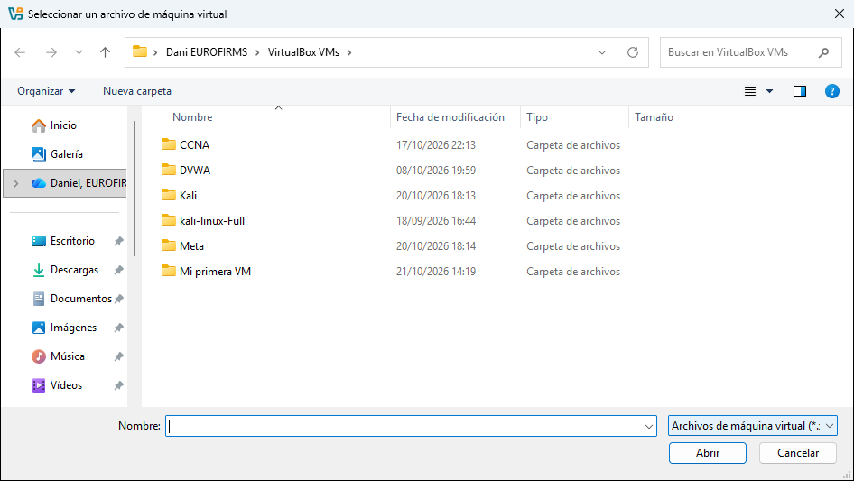

3. Selecciona el archivo `.vbox` (por ejemplo, `Mi primera VM.vbox`) y pulsa **Abrir**.
4. La máquina aparece en la lista con todas sus instantáneas y su configuración, tal como estaba:

   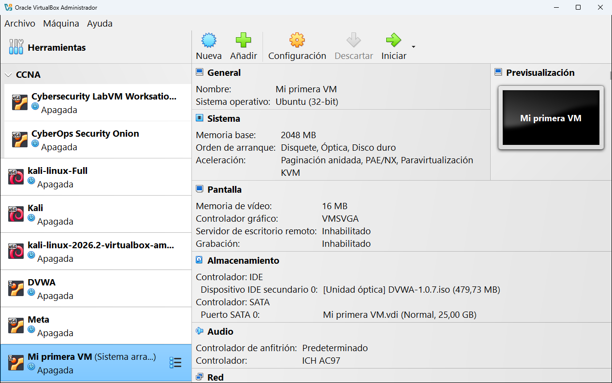

> [!TIP]
> Si al añadir sale un error de que ya existe una máquina con ese identificador (UUID), es que esa máquina **ya está en la lista** (quizá con otro nombre). No se puede añadir dos veces la misma.

---

## Importar una máquina (.ova)

Un archivo **OVA** (*Open Virtual Appliance*) es una máquina virtual completa empaquetada en un solo archivo, lista para compartir. En el ejemplo importamos `Lubuntu.ova`.

1. Pulsa **Importar** (con **Herramientas** seleccionado) o ve a **Archivo** → **Importar servicio virtualizado...**. El asistente tiene dos secciones: **Fuente** y **Configuración**.

   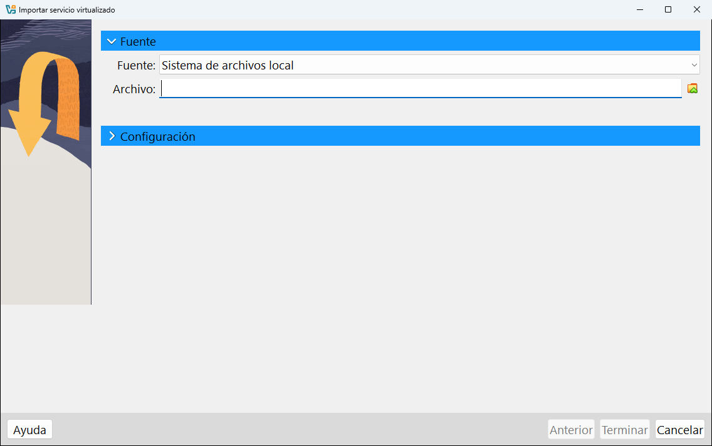

2. En **Fuente** deja **Sistema de archivos local** (la otra opción es Oracle Cloud Infrastructure). En **Archivo** pulsa el icono de la carpeta y elige el `.ova`:

   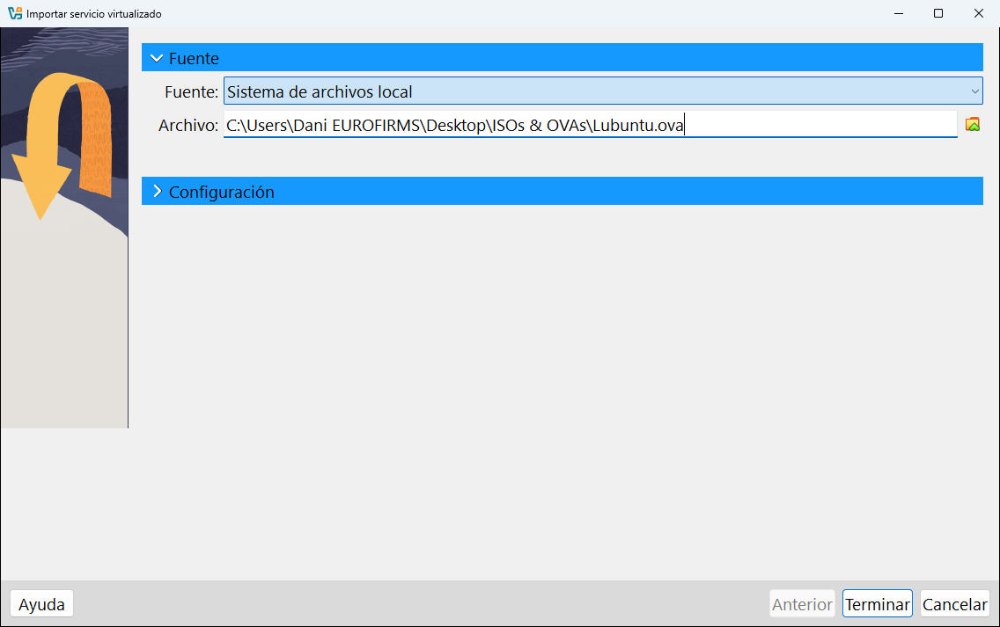

3. Abre la sección **Configuración**. VirtualBox lee el archivo y muestra lo que trae dentro, el **Sistema virtual 1**:

   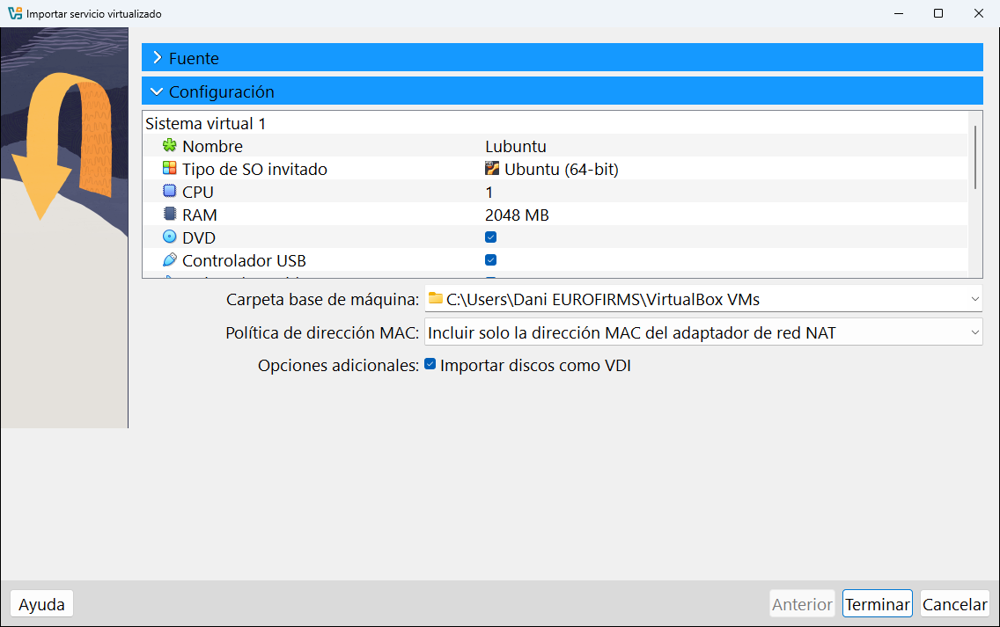

   Cada línea se puede cambiar **antes de importar** haciendo doble clic sobre su valor: el **Nombre**, el **Tipo de SO invitado**, la **CPU**, la **RAM**, si lleva **DVD**, **Controlador USB**, tarjeta de sonido, adaptador de red... Si bajas en la lista verás los controladores de disco y el disco virtual:

   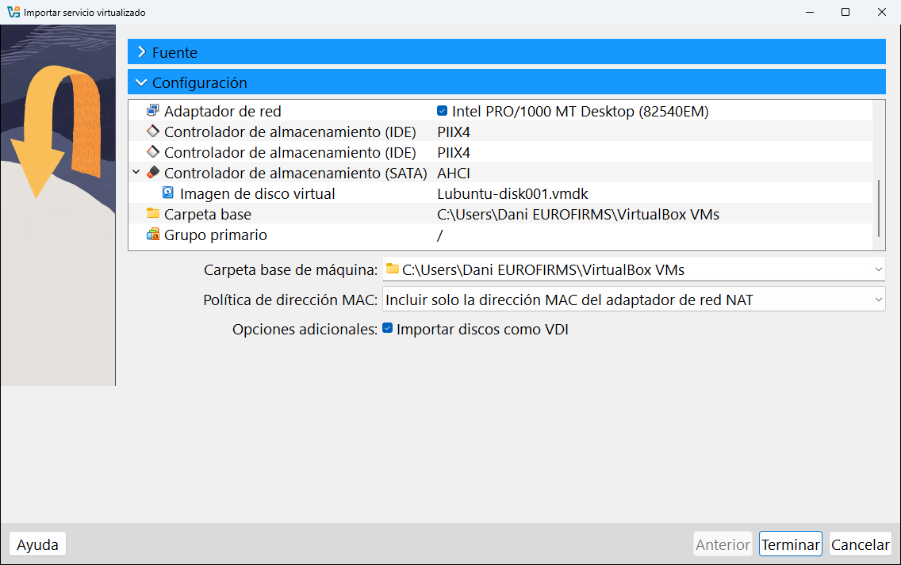

   Debajo de la lista hay tres ajustes más:

   | Ajuste | Qué hace | Recomendación |
   |---|---|---|
   | **Carpeta base de máquina** | Dónde se guardará la máquina importada. | La de siempre, o un disco con más espacio. |
   | **Política de dirección MAC** | Qué hacer con las direcciones MAC (el número de serie de cada tarjeta de red). | La que viene: **Incluir solo la dirección MAC del adaptador de red NAT**. Si importas la misma OVA dos veces, elige en la lista la opción que **genera direcciones MAC nuevas** para que no choquen en la red. |
   | **Importar discos como VDI** | Convierte el disco (que dentro del OVA va en VMDK) al formato de VirtualBox. | Déjalo marcado. |

4. Pulsa **Terminar**. La importación tarda unos minutos (copia y descomprime el disco). El progreso aparece en la ventana principal:

   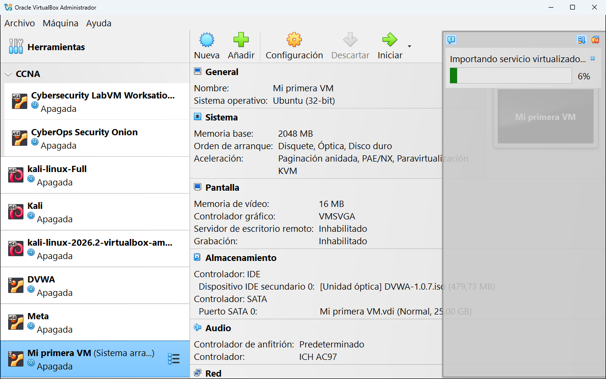

5. Cuando termina, la máquina **Lubuntu** aparece en la lista, lista para arrancar:

   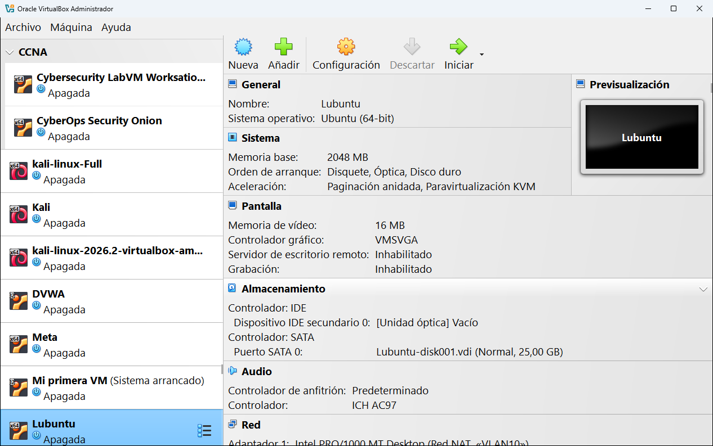

> [!NOTE]
> El archivo `Lubuntu.ova` ocupa 3,65 GB, pero el disco importado ocupa **7,49 GB**: dentro del OVA el disco va comprimido. Ten en cuenta este espacio extra antes de importar.

> [!TIP]
> Después de importar, el `.ova` ya no hace falta para que la máquina funcione. Puedes guardarlo como copia de seguridad o borrarlo para recuperar espacio.

---

## Exportar una máquina a .ova

Exportar es lo contrario de importar: empaqueta una o varias máquinas en un `.ova` para llevarlas a otro ordenador o compartirlas.

> [!IMPORTANT]
> La máquina tiene que estar **apagada** (no guardada ni pausada) para poder exportarla.

1. Ve a **Archivo** → **Exportar servicio virtualizado...**. En **Máquinas virtuales**, elige las que quieres exportar:

   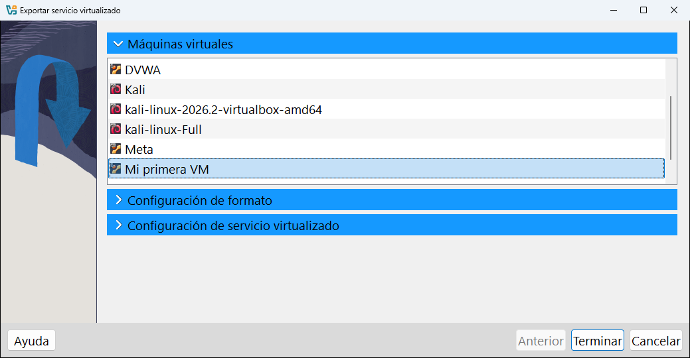

2. En **Configuración de formato**:

   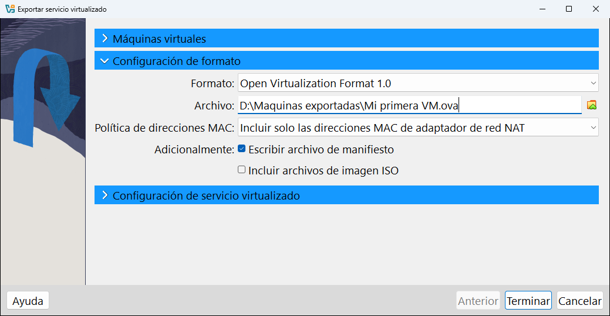

   | Ajuste | Qué es | Recomendación |
   |---|---|---|
   | **Formato** | La versión del estándar OVF. | **Open Virtualization Format 1.0**, el más compatible. |
   | **Archivo** | Dónde se guardará el `.ova`. | Una carpeta con espacio suficiente. |
   | **Política de direcciones MAC** | Qué direcciones MAC se guardan. | La que viene por defecto. |
   | **Escribir archivo de manifiesto** | Añade un archivo `.mf` con sumas de comprobación para detectar si el OVA se ha dañado. | Marcado. |
   | **Incluir archivos de imagen ISO** | Mete también las ISO que tenga puestas la máquina. | Desmarcado, salvo que la otra persona necesite la ISO. |

   Los formatos disponibles son **Open Virtualization Format 0.9**, **1.0** y **2.0**:

   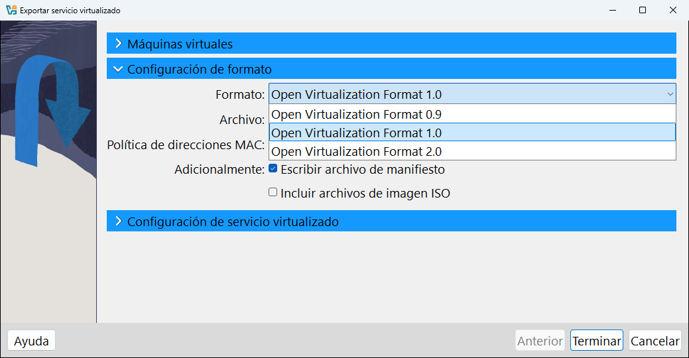

   Fíjate bien en la ruta de **Archivo** (ver el aviso de debajo de esta lista).

3. En **Configuración de servicio virtualizado** puedes añadir información descriptiva que verá quien importe la máquina: **Nombre**, **Producto**, **URL del producto**, **Vendedor**, **URL del vendedor**, **Versión**, **Descripción** y **Licencia**. Es opcional.

   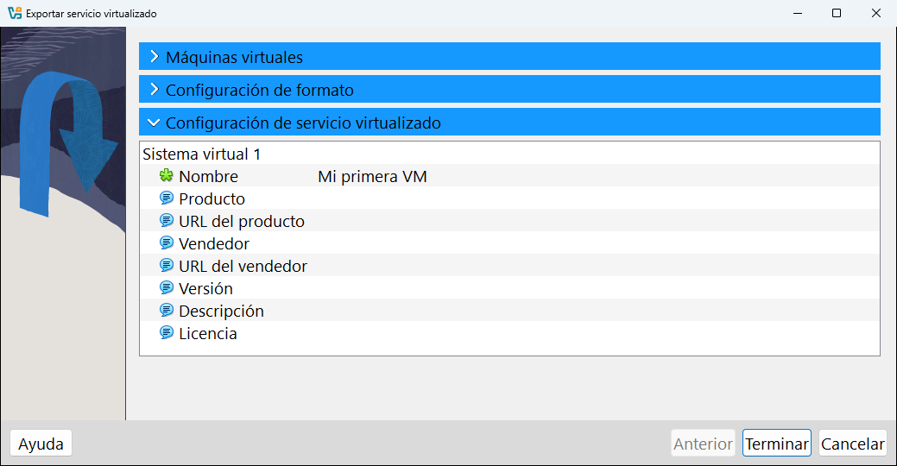

4. Pulsa **Terminar** y espera a que termine.

> [!WARNING]
> VirtualBox propone guardar el `.ova` en tu carpeta **Documentos**. Si esa carpeta está sincronizada con OneDrive (pasa mucho en ordenadores de empresa), el archivo se subirá a la nube, y puede ocupar muchos gigas. En el ejemplo se cambió a `D:\Maquinas exportadas\Mi primera VM.ova`.

### Qué hay dentro de un .ova

Un `.ova` es en realidad un archivo **tar** (un paquete de archivos, como un `.zip` sin comprimir) que contiene tres cosas. Este es el contenido real del `Mi primera VM.ova` exportado:

```text
Mi primera VM.ovf            8 KB   Descripción de la máquina (memoria, CPU, discos, red...) en texto XML
Mi primera VM-disk002.vmdk  70 KB   El disco virtual, comprimido en formato VMDK
Mi primera VM.mf            145 B   El manifiesto: sumas de comprobación para verificar que nada se ha dañado
```

El disco ocupa tan poco porque la máquina arranca desde un CD y nunca escribió nada en él.

---

## Clonar una máquina

**Clonar** es hacer una copia de una máquina dentro del mismo ordenador. Útil para tener varias máquinas iguales o para probar algo arriesgado sin tocar la original. Se abre con **Máquina** → **Clonar...** o **Ctrl + O** (la máquina tiene que estar apagada).

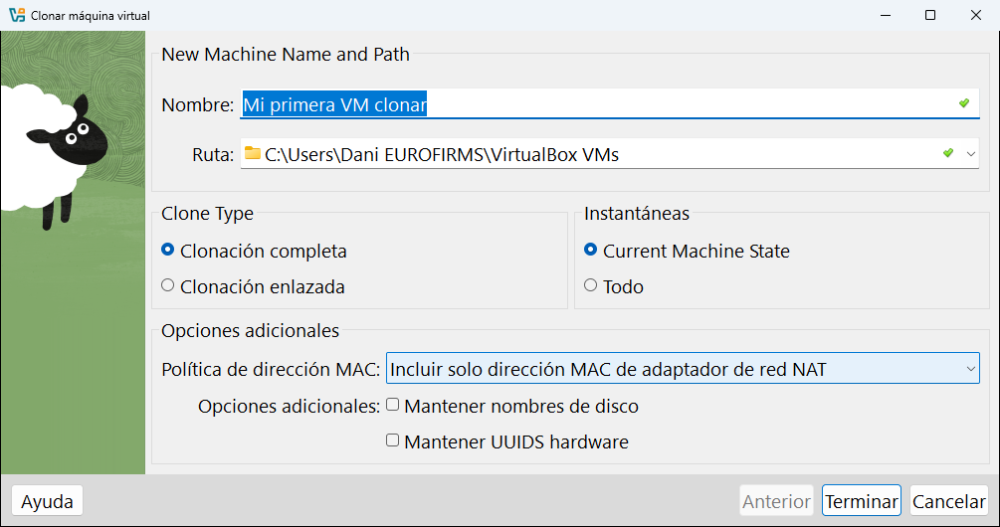

| Ajuste | Qué es |
|---|---|
| **Nombre** y **Ruta** | El nombre de la copia y dónde se guarda. |
| **Clonación completa** | Copia todo, incluidos los discos. La copia es totalmente independiente. Ocupa lo mismo que la original. |
| **Clonación enlazada** | La copia **reutiliza** los discos de la original y solo guarda sus cambios. Se crea en segundos y ocupa muy poco, pero **depende de la original**: si borras la original, la copia deja de funcionar. |
| **Instantáneas: Current Machine State** | Copia solo el estado actual, sin las instantáneas. |
| **Instantáneas: Todo** | Copia también todas las instantáneas. |
| **Política de dirección MAC** | Por defecto, **Incluir solo dirección MAC de adaptador de red NAT**. La lista también permite conservar todas las direcciones o generar direcciones nuevas para todos los adaptadores. Si vas a encender la original y la copia a la vez en la misma red, genera direcciones nuevas. |
| **Mantener nombres de disco** | Los discos de la copia se llaman igual que los de la original. |
| **Mantener UUIDS hardware** | La copia tiene los mismos identificadores de hardware. Solo para casos especiales (por ejemplo, licencias de software ligadas al hardware). |

> [!TIP]
> Para un laboratorio con varias máquinas casi iguales (por ejemplo, tres Ubuntu), instala una, haz una instantánea y crea **clones enlazados** a partir de ella: ahorrarás muchísimo espacio.

---

## Mover una máquina

**Máquina** → **Mover...** traslada la carpeta completa de una máquina a otro sitio (por ejemplo, de `C:` a un disco `D:` más grande) y actualiza VirtualBox para que la siga encontrando.

> [!WARNING]
> No muevas las carpetas de las máquinas con el Explorador de Windows mientras VirtualBox las tiene registradas. La máquina quedaría **Inaccesible**. Usa siempre **Mover...**, o bien elimínala de la lista con **Solo borrar**, muévela y vuelve a **añadirla**.

---

## Eliminar una máquina

**Máquina** → **Eliminar...** (la máquina tiene que estar apagada) muestra esta pregunta:

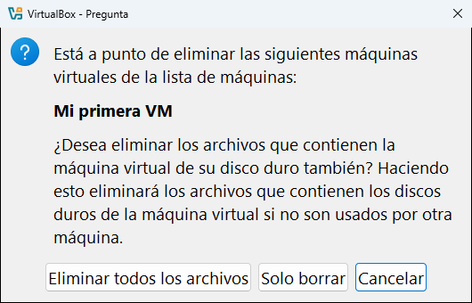

| Botón | Qué hace |
|---|---|
| **Eliminar todos los archivos** | Quita la máquina de la lista **y borra** su carpeta, sus discos, sus instantáneas y sus registros. **No se puede deshacer.** Los discos que use otra máquina no se borran. |
| **Solo borrar** | Solo la quita de la **lista**. Todos sus archivos siguen en el disco y puedes volver a [añadirla](#añadir-una-máquina-que-ya-existe) cuando quieras. |
| **Cancelar** | No hace nada. |

> [!CAUTION]
> El botón **Solo borrar** tiene un nombre confuso: **no borra nada del disco**, solo quita la máquina de la lista. El que borra los archivos es **Eliminar todos los archivos**. Léelo dos veces antes de pulsar.

En el ejemplo se usó **Solo borrar** con **Mi primera VM** y después se volvió a añadir con **Añadir**: la máquina volvió con todas sus instantáneas.

---

<!-- nav -->
<div align="center">

[⬅️ 6 · Crear una máquina nueva](06-crear-una-maquina.md) &nbsp;·&nbsp; [🏠 Índice](../README.md) &nbsp;·&nbsp; [8 · Configuración de una máquina ➡️](08-configuracion/README.md)

</div>
