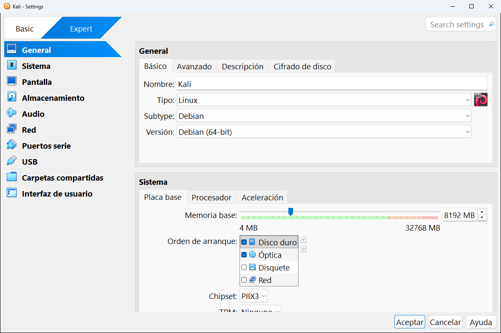
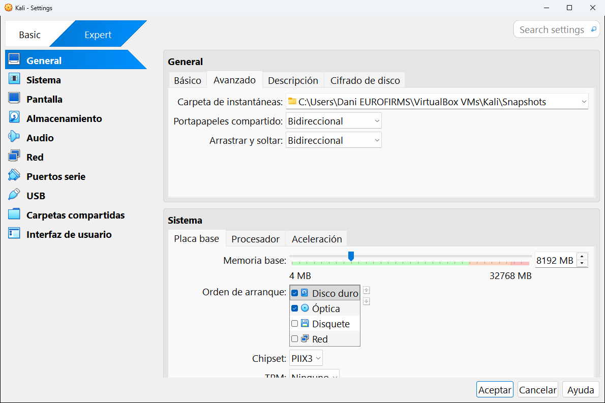
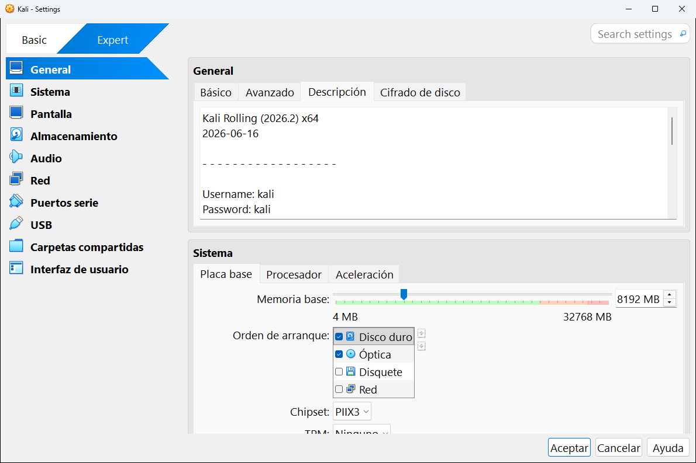
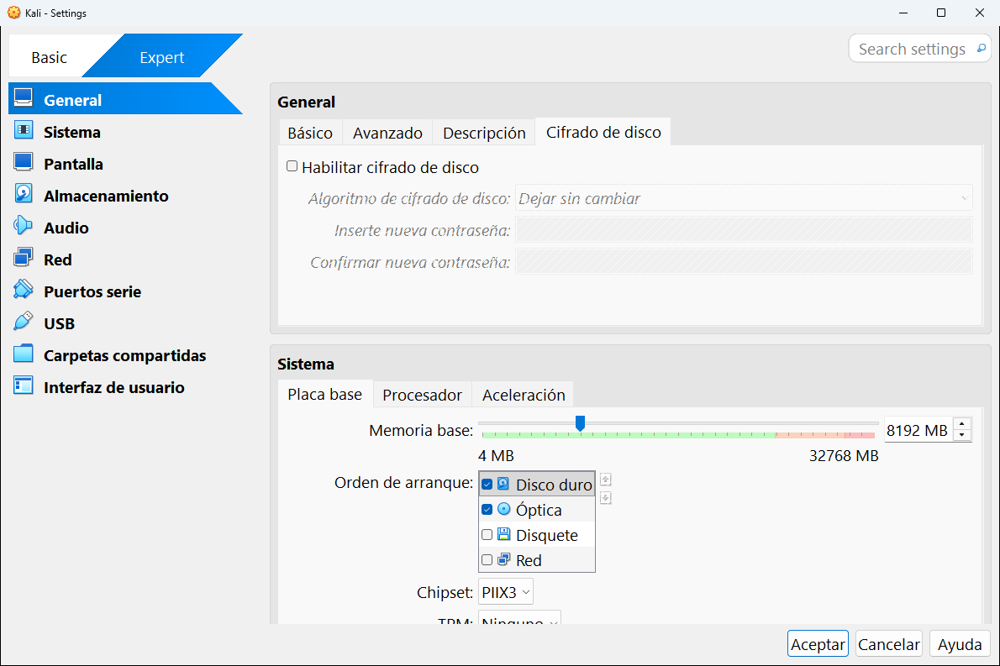

# 8.1 · General

La categoría **General** tiene cuatro pestañas: **Básico**, **Avanzado**, **Descripción** y **Cifrado de disco**.

---

## Básico

| Ajuste | Qué es | En la captura |
|---|---|---|
| **Nombre** | El nombre de la máquina en la lista. Si lo cambias, VirtualBox renombra también su carpeta y sus archivos. | Kali |
| **Tipo** | La familia del sistema operativo: Linux, Microsoft Windows, macOS, BSD... | Linux |
| **Subtype** | La distribución o variante dentro de la familia. | Debian |
| **Versión** | La versión concreta y si es de 32 o 64 bits. | Debian (64-bit) |

> [!NOTE]
> Kali Linux está basado en Debian, por eso aparece como **Debian (64-bit)**. Cuando tu sistema no está en la lista, elige aquel en el que está basado.

## Avanzado

| Ajuste | Qué es |
|---|---|
| **Carpeta de instantáneas** | Dónde se guardan las [instantáneas](../09-herramientas-de-la-maquina/02-instantaneas.md). Por defecto, la subcarpeta `Snapshots` dentro de la carpeta de la máquina. |
| **Portapapeles compartido** | Si puedes **copiar y pegar texto** entre tu ordenador y la máquina. |
| **Arrastrar y soltar** | Si puedes **arrastrar archivos** con el ratón entre tu ordenador y la máquina. |

Las dos últimas tienen cuatro opciones:

| Opción | Qué permite |
|---|---|
| **Inhabilitado** | Nada. La máquina está aislada (lo más seguro). |
| **Anfitrión a invitado** | Solo de tu ordenador hacia la máquina. |
| **Invitado a anfitrión** | Solo de la máquina hacia tu ordenador. |
| **Bidireccional** | En los dos sentidos (lo más cómodo). |

> [!IMPORTANT]
> El portapapeles compartido y el arrastrar y soltar **solo funcionan si la máquina tiene instalados los complementos del invitado**. Ver el [capítulo 10](../10-usar-una-maquina.md#los-complementos-del-invitado).

> [!WARNING]
> Si usas la máquina para analizar programas maliciosos o archivos sospechosos, déjalos en **Inhabilitado**. Así nada puede pasar de la máquina a tu ordenador por error.

## Descripción

Un cuadro de texto libre para apuntar lo que quieras sobre la máquina: para qué es, qué tiene instalado, usuario y contraseña... En la captura, la máquina Kali trae la descripción que puso su creador: la versión (`Kali Rolling (2026.2)`), la fecha y el usuario y contraseña por defecto de esa imagen (`kali` / `kali`). Esta descripción también aparece en el panel de [Detalles](../09-herramientas-de-la-maquina/01-detalles.md).

## Cifrado de disco

Protege con contraseña los discos de la máquina: sin la contraseña no se puede arrancar ni leer su contenido.

| Ajuste | Qué es |
|---|---|
| **Habilitar cifrado de disco** | Activa el cifrado. |
| **Algoritmo de cifrado de disco** | El tipo de cifrado (variantes de AES). **Dejar sin cambiar** mantiene el actual. |
| **Inserte nueva contraseña** y **Confirmar nueva contraseña** | La contraseña. **Si la olvidas, pierdes la máquina**: no hay forma de recuperarla. |

> [!NOTE]
> Según la documentación de VirtualBox 7.1, el cifrado de discos con AES forma parte del [paquete de extensiones](../05-herramientas-globales/01-extensiones.md). Para practicar no lo necesitas.

---

<!-- nav -->

[⬅️ 8 · Configuración de una máquina](README.md) &nbsp;·&nbsp; [🏠 Índice](../../README.md) &nbsp;·&nbsp; [8.2 · Sistema ➡️](02-sistema.md)

