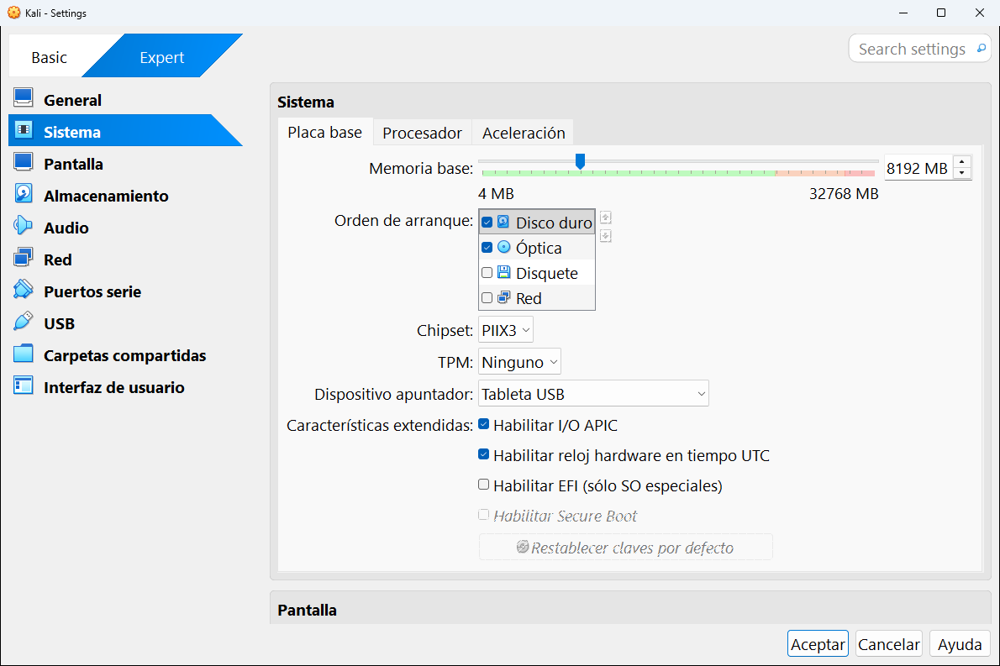
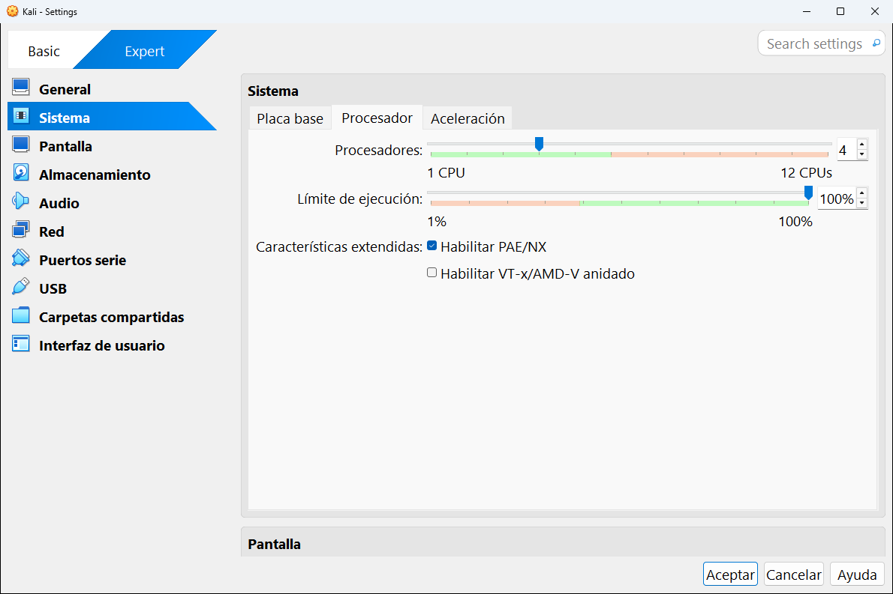
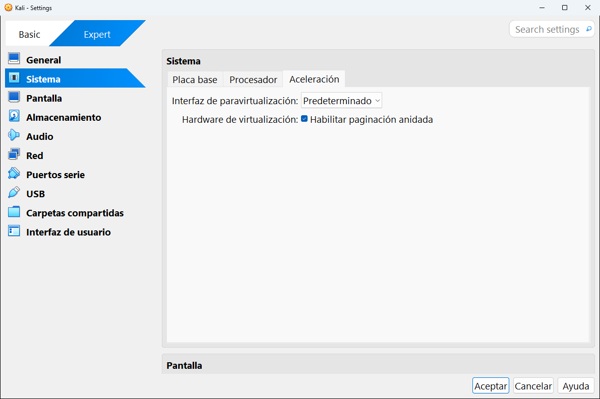

# 8.2 · Sistema

La categoría **Sistema** configura el "hardware" principal de la máquina: la memoria, la placa base y el procesador. Tiene tres pestañas: **Placa base**, **Procesador** y **Aceleración**.

---

## Placa base

| Ajuste | Qué es | En la captura |
|---|---|---|
| **Memoria base** | La memoria RAM de la máquina. La barra va de 4 MB hasta la RAM total de tu ordenador (aquí 32768 MB). El color avisa: verde está bien, naranja y rojo es demasiado. | 8192 MB (8 GB) |
| **Orden de arranque** | Dónde busca la máquina un sistema para arrancar, y en qué orden. Marca o desmarca cada dispositivo y cambia el orden con las flechas de la derecha. | Disco duro, Óptica |
| **Chipset** | El modelo de placa base que se simula: **PIIX3** (el clásico, compatible con todo) o **ICH9** (más moderno, necesario para algunas configuraciones avanzadas). | PIIX3 |
| **TPM** | Un chip de seguridad: **Ninguno**, **v1.2** o **v2.0**. **Windows 11 necesita v2.0**. | Ninguno |
| **Dispositivo apuntador** | Cómo se simula el ratón (ver la tabla de abajo). | Tableta USB |

**Opciones del orden de arranque:**

| Dispositivo | Arranca desde... |
|---|---|
| **Disquete** | Una imagen de disquete. |
| **Óptica** | La ISO que haya en la unidad de CD/DVD. Se usa para **instalar** sistemas. |
| **Disco duro** | El disco virtual. Es donde arranca un sistema ya instalado. |
| **Red** | Un servidor de la red (PXE). Solo en entornos de empresa. |

> [!TIP]
> Si tu máquina vuelve a arrancar el instalador cada vez que la enciendes, es que la **Óptica** está antes que el **Disco duro** y la ISO sigue puesta. Quita la ISO en [Almacenamiento](04-almacenamiento.md) o pon el disco duro el primero.

**Opciones del dispositivo apuntador:**

| Opción | Cuándo usarla |
|---|---|
| **Ratón PS/2** | Sistemas muy antiguos. El ratón queda "atrapado" dentro de la máquina hasta que pulsas la tecla anfitrión. |
| **Tableta USB** | **La recomendada.** El ratón entra y sale de la máquina libremente. |
| **Tableta multitáctil USB** | Como la anterior, con soporte de gestos táctiles. |
| **Pantalla y panel táctil USB MT** | Simula una pantalla táctil y un panel táctil. |

**Características extendidas:**

| Casilla | Qué hace |
|---|---|
| **Habilitar I/O APIC** | Necesario para usar más de un procesador y para sistemas de 64 bits. Déjalo marcado. |
| **Habilitar reloj hardware en tiempo UTC** | El reloj de la máquina funciona en hora universal. Márcalo para Linux, desmárcalo para Windows (que espera la hora local). |
| **Habilitar EFI (sólo SO especiales)** | Arranque UEFI moderno en lugar de la BIOS clásica. Obligatorio para Windows 11. |
| **Habilitar Secure Boot** | Arranque seguro: solo arrancan sistemas firmados. Necesita EFI. Obligatorio para Windows 11. |
| **Restablecer claves por defecto** | Vuelve a poner las claves de Secure Boot de fábrica. |

## Procesador

| Ajuste | Qué es | En la captura |
|---|---|---|
| **Procesadores** | Cuántos núcleos de tu procesador usa la máquina. La barra llega hasta los que tiene tu ordenador (aquí 12). | 4 |
| **Límite de ejecución** | El porcentaje máximo de cada núcleo que puede usar la máquina. Bájalo si una máquina hace que tu ordenador vaya lento. | 100 % |
| **Habilitar PAE/NX** | Permite a sistemas de 32 bits usar más de 4 GB de RAM y activa una protección de memoria. Déjalo marcado. | Marcado |
| **Habilitar VT-x/AMD-V anidado** | Permite usar virtualización **dentro** de la máquina (por ejemplo, instalar otro hipervisor dentro). Solo para casos avanzados. | Desmarcado |

> [!WARNING]
> No asignes todos tus núcleos. Una regla sencilla: como máximo la **mitad** de los que tengas. Con 12 núcleos, no pases de 6 en una máquina.

## Aceleración

| Ajuste | Qué es |
|---|---|
| **Interfaz de paravirtualización** | Una forma de que el sistema invitado "sepa" que es virtual y colabore con VirtualBox para ir más rápido. Las opciones son **Ninguno**, **Predeterminado**, **Heredada**, **Mínima**, **Hyper-V** y **KVM**. Deja **Predeterminado**: VirtualBox elige **KVM** para Linux e **Hyper-V** para Windows. |
| **Hardware de virtualización: Habilitar paginación anidada** | Usa una función del procesador que acelera mucho la gestión de la memoria. Déjalo marcado. |

---

<!-- nav -->

[⬅️ 8.1 · General](01-general.md) &nbsp;·&nbsp; [🏠 Índice](../../README.md) &nbsp;·&nbsp; [8.3 · Pantalla ➡️](03-pantalla.md)

