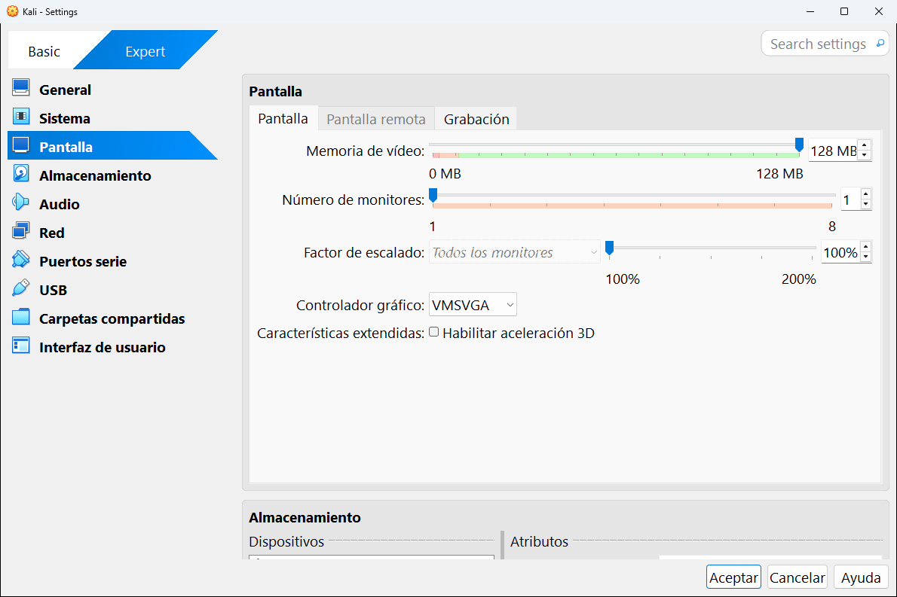
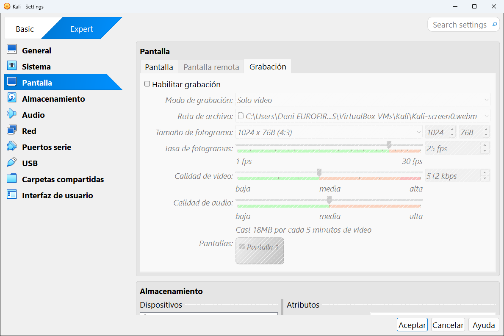

# 8.3 · Pantalla

La categoría **Pantalla** configura la tarjeta gráfica de la máquina. Tiene tres pestañas: **Pantalla**, **Pantalla remota** y **Grabación**.

---

## Pantalla

| Ajuste | Qué es | En la captura |
|---|---|---|
| **Memoria de vídeo** | La memoria de la tarjeta gráfica virtual. Más memoria permite resoluciones más altas y más monitores. | 128 MB |
| **Número de monitores** | Cuántas pantallas tiene la máquina (de 1 a 8). Cada una se abre en su propia ventana. | 1 |
| **Factor de escalado** | Agranda la imagen de la máquina en tu monitor (100 % es tamaño real). Puede aplicarse a todos los monitores o a uno. | 100 % |
| **Controlador gráfico** | El modelo de tarjeta gráfica que se simula (ver la tabla de abajo). | VMSVGA |
| **Habilitar aceleración 3D** | Usa la tarjeta gráfica de tu ordenador para efectos 3D dentro de la máquina. Necesita los complementos del invitado. | Desmarcado |

**Los tres controladores gráficos:**

| Controlador | Para qué sistema |
|---|---|
| **VMSVGA** | **Linux** moderno. Es el que VirtualBox elige para Linux. |
| **VBoxSVGA** | **Windows** moderno (7, 10, 11). Es el que VirtualBox elige para Windows. |
| **VBoxVGA** | Sistemas antiguos. Solo si los otros dos dan problemas. |

> [!TIP]
> Si la pantalla de la máquina se ve pequeña y no puedes cambiar la resolución, casi siempre es porque **faltan los complementos del invitado**, no por la memoria de vídeo. Ver el [capítulo 10](../10-usar-una-maquina.md#los-complementos-del-invitado).

## Pantalla remota

En la captura anterior se ve que la pestaña **Pantalla remota** aparece **en gris**: no se puede abrir. Es porque este ordenador no tiene el [paquete de extensiones](../05-herramientas-globales/01-extensiones.md), que es el que añade el escritorio remoto **VRDP**.

Con el paquete instalado, esta pestaña permite activar un servidor de escritorio remoto para ver y manejar la máquina **desde otro ordenador**, con un programa como *Conexión a Escritorio remoto* de Windows. Sus ajustes son el **puerto** por el que se conecta (por defecto el 3389), el **método de autenticación** (si pide usuario y contraseña) y si se permiten **varias conexiones** a la vez.

## Grabación

Graba en vídeo todo lo que pasa en la pantalla de la máquina. Muy útil para hacer tutoriales o guardar la prueba de un ejercicio.

| Ajuste | Qué es | En la captura |
|---|---|---|
| **Habilitar grabación** | Activa la grabación. Empieza a grabar al arrancar la máquina. | Desmarcado |
| **Modo de grabación** | Qué se graba: solo vídeo, vídeo y audio, o solo audio. | Solo vídeo |
| **Ruta de archivo** | Dónde se guarda. Es un archivo `.webm`, dentro de la carpeta de la máquina. | `...\Kali\Kali-screen0.webm` |
| **Tamaño de fotograma** | La resolución del vídeo. | 1024 x 768 (4:3) |
| **Tasa de fotogramas** | Fotogramas por segundo (de 1 a 30). Más fotogramas, más fluido y más pesado. | 25 fps |
| **Calidad de vídeo** | De baja a alta, en kbps. | 512 kbps |
| **Calidad de audio** | De baja a alta. | Media |
| **Pantallas** | Qué monitores se graban, si hay varios. | Pantalla 1 |

Debajo de las barras, VirtualBox calcula cuánto ocupará: en la captura, *casi 18 MB por cada 5 minutos de vídeo*.

> [!TIP]
> No hace falta activarla aquí: con la máquina encendida puedes empezar y parar la grabación desde su menú **Ver** → **Grabando**.

---

<!-- nav -->

[⬅️ 8.2 · Sistema](02-sistema.md) &nbsp;·&nbsp; [🏠 Índice](../../README.md) &nbsp;·&nbsp; [8.4 · Almacenamiento ➡️](04-almacenamiento.md)

