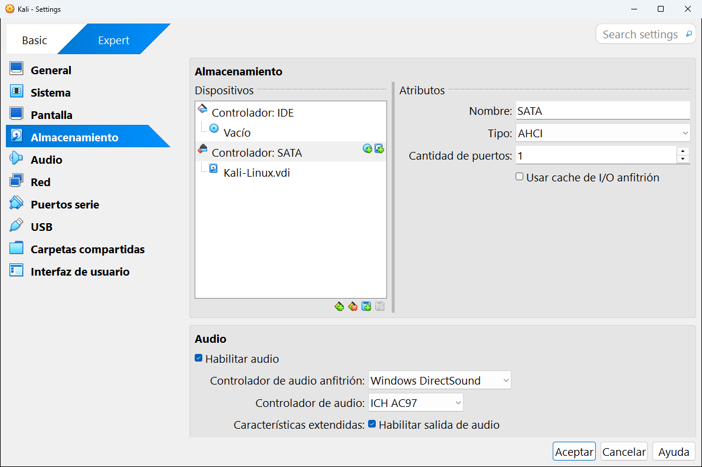
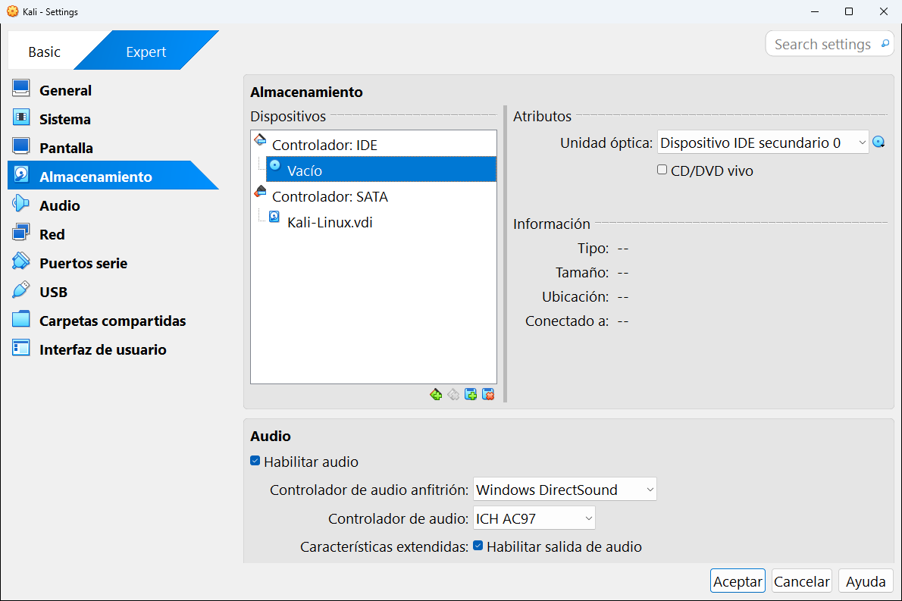
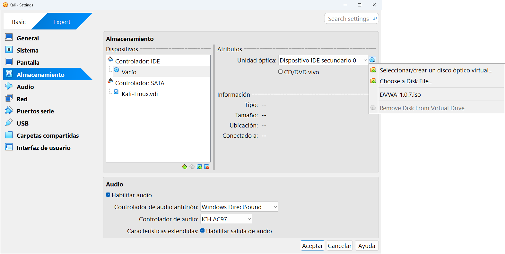
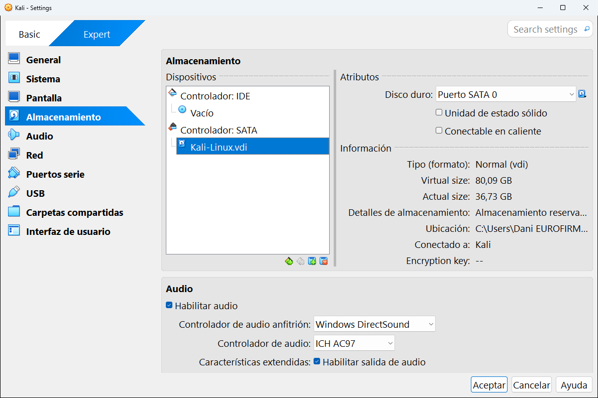
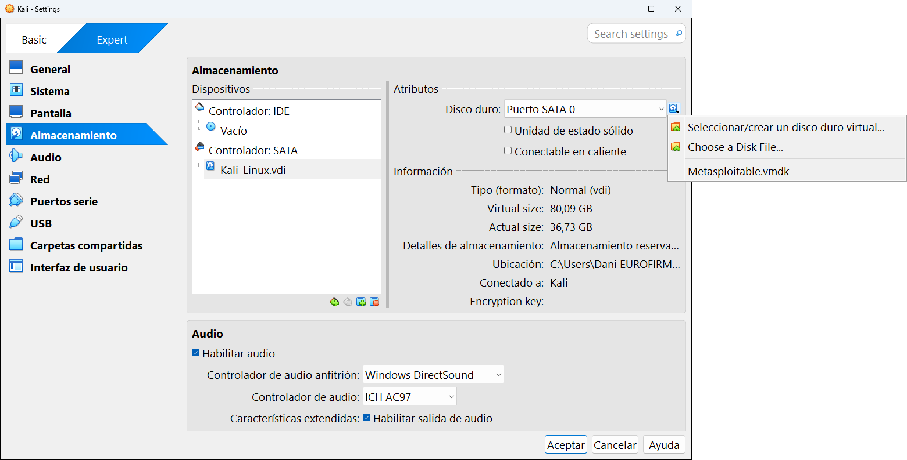
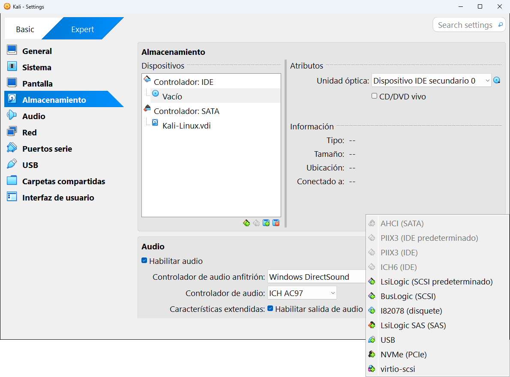

# 8.4 · Almacenamiento

La categoría **Almacenamiento** dice qué **discos** tiene la máquina: discos duros virtuales, unidades de CD/DVD (donde se ponen las ISO) y disquetes. Es la categoría que más vas a usar después de crear una máquina, por ejemplo para **meter o sacar una ISO**.

**En esta página:**
- [Cómo se organiza: controladores y dispositivos](#cómo-se-organiza-controladores-y-dispositivos)
- [Un controlador](#un-controlador)
- [La unidad óptica (CD/DVD)](#la-unidad-óptica-cddvd)
- [Un disco duro](#un-disco-duro)
- [Los botones de abajo](#los-botones-de-abajo)
- [Tareas frecuentes](#tareas-frecuentes)

---

## Cómo se organiza: controladores y dispositivos

En un ordenador de verdad, los discos se enchufan a la placa base a través de un **controlador** (SATA, IDE, NVMe...). VirtualBox lo representa igual, como un árbol:

```text
Controlador: IDE
└── Unidad óptica (CD/DVD) ...... Vacío
Controlador: SATA
└── Disco duro .................. Kali-Linux.vdi
```

A la izquierda está ese árbol (**Dispositivos**) y a la derecha los **Atributos** y la **Información** de lo que tengas seleccionado.

## Un controlador



| Atributo | Qué es | En la captura |
|---|---|---|
| **Nombre** | El nombre del controlador. | SATA |
| **Tipo** | El modelo de controlador. | AHCI |
| **Cantidad de puertos** | Cuántos discos se le pueden conectar (en SATA, hasta 30). | |
| **Usar cache de I/O anfitrión** | Usa la memoria de tu ordenador como caché para el disco. Puede acelerar, pero si tu ordenador se apaga de golpe puedes perder datos. Déjalo desmarcado. | Desmarcado |

## La unidad óptica (CD/DVD)



| Atributo | Qué es |
|---|---|
| **Unidad óptica** | En qué puerto del controlador está conectada. Aquí, **Dispositivo IDE secundario 0**. |
| **CD/DVD vivo** | Si está marcado, la ISO **no se saca** de la unidad cuando el sistema invitado "expulsa" el disco. |
| **Información** | El tipo, el tamaño y la ubicación de la ISO, y qué máquinas la usan. Aquí está vacía porque no hay ninguna ISO puesta. |

Para **meter una ISO**, pulsa el pequeño icono de CD que hay a la derecha de **Unidad óptica**. Se abre este menú:



| Opción | Qué hace |
|---|---|
| **Seleccionar/crear un disco óptico virtual...** | Abre una lista con todas las ISO que conoce VirtualBox (las de la herramienta [Medio](../05-herramientas-globales/02-medio.md#discos-ópticos-y-disquetes)). |
| **Choose a Disk File...** | Abre el explorador de Windows para buscar una ISO nueva. (Aparece en inglés aunque tengas VirtualBox en español.) |
| `DVWA-1.0.7.iso` | Las ISO usadas recientemente, para elegirlas con un clic. |
| **Remove Disk From Virtual Drive** | Saca la ISO de la unidad. (También en inglés.) |

## Un disco duro



| Atributo | Qué es | En la captura |
|---|---|---|
| **Disco duro** | En qué puerto está conectado. | Puerto SATA 0 |
| **Unidad de estado sólido** | Le dice al sistema invitado que el disco es un SSD. Algunos sistemas optimizan su funcionamiento. | Desmarcado |
| **Conectable en caliente** | Permite conectar y desconectar el disco con la máquina encendida. | Desmarcado |
| **Tipo (formato)** | Tipo de disco y formato del archivo. | Normal (vdi) |
| **Virtual size** / **Actual size** | El [tamaño virtual y el tamaño real](../05-herramientas-globales/02-medio.md#tamaño-virtual-y-tamaño-actual). | 80,09 GB / 36,73 GB |
| **Detalles de almacenamiento** | Si es dinámico o fijo. | Almacenamiento reservado dinámicamente |
| **Ubicación** | La ruta del archivo `.vdi`. | |
| **Conectado a** | Las máquinas que usan este disco. | Kali |
| **Encryption key** | Si está cifrado. | |

El icono de disco a la derecha de **Disco duro** abre un menú parecido al de la unidad óptica, para cambiar el disco por otro:



## Los botones de abajo

Debajo del árbol hay cuatro pequeños iconos:

| Icono | Qué hace |
|---|---|
| **Añadir controlador** (el primero) | Añade un controlador nuevo. |
| **Eliminar controlador** | Quita el controlador seleccionado y todo lo que tiene conectado. |
| **Añadir dispositivo** | Conecta un disco duro, una unidad óptica o un disquete al controlador seleccionado. |
| **Eliminar dispositivo** | Desconecta el dispositivo seleccionado. **No borra** el archivo del disco. |

Al pulsar **Añadir controlador** aparecen todos los tipos disponibles:



| Controlador | Para qué |
|---|---|
| **AHCI (SATA)** | El normal para discos duros. **Úsalo siempre que puedas.** |
| **PIIX3 / ICH6 (IDE)** | El clásico. VirtualBox lo usa para la unidad de CD/DVD y para sistemas antiguos. |
| **LsiLogic / BusLogic (SCSI)** y **LsiLogic SAS** | Discos de servidor. Algunas máquinas importadas de VMware los usan. |
| **I82078 (disquete)** | Para disqueteras. |
| **USB** | Para conectar discos virtuales como si fueran memorias USB. |
| **NVMe (PCIe)** | Simula un SSD NVMe moderno. Rápido, pero algunos sistemas antiguos no lo reconocen. |
| **virtio-scsi** | Un controlador "paravirtualizado" muy eficiente para Linux. |

## Tareas frecuentes

**Meter una ISO para instalar un sistema**
1. Selecciona la unidad óptica (el icono de CD bajo **Controlador: IDE**).
2. Pulsa el icono de CD de la derecha → **Choose a Disk File...** y elige la ISO.
3. Comprueba en [Sistema](02-sistema.md#placa-base) que **Óptica** está en el orden de arranque.

**Sacar la ISO después de instalar**
1. Selecciona la unidad óptica.
2. Icono de CD → **Remove Disk From Virtual Drive**.

**Añadir un segundo disco duro**
1. Selecciona **Controlador: SATA**.
2. Pulsa el icono **Añadir dispositivo** → **Disco duro** → **Crear**, y sigue el asistente.
3. Dentro del sistema invitado tendrás que darle formato, como a un disco nuevo de verdad.

---

<!-- nav -->
<div align="center">

[⬅️ 8.3 · Pantalla](03-pantalla.md) &nbsp;·&nbsp; [🏠 Índice](../../README.md) &nbsp;·&nbsp; [8.5 · Audio ➡️](05-audio.md)

</div>
