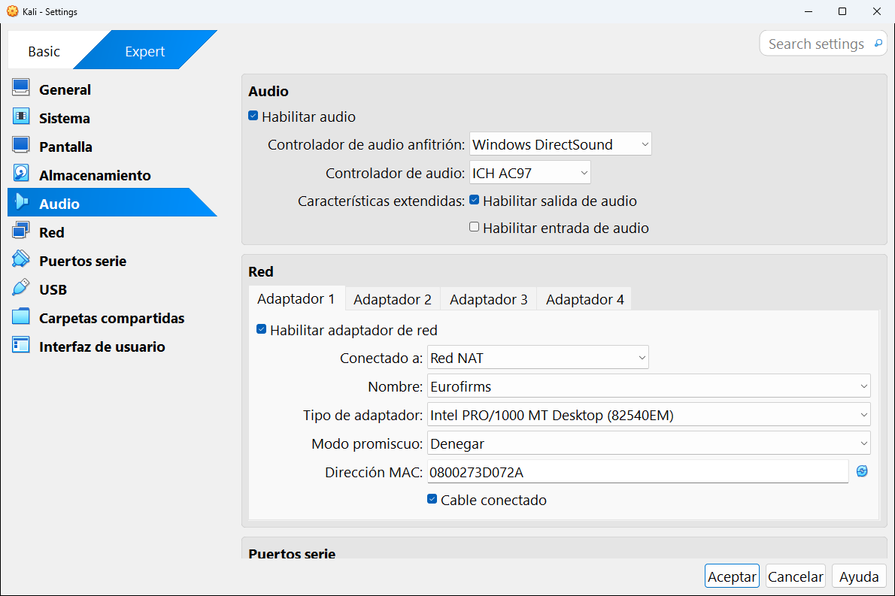

# 8.5 · Audio

La categoría **Audio** configura la tarjeta de sonido de la máquina: si se oye lo que suena dentro y si puede usar tu micrófono.

| Ajuste | Qué es | En la captura |
|---|---|---|
| **Habilitar audio** | Activa la tarjeta de sonido virtual. Si la desmarcas, la máquina no tiene sonido. | Marcado |
| **Controlador de audio anfitrión** | Cómo envía VirtualBox el sonido a **tu ordenador** (ver la tabla de abajo). | Windows DirectSound |
| **Controlador de audio** | El modelo de tarjeta de sonido que ve **la máquina** (ver la tabla de abajo). | ICH AC97 |
| **Habilitar salida de audio** | El sonido de la máquina sale por tus altavoces. | Marcado |
| **Habilitar entrada de audio** | La máquina puede usar **tu micrófono**. | Desmarcado |

**Controlador de audio anfitrión** (el lado de tu ordenador):

| Opción | Cuándo usarla |
|---|---|
| **Predeterminado** | Deja que VirtualBox elija. Es lo recomendable. |
| **Sesión de audio Windows** | El sistema de audio moderno de Windows. |
| **Windows DirectSound** | El sistema de audio clásico de Windows. Muy compatible. |
| **Audio nulo** | La máquina cree que tiene sonido, pero no se oye nada. |

**Controlador de audio** (el lado de la máquina):

| Opción | Cuándo usarla |
|---|---|
| **ICH AC97** | Funciona con casi todos los Linux y con Windows antiguos. |
| **Audio Intel HD** | Windows modernos (10 y 11) y Linux recientes. |
| **SoundBlaster 16** | Sistemas muy antiguos (MS-DOS, Windows 95...). |

> [!NOTE]
> La **entrada de audio** viene desmarcada por privacidad: así ninguna máquina puede escuchar por tu micrófono sin que tú lo actives. Márcala solo si lo necesitas (por ejemplo, para una videollamada dentro de la máquina).

---

<!-- nav -->

[⬅️ 8.4 · Almacenamiento](04-almacenamiento.md) &nbsp;·&nbsp; [🏠 Índice](../../README.md) &nbsp;·&nbsp; [8.6 · Red ➡️](06-red.md)

