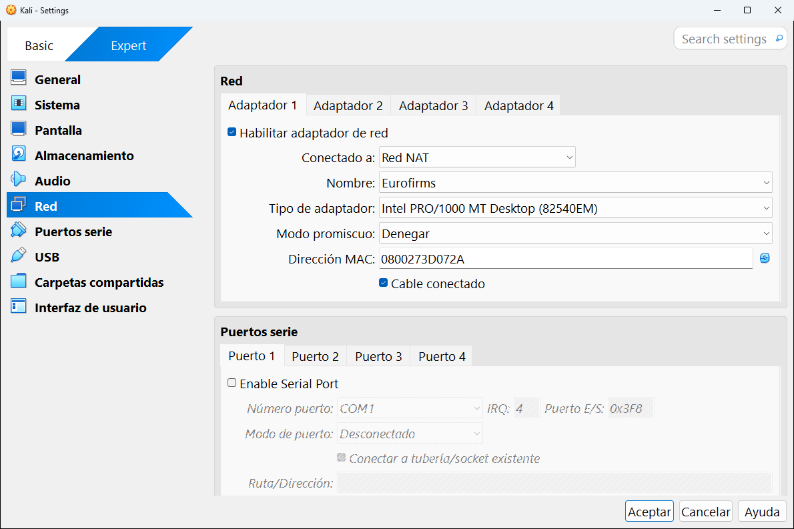
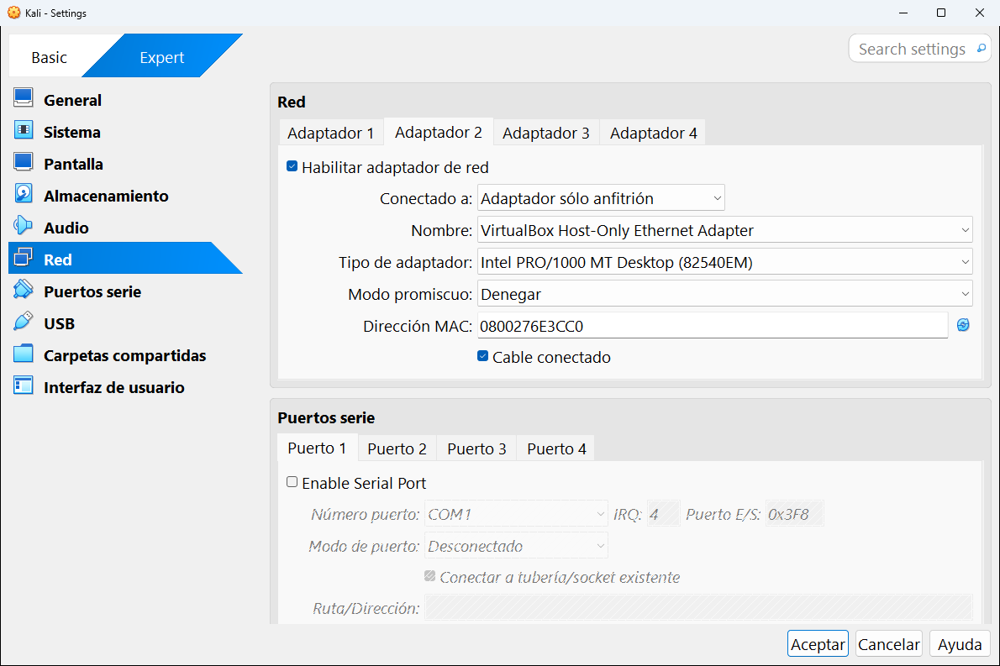
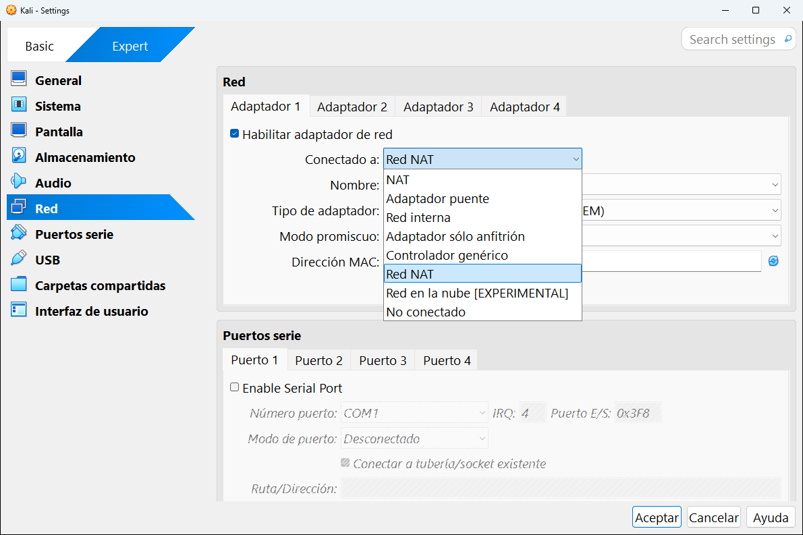

# 8.6 · Red

La categoría **Red** configura las **tarjetas de red** de la máquina. Cada máquina puede tener hasta **cuatro**, una por pestaña: **Adaptador 1**, **Adaptador 2**, **Adaptador 3** y **Adaptador 4**. Cada tarjeta se puede conectar a un tipo de red distinto.

> [!TIP]
> Esta página explica **los ajustes**. Si lo que necesitas es entender **qué hace cada tipo de red** y cuál elegir, tienes esquemas y una tabla comparativa en [Las redes explicadas](../11-redes-explicadas.md).

---

## Adaptador 1: conectado a una Red NAT

| Ajuste | Qué es | En la captura |
|---|---|---|
| **Habilitar adaptador de red** | Pone la tarjeta en la máquina. Si está desmarcado, es como si no existiera. | Marcado |
| **Conectado a** | **A qué red** se conecta la tarjeta. Es el ajuste más importante (ver abajo). | Red NAT |
| **Nombre** | Qué red concreta de ese tipo. Aparece para Red NAT, Adaptador puente, Red interna y Solo-anfitrión. | Eurofirms |
| **Tipo de adaptador** | El modelo de tarjeta que ve el sistema invitado (ver abajo). | Intel PRO/1000 MT Desktop (82540EM) |
| **Modo promiscuo** | Si la tarjeta puede ver el tráfico de red que va dirigido a **otras** máquinas (ver abajo). | Denegar |
| **Dirección MAC** | El "número de serie" de la tarjeta. El botón de al lado genera uno nuevo al azar. | 0800273D072A |
| **Cable conectado** | Simula que el cable de red está enchufado. Desmárcalo para "desenchufar" la máquina sin quitarle la tarjeta. | Marcado |

## Adaptador 2: conectado a Solo-anfitrión

Esta máquina Kali tiene una **segunda tarjeta**, conectada a la red solo-anfitrión. Así tiene Internet por la primera tarjeta y, a la vez, una red privada con tu ordenador por la segunda.

## Conectado a: los ocho tipos de red

| Opción | En una frase |
|---|---|
| **NAT** | Sale a Internet a través de tu ordenador. Las máquinas no se ven entre sí. Es la opción por defecto. |
| **Adaptador puente** | La máquina aparece en tu red real como un ordenador más, con su propia IP del router. |
| **Red interna** | Una red privada solo entre máquinas virtuales. Ni Internet ni tu ordenador. |
| **Adaptador sólo anfitrión** | Una red privada entre tus máquinas y tu ordenador, sin Internet. |
| **Controlador genérico** | Para usos avanzados (túneles UDP, redes VDE). |
| **Red NAT** | Como NAT, pero las máquinas de la misma red NAT sí se ven entre sí. |
| **Red en la nube [EXPERIMENTAL]** | Conecta con una red de Oracle Cloud Infrastructure. |
| **No conectado** | La tarjeta existe, pero sin cable. |

Todas están explicadas con esquemas en [Las redes explicadas](../11-redes-explicadas.md).

> [!NOTE]
> Con **NAT** aparece además un botón **Reenvío de puertos** para abrir puertos de tu ordenador hacia la máquina. Funciona igual que el [reenvío de puertos de una Red NAT](../05-herramientas-globales/03-red.md#pestaña-reenvío-de-puertos), pero solo para esa máquina.

## Tipo de adaptador

| Modelo | Cuándo usarlo |
|---|---|
| **Intel PRO/1000 MT Desktop (82540EM)** | **El recomendado.** Lo reconocen casi todos los sistemas. Es el que VirtualBox elige por defecto. |
| **Intel PRO/1000 T Server (82543GC)** e **Intel PRO/1000 MT Server (82545EM)** | Variantes para algunos Windows de servidor o cuando el anterior da problemas. |
| **PCnet-PCI II (Am79C970A)** y **PCnet-FAST III (Am79C973)** | Sistemas muy antiguos. |
| **Red paravirtualizada (virtio-net)** | La más rápida, para Linux modernos. Windows necesita controladores aparte. |

## Modo promiscuo

Normalmente una tarjeta de red solo atiende al tráfico que va dirigido a ella. En **modo promiscuo** ve **todo** el tráfico de la red. Lo necesitas para **capturar tráfico** con herramientas como Wireshark o tcpdump en un laboratorio.

| Opción | Qué permite |
|---|---|
| **Denegar** | Solo ve su propio tráfico (por defecto y lo más seguro). |
| **Permitir MVs** | Ve el tráfico de las demás máquinas virtuales de la misma red. **La adecuada para laboratorios.** |
| **Permitir todo** | Ve también el tráfico de tu ordenador y del resto de la red. |

> [!WARNING]
> En una red que no es tuya (la de tu empresa o tu centro), capturar el tráfico de otros equipos puede estar prohibido. Usa el modo promiscuo solo en tus redes de laboratorio.

---

<!-- nav -->

[⬅️ 8.5 · Audio](05-audio.md) &nbsp;·&nbsp; [🏠 Índice](../../README.md) &nbsp;·&nbsp; [8.7 · Puertos serie ➡️](07-puertos-serie.md)

