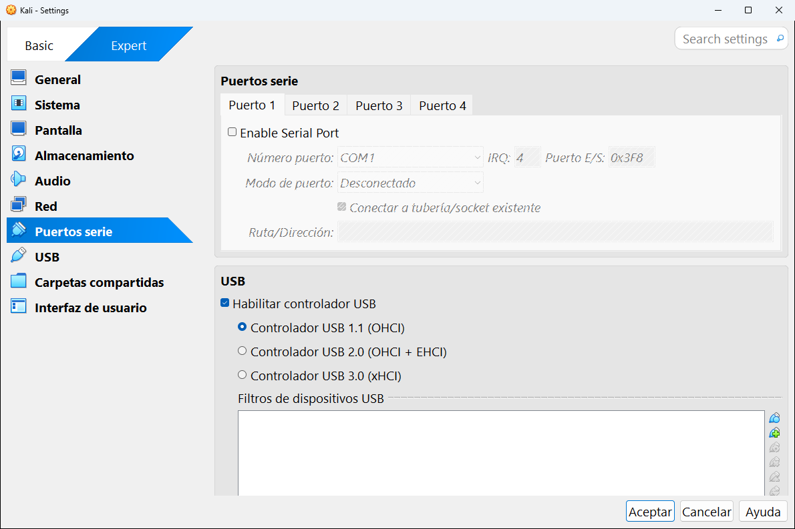

# 8.7 · Puertos serie

> [!NOTE]
> Esta categoría solo aparece en **modo experto**. Si estás empezando, **no la necesitas**: puedes pasar a la siguiente.

Los **puertos serie** (o puertos **COM**) son un tipo de conexión muy antiguo que todavía se usa para hablar con equipos de red (routers y switches de Cisco, por ejemplo), placas electrónicas y para depurar sistemas. Cada máquina puede tener hasta **cuatro**, uno por pestaña: **Puerto 1**, **Puerto 2**, **Puerto 3** y **Puerto 4**.

| Ajuste | Qué es | En la captura |
|---|---|---|
| **Enable Serial Port** | Activa el puerto. Mientras esté desmarcado, el resto de ajustes aparecen en gris. (Este texto sale en inglés.) | Desmarcado |
| **Número puerto** | Qué puerto COM ve la máquina. Cada uno tiene su **IRQ** y su dirección de **E/S** estándar, que se rellenan solas. | COM1 (IRQ 4, E/S 0x3F8) |
| **Modo de puerto** | A qué se conecta el puerto en tu ordenador (ver abajo). | Desconectado |
| **Conectar a tubería/socket existente** | Si se conecta a una tubería ya creada en lugar de crear una nueva. | |
| **Ruta/dirección** | La ruta de la tubería, del archivo o del puerto real, según el modo. | |

El **Puerto 2** viene preparado como **COM2** (IRQ 3, E/S 0x2F8):

**Los modos de puerto:**

| Modo | Qué hace |
|---|---|
| **Desconectado** | El puerto existe en la máquina, pero no está conectado a nada. |
| **Dispositivo anfitrión** | Lo conecta a un puerto serie **real** de tu ordenador (por ejemplo, un cable USB-serie para configurar un switch). |
| **Tubería anfitrión** | Lo conecta a una "tubería" de Windows, para que otro programa o **otra máquina virtual** hablen con él. |
| **Archivo crudo** | Guarda en un archivo todo lo que la máquina envía por el puerto. Útil para guardar mensajes de arranque. |
| **TCP** | Lo conecta a un puerto de red, para acceder a él con programas como PuTTY. |

---

<!-- nav -->

[⬅️ 8.6 · Red](06-red.md) &nbsp;·&nbsp; [🏠 Índice](../../README.md) &nbsp;·&nbsp; [8.8 · USB ➡️](08-usb.md)

