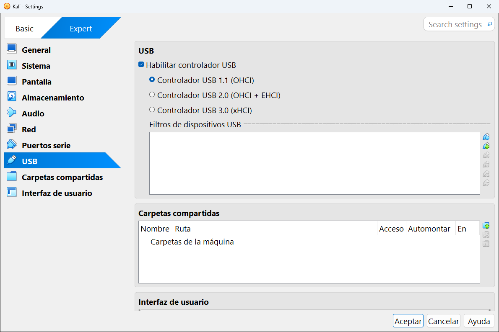

# 8.8 · USB

La categoría **USB** permite usar **dispositivos USB de tu ordenador dentro de la máquina**: memorias USB, discos externos, adaptadores Wi-Fi, lectores de tarjetas...

| Ajuste | Qué es |
|---|---|
| **Habilitar controlador USB** | Pone un controlador USB en la máquina. Si está desmarcado, la máquina no puede usar nada por USB. |
| **Controlador USB 1.1 (OHCI)** | USB muy antiguo y lento. Solo para dispositivos viejos. |
| **Controlador USB 2.0 (OHCI + EHCI)** | USB 2.0. Funciona con casi todo. |
| **Controlador USB 3.0 (xHCI)** | USB 3.0, el más rápido. **El recomendado** para sistemas modernos. |
| **Filtros de dispositivos USB** | Lista de dispositivos que se conectan **solos** a la máquina en cuanto los enchufas. |

## Los filtros de dispositivos USB

Los botones a la derecha de la lista sirven para:

- **Añadir un filtro vacío** y rellenar a mano sus datos (fabricante, producto, número de serie...).
- **Añadir un filtro a partir de un dispositivo conectado**: muestra los USB que tienes enchufados y crea el filtro con un clic. **Es la forma más fácil.**
- **Editar**, **eliminar** y **subir o bajar** un filtro en la lista.

Si no creas ningún filtro, puedes conectar un USB a la máquina cuando la necesites desde su ventana, en el menú **Dispositivos** → **USB** (ver el [capítulo 10](../10-usar-una-maquina.md#menú-dispositivos)).

> [!IMPORTANT]
> Mientras un dispositivo USB está conectado a la máquina virtual, **tu ordenador deja de verlo**. Si conectas así tu memoria USB, desaparecerá del Explorador de Windows hasta que la desconectes de la máquina.

> [!WARNING]
> **No conectes nunca a una máquina virtual el teclado o el ratón USB que estás usando**: dejarían de funcionar en tu ordenador. Si te pasa, apaga la máquina virtual para recuperarlos.

> [!NOTE]
> El USB 2.0 y 3.0 viene incluido en VirtualBox normal: ya **no** hace falta el paquete de extensiones.

---

<!-- nav -->

[⬅️ 8.7 · Puertos serie](07-puertos-serie.md) &nbsp;·&nbsp; [🏠 Índice](../../README.md) &nbsp;·&nbsp; [8.9 · Carpetas compartidas ➡️](09-carpetas-compartidas.md)

