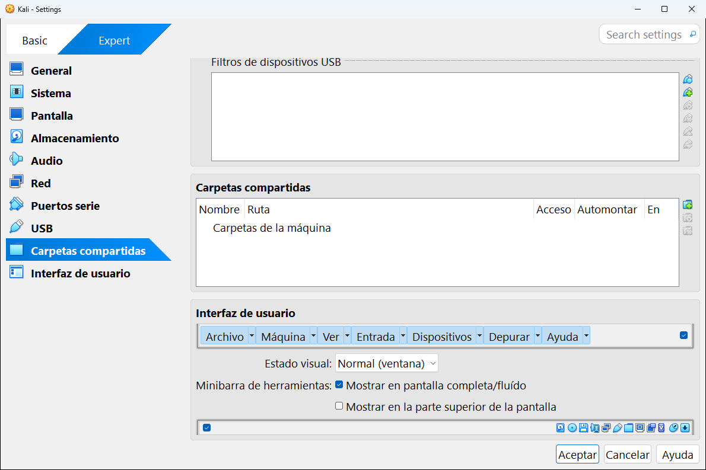

# 8.9 · Carpetas compartidas

Una **carpeta compartida** es una carpeta de **tu ordenador** que la máquina virtual puede ver y usar como si fuera suya. Es la forma más cómoda de pasar archivos entre los dos: lo que guardas en esa carpeta desde Windows aparece dentro de la máquina, y al revés.



En la parte de arriba de la captura está la lista de carpetas compartidas, vacía en esta máquina. (La parte de abajo es la categoría siguiente, [Interfaz de usuario](10-interfaz-de-usuario.md).)

## La lista

| Columna | Qué es |
|---|---|
| **Nombre** | El nombre con el que la máquina verá la carpeta. |
| **Ruta** | La carpeta de tu ordenador, por ejemplo `C:\Users\Ana\Documents\compartida`. |
| **Acceso** | **Completo** (leer y escribir) o **Solo lectura**. |
| **Automontar** | Si la carpeta aparece sola dentro de la máquina al arrancar. |

Las carpetas se agrupan en **Carpetas de la máquina** (permanentes: siempre están) y, si la máquina está encendida, **Carpetas transitorias** (solo duran hasta que la apagas).

## Cómo añadir una carpeta

1. Pulsa el icono **+** (añadir carpeta compartida) que hay a la derecha de la lista.
2. Rellena la ventana que aparece:

   | Campo | Qué poner |
   |---|---|
   | **Ruta de la carpeta** | La carpeta de tu ordenador. Elige **Otro...** en el desplegable para buscarla. |
   | **Nombre de carpeta** | Se rellena solo con el nombre de la carpeta. Sin espacios es más fácil de usar. |
   | **Solo lectura** | Márcalo si la máquina solo debe poder leer, no modificar. |
   | **Automontar** | Márcalo para que aparezca sola. |
   | **Punto de montaje** | Opcional: dónde aparecerá dentro de la máquina (por ejemplo `/home/kali/compartida` o la letra `Z:` en Windows). |

3. Pulsa **Aceptar**.

## Dónde aparece dentro de la máquina

| Sistema invitado | Dónde la encuentras |
|---|---|
| **Windows** | En el Explorador, como una unidad de red llamada `\\VBOXSVR\nombre`, normalmente con una letra como `Z:`. |
| **Linux** | En la carpeta `/media/sf_nombre`. |

> [!IMPORTANT]
> Las carpetas compartidas **solo funcionan con los complementos del invitado instalados**. Además, en Linux tu usuario tiene que pertenecer al grupo `vboxsf` para poder abrirla. Se añade con este comando dentro de la máquina, y después hay que cerrar sesión y volver a entrar:
>
> ```bash
> sudo usermod -aG vboxsf $USER
> ```

> [!WARNING]
> No compartas carpetas con contenido importante (y nunca el disco `C:` entero) con una máquina en la que pruebas programas sospechosos o haces ejercicios de ataque. Lo que pase dentro de la máquina podría afectar a esos archivos.

---

<!-- nav -->
<div align="center">

[⬅️ 8.8 · USB](08-usb.md) &nbsp;·&nbsp; [🏠 Índice](../../README.md) &nbsp;·&nbsp; [8.10 · Interfaz de usuario ➡️](10-interfaz-de-usuario.md)

</div>
