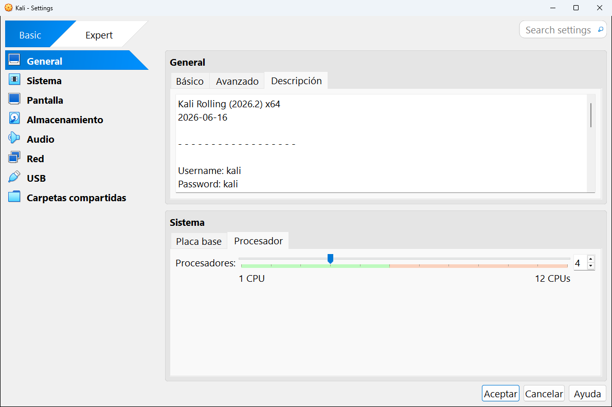

# 8 · La configuración de una máquina

La ventana de **Configuración** reúne **todos los ajustes** de una máquina virtual: memoria, procesador, discos, red, USB... Es la "BIOS" y la caja de herramientas de la máquina a la vez. Las capturas de este capítulo son de la máquina **Kali**.

## Cómo se abre

- Selecciona la máquina y pulsa el botón **Configuración**.
- **Máquina** → **Configuración...** o **Ctrl + S**.
- Clic derecho sobre la máquina → **Configuración...**
- Con la máquina encendida, desde su ventana: **Máquina** → **Configuración...**

> [!IMPORTANT]
> Casi todos los ajustes **solo se pueden cambiar con la máquina apagada**. Si la abres con la máquina encendida o guardada, muchas opciones aparecerán en gris. Apágala del todo (no la dejes en estado guardado) y vuelve a abrir la configuración.

## Cómo está organizada

- A la izquierda está la **lista de categorías**. Al hacer clic en una, la página de la derecha salta a esa sección. Toda la configuración es una sola página larga: también puedes ir bajando con la rueda del ratón.
- Arriba a la izquierda está el interruptor **Basic** / **Expert**, el mismo que en [Preferencias](../04-preferencias.md#modo-básico-y-modo-experto). En **modo básico** (la captura de arriba) hay 8 categorías, en **modo experto** aparecen también **Puertos serie** e **Interfaz de usuario**, y más opciones dentro de cada categoría.
- Arriba a la derecha, **Search settings** busca un ajuste por su nombre.
- Abajo, **Aceptar** guarda los cambios, **Cancelar** los descarta y **Ayuda** abre el manual.

> [!TIP]
> Si algún ajuste no es válido (por ejemplo, demasiada memoria), aparece un **aviso** en la parte de abajo de la ventana explicando el problema. Pasa el ratón por encima para leerlo.

## Las 10 categorías

| | Categoría | Qué se configura |
|:-:|---|---|
| 1 | [General](01-general.md) | Nombre, sistema operativo, portapapeles compartido, descripción y cifrado |
| 2 | [Sistema](02-sistema.md) | Memoria, orden de arranque, procesadores, EFI, TPM y aceleración |
| 3 | [Pantalla](03-pantalla.md) | Memoria de vídeo, controlador gráfico, monitores, escritorio remoto y grabación |
| 4 | [Almacenamiento](04-almacenamiento.md) | Discos duros, unidades de CD/DVD (ISO) y controladores |
| 5 | [Audio](05-audio.md) | Altavoces y micrófono |
| 6 | [Red](06-red.md) | Las cuatro tarjetas de red y a qué red se conecta cada una |
| 7 | [Puertos serie](07-puertos-serie.md) | Puertos COM (solo en modo experto) |
| 8 | [USB](08-usb.md) | Controlador USB y dispositivos que se conectan solos |
| 9 | [Carpetas compartidas](09-carpetas-compartidas.md) | Carpetas de tu ordenador visibles desde la máquina |
| 10 | [Interfaz de usuario](10-interfaz-de-usuario.md) | Menús y barras de la ventana de la máquina (solo en modo experto) |

---

<!-- nav -->

[⬅️ 7 · Añadir, importar y exportar](../07-anadir-importar-exportar.md) &nbsp;·&nbsp; [🏠 Índice](../../README.md) &nbsp;·&nbsp; [8.1 · General ➡️](01-general.md)

