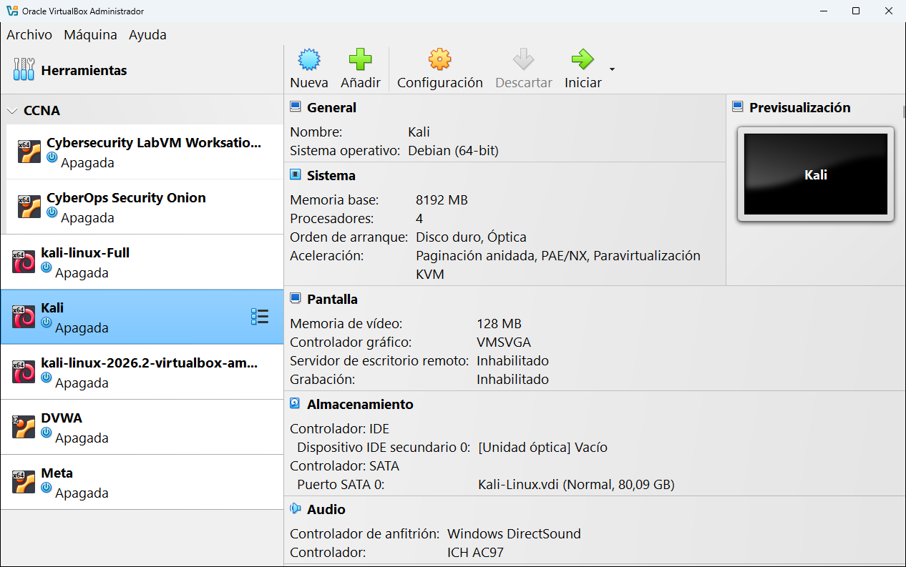

# 9.1 · Detalles

**Detalles** es la herramienta que aparece por defecto: un resumen de la configuración de la máquina, en secciones, sin tener que abrir la ventana de configuración.

## Las secciones

| Sección | Qué muestra | En la captura |
|---|---|---|
| **General** | Nombre y sistema operativo. Si está en un grupo, también el grupo. | Kali · Debian (64-bit) |
| **Sistema** | Memoria, procesadores, orden de arranque y aceleración. | 8192 MB · 4 procesadores · Disco duro, Óptica |
| **Pantalla** | Memoria de vídeo, controlador gráfico, escritorio remoto y grabación. | 128 MB · VMSVGA |
| **Almacenamiento** | Cada controlador con sus discos y unidades. | IDE: unidad óptica vacía · SATA: Kali-Linux.vdi (80,09 GB) |
| **Audio** | Controlador de audio del anfitrión y de la máquina. | Windows DirectSound · ICH AC97 |
| **Red** | Cada tarjeta de red activa y a qué está conectada. | |
| **USB** | El controlador USB y los filtros. | |
| **Carpetas compartidas** | Cuántas carpetas compartidas tiene. | |
| **Descripción** | La descripción de la pestaña [General → Descripción](../08-configuracion/01-general.md#descripción). | |

A la derecha, **Previsualización** muestra una miniatura de la pantalla de la máquina (si está encendida).

## Lo que se puede hacer desde aquí

- **Haz clic en el título de una sección** (por ejemplo, **Sistema**) para abrir la configuración directamente en esa sección.
- **Haz clic en la unidad óptica** (`[Unidad óptica] Vacío`) para elegir una ISO sin abrir la configuración.
- La **flecha** de la derecha de cada título **pliega** la sección para ocupar menos.
- **Haz clic derecho** en el panel para elegir qué secciones quieres ver.

> [!TIP]
> Antes de arrancar una máquina que acabas de importar o descargar, échale un vistazo a sus detalles: memoria, procesadores y tipo de red. Así evitas sorpresas, como una máquina que pide 8 GB de RAM cuando tu ordenador tiene solo 8.

---

<!-- nav -->

[⬅️ 9 · Herramientas de la máquina](README.md) &nbsp;·&nbsp; [🏠 Índice](../../README.md) &nbsp;·&nbsp; [9.2 · Instantáneas ➡️](02-instantaneas.md)

