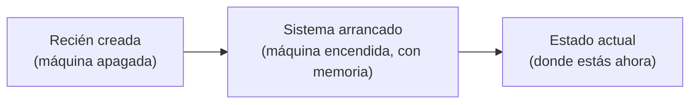
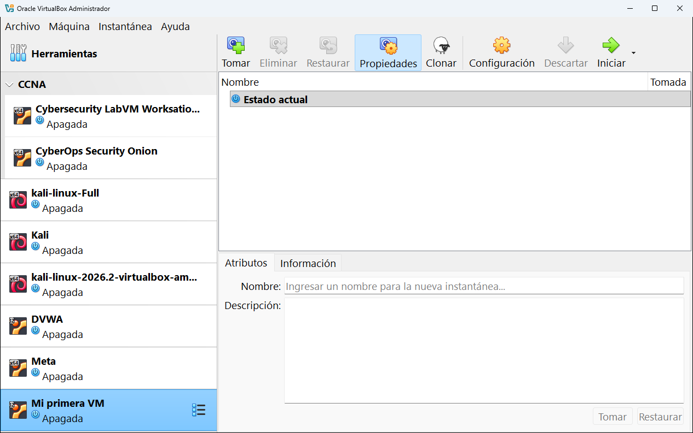
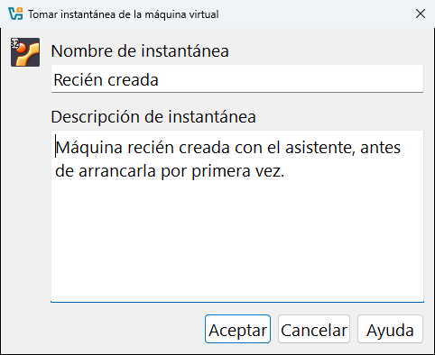
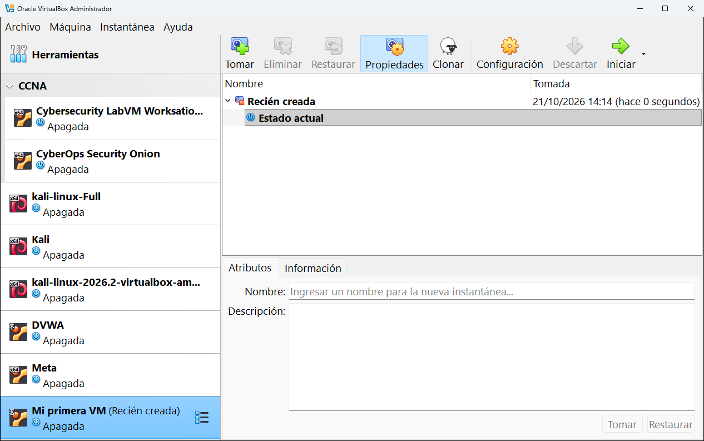
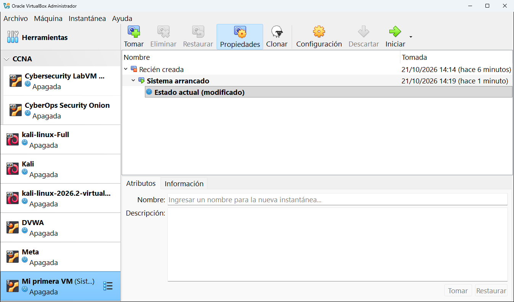
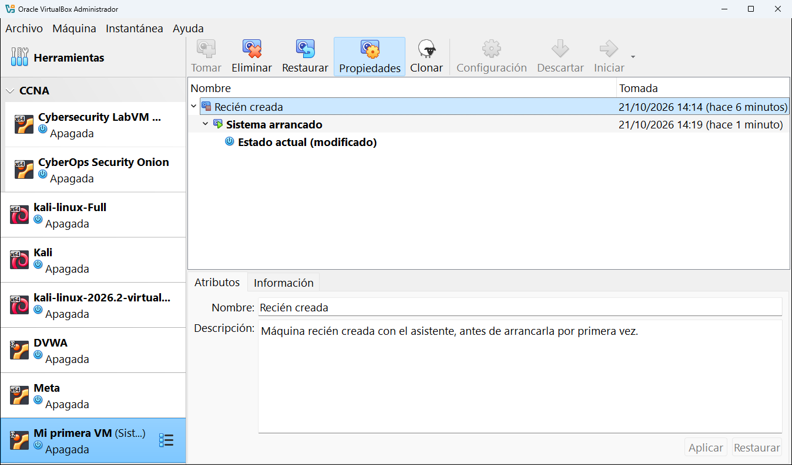
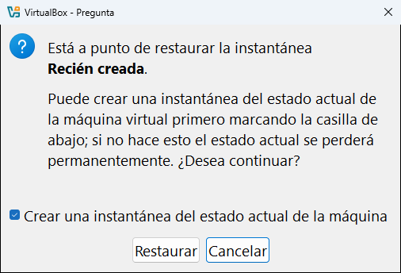
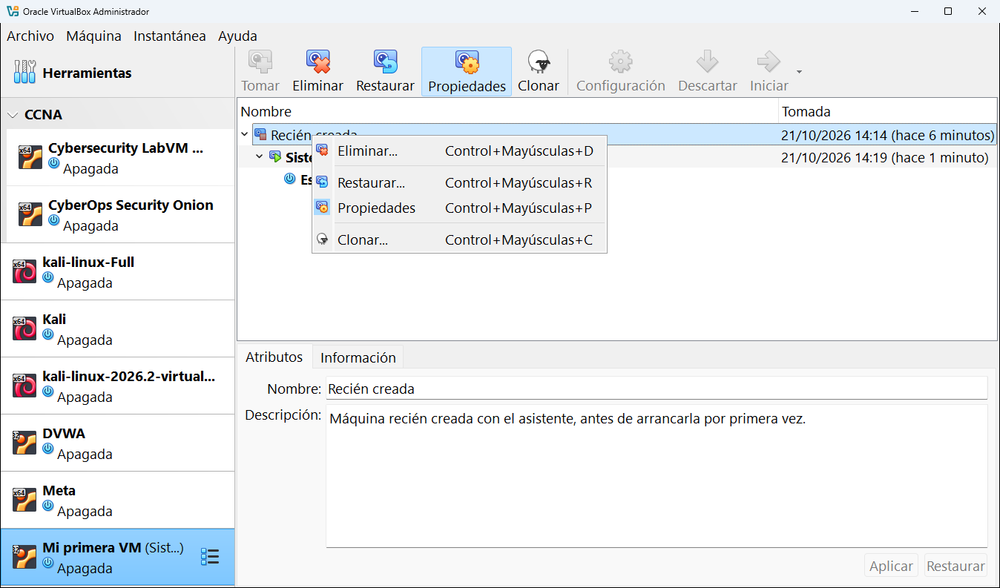

# 9.2 · Instantáneas

Una **instantánea** (*snapshot*) es una **foto del estado de la máquina** en un momento concreto. Si después rompes algo, **restauras** la instantánea y la máquina vuelve exactamente a como estaba. Es una de las funciones más útiles de VirtualBox para aprender y practicar.

**En esta página:**
- [Cómo funcionan](#cómo-funcionan)
- [Una máquina sin instantáneas](#una-máquina-sin-instantáneas)
- [Tomar una instantánea](#tomar-una-instantánea)
- [El árbol de instantáneas](#el-árbol-de-instantáneas)
- [Restaurar una instantánea](#restaurar-una-instantánea)
- [Los botones y el menú](#los-botones-y-el-menú)
- [Buenas costumbres](#buenas-costumbres)

---

## Cómo funcionan

Al tomar una instantánea, VirtualBox **congela** el disco tal como está y, a partir de ese momento, guarda los cambios en un **archivo aparte** (un disco "diferencial"). Restaurar es tan rápido porque solo tiene que tirar esos cambios.

Si la tomas **con la máquina encendida**, además guarda el contenido de la **memoria**: al restaurarla, la máquina vuelve encendida, con los mismos programas abiertos.



## Una máquina sin instantáneas

Si la máquina no tiene ninguna, solo aparece **Estado actual**, que es la máquina tal como está ahora. Así se ve **Mi primera VM** recién creada:



## Tomar una instantánea

1. Pulsa **Tomar** (o, con la máquina encendida, **Máquina** → **Tomar instantánea...** en su ventana, o **Ctrl derecha + T**).
2. Escribe un **nombre** que diga qué hay en ese momento y, si quieres, una **descripción**:

   

3. Pulsa **Aceptar**. La instantánea aparece en el árbol, por encima del **Estado actual**:

   

> [!TIP]
> Pon nombres que te sirvan dentro de un mes: `Recién instalada`, `Antes de actualizar`, `Con Apache configurado`... Evita `Instantánea 1`, `Instantánea 2`.

## El árbol de instantáneas

Las instantáneas forman un **árbol**: cada una cuelga de la anterior. Después de arrancar la máquina y tomar una segunda instantánea **con la máquina encendida**, y luego apagarla, el árbol queda así:



| Elemento | Qué significa |
|---|---|
| **Recién creada** | La primera instantánea, tomada con la máquina apagada. |
| **Sistema arrancado** | La segunda, tomada con la máquina encendida. Su icono es distinto porque guarda también la memoria. Está en **negrita** porque es la instantánea de la que parte el estado actual. |
| **Estado actual (modificado)** | La máquina tal como está ahora. **(modificado)** indica que ha cambiado desde la última instantánea (en este caso, se apagó). |
| **Tomada** | La fecha y hora de cada instantánea. |

El nombre de la última instantánea aparece también en la lista de máquinas, entre paréntesis: **Mi primera VM (Sistema arrancado)**.

Con el botón **Propiedades** se ve abajo el nombre y la descripción de la instantánea seleccionada, y se pueden editar.

## Restaurar una instantánea

1. Selecciona la instantánea a la que quieres volver:

   

2. Pulsa **Restaurar**. VirtualBox avisa de que el estado actual **se perderá** y ofrece guardarlo antes:

   

3. Si marcas **Crear una instantánea del estado actual de la máquina**, VirtualBox guarda primero cómo está ahora, por si quieres volver. Si no la marcas, lo que hayas hecho desde la instantánea **se pierde para siempre**.
4. Pulsa **Restaurar**.

> [!WARNING]
> Para restaurar, la máquina tiene que estar **apagada**. Si está encendida, apágala primero (o usa la opción **Restaurar instantánea actual** de la ventana de cerrar, ver el [capítulo 10](../10-usar-una-maquina.md#apagar-una-máquina-correctamente)).

## Los botones y el menú

| Botón | Atajo | Qué hace |
|---|---|---|
| **Tomar** | | Crea una instantánea nueva del estado actual. |
| **Eliminar** | Ctrl + Mayús + D | Borra la instantánea seleccionada. **La máquina no pierde nada**: los cambios de esa instantánea se fusionan con la siguiente. Solo pierdes la posibilidad de volver a ese punto. |
| **Restaurar** | Ctrl + Mayús + R | Vuelve a la instantánea seleccionada. |
| **Propiedades** | Ctrl + Mayús + P | Muestra u oculta el panel con el nombre y la descripción. |
| **Clonar** | Ctrl + Mayús + C | Crea una máquina nueva a partir de la instantánea seleccionada. |

Las mismas acciones aparecen con clic derecho sobre una instantánea:



## Dónde se guardan

Dentro de la carpeta de la máquina, en la subcarpeta `Snapshots`:

```text
Mi primera VM\
└── Snapshots\
    ├── {3a2d1cf4-...}.vdi                    disco diferencial (cambios desde una instantánea)
    ├── {ece0c32e-...}.vdi                    otro disco diferencial
    └── 2026-10-21T12-19-14-652624300Z.sav    memoria guardada de "Sistema arrancado" (unos 217 MB)
```

## Buenas costumbres

- Toma una instantánea **antes** de cualquier cambio arriesgado: actualizar el sistema, instalar un programa raro, hacer un ejercicio de ataque...
- **No acumules decenas**: cada una ocupa espacio y hace la máquina un poco más lenta. Elimina las que ya no necesites.
- **Una instantánea no es una copia de seguridad.** Depende del disco original: si el `.vdi` se daña o lo borras, las instantáneas no sirven de nada. Para una copia de verdad, [exporta](../07-anadir-importar-exportar.md#exportar-una-máquina-a-ova) o [clona](../07-anadir-importar-exportar.md#clonar-una-máquina) la máquina.
- No borres a mano los archivos de la carpeta `Snapshots`. Usa siempre el botón **Eliminar**.

---

<!-- nav -->
<div align="center">

[⬅️ 9.1 · Detalles](01-detalles.md) &nbsp;·&nbsp; [🏠 Índice](../../README.md) &nbsp;·&nbsp; [9.3 · Trazas ➡️](03-trazas.md)

</div>
