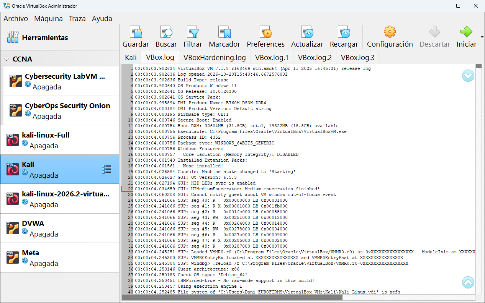
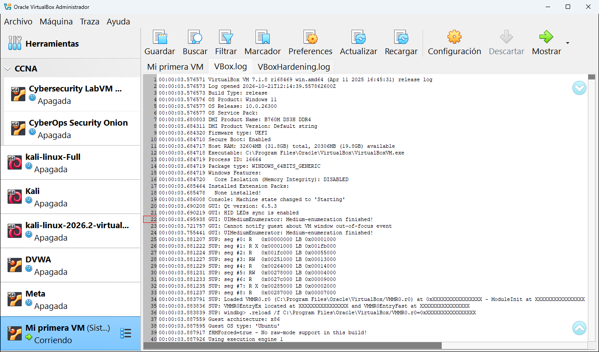

# 9.3 · Trazas

Las **trazas** (en inglés *logs*, también llamadas **registros**) son archivos de texto donde VirtualBox **apunta todo lo que pasa** mientras una máquina está encendida: con qué configuración arrancó, qué hardware detectó, qué errores hubo... Esta herramienta permite leerlas sin buscar los archivos a mano.

## Las pestañas: un archivo cada una

| Pestaña | Qué contiene |
|---|---|
| **VBox.log** | El registro de la **última vez** que arrancaste la máquina. Es el más útil. |
| **VBox.log.1**, **.2**, **.3** | Los registros de los arranques anteriores (el `.1` es el penúltimo, y así). VirtualBox guarda los últimos y borra los más viejos. |
| **VBoxHardening.log** | El registro de las comprobaciones de seguridad que hace VirtualBox al arrancar la máquina. Solo importa si la máquina no llega a arrancar. |

## Qué se puede leer en VBox.log

Cada línea empieza con el **tiempo** desde que arrancó la máquina (`00:00:03.902634`) y después el mensaje. Al principio del archivo de la captura se ve:

| Línea | Qué dice |
|---|---|
| `VirtualBox VM 7.1.8 r168469 win.amd64` | La versión de VirtualBox. |
| `OS Product: Windows 11` | El sistema de **tu ordenador**. |
| `Host RAM: 32604MB (31.8GB) total` | La memoria de tu ordenador y cuánta había libre. |
| `Executable: C:\Program Files\Oracle\VirtualBox\VirtualBoxVM.exe` | El programa que ejecuta la máquina. |
| `Installed Extension Packs: None installed!` | Que no hay [paquete de extensiones](../05-herramientas-globales/01-extensiones.md). |
| `Guest OS type: 'Debian_64'` | El tipo de sistema invitado configurado. |

Más abajo aparecen el hardware virtual, los discos que se abrieron, la red, los errores...

## Los botones

| Botón | Qué hace |
|---|---|
| **Guardar** | Guarda una copia del registro en el archivo que elijas (para enviarlo a quien te ayude). |
| **Buscar** | Muestra una barra para buscar una palabra (por ejemplo `error`). |
| **Filtrar** | Muestra solo las líneas que contienen ciertas palabras. |
| **Marcador** | Marca líneas importantes para volver a ellas. También puedes hacer clic en el número de línea. |
| **Preferences** | Cambia el tamaño de la letra y si las líneas largas se parten. |
| **Actualizar** | Vuelve a leer el registro (útil con la máquina encendida, porque va creciendo). |
| **Recargar** | Vuelve a cargar todos los archivos de registro. |

Esta es la traza de **Mi primera VM** mientras estaba encendida:

> [!TIP]
> Si una máquina da un error al arrancar, abre **VBox.log**, pulsa **Buscar** y busca las palabras `error`, `failed` o `VERR_`. El código que empieza por `VERR_` es lo que tienes que copiar en el buscador para encontrar la solución.

> [!WARNING]
> Los registros contienen datos de tu ordenador: modelo de la placa base, memoria, rutas de carpetas con tu nombre de usuario... Revísalos antes de publicarlos en un foro.

Los archivos están en la subcarpeta `Logs` de la carpeta de la máquina (ver [Tipos de archivo](../12-tipos-de-archivo.md)).

---

<!-- nav -->

[⬅️ 9.2 · Instantáneas](02-instantaneas.md) &nbsp;·&nbsp; [🏠 Índice](../../README.md) &nbsp;·&nbsp; [9.4 · Actividad ➡️](04-actividad.md)

