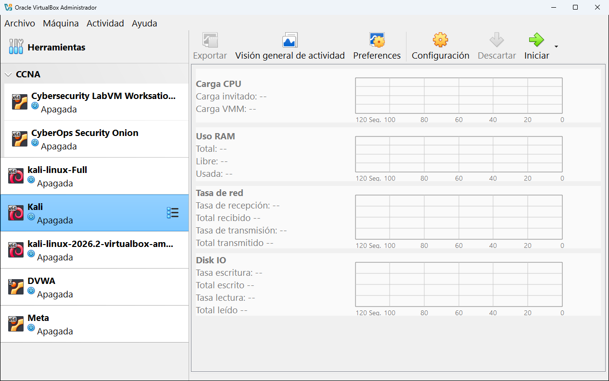
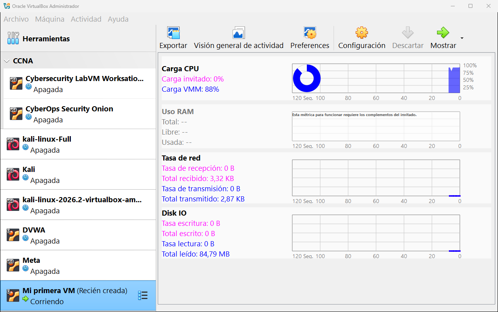

# 9.4 · Actividad

La herramienta **Actividad** dibuja **gráficas en tiempo real** de cuánto usa la máquina: procesador, memoria, red y disco. Es la versión detallada de la herramienta global [Actividades](../05-herramientas-globales/05-actividades.md), solo para una máquina.

## Con la máquina apagada

Si la máquina está apagada, las gráficas aparecen vacías y los valores con un guion (`-`):

## Con la máquina encendida

Cada gráfica muestra los **últimos 120 segundos** (el eje de abajo va de 120 a 0 segundos), con el valor actual a la derecha.

| Gráfica | Qué mide | En la captura |
|---|---|---|
| **Carga CPU** | **Carga invitado**: lo que usa el sistema de dentro. **Carga VMM**: lo que gasta VirtualBox en mover la máquina. El círculo muestra el total. | Invitado 0 %, VMM 88 % |
| **Uso RAM** | Memoria total, libre y usada dentro de la máquina. | Vacía: *"Esta métrica para funcionar requiere los complementos del invitado"* |
| **Tasa de red** | Velocidad de recepción y transmisión, y el total recibido y enviado. | 3,32 KB recibidos, 2,87 KB enviados |
| **Disk IO** | Velocidad de escritura y lectura del disco, y los totales. | 84,79 MB leídos |

> [!NOTE]
> La gráfica de **memoria** solo funciona si la máquina tiene los **complementos del invitado** instalados, porque es el sistema de dentro el que tiene que contar cuánta memoria usa. En el ejemplo la máquina arranca un CD "live" sin ellos. Ver el [capítulo 10](../10-usar-una-maquina.md#los-complementos-del-invitado).

> [!TIP]
> Una **Carga VMM** alta con la **Carga invitado** a cero, como en la captura, suele ser normal al principio, mientras el sistema arranca o espera en una pantalla de texto. Si se mantiene alta mucho rato, prueba a darle a la máquina un núcleo más o a instalar los complementos del invitado.

## Los botones

| Botón | Qué hace |
|---|---|
| **Exportar** | Guarda los datos de las gráficas en un archivo. |
| **Visión general de actividad** | Abre la herramienta global [Actividades](../05-herramientas-globales/05-actividades.md), con todas las máquinas encendidas. |
| **Preferences** | Ajustes de las gráficas (cuánto tiempo muestran, colores...). |

---

<!-- nav -->

[⬅️ 9.3 · Trazas](03-trazas.md) &nbsp;·&nbsp; [🏠 Índice](../../README.md) &nbsp;·&nbsp; [9.5 · Administrador de archivos ➡️](05-administrador-de-archivos.md)

