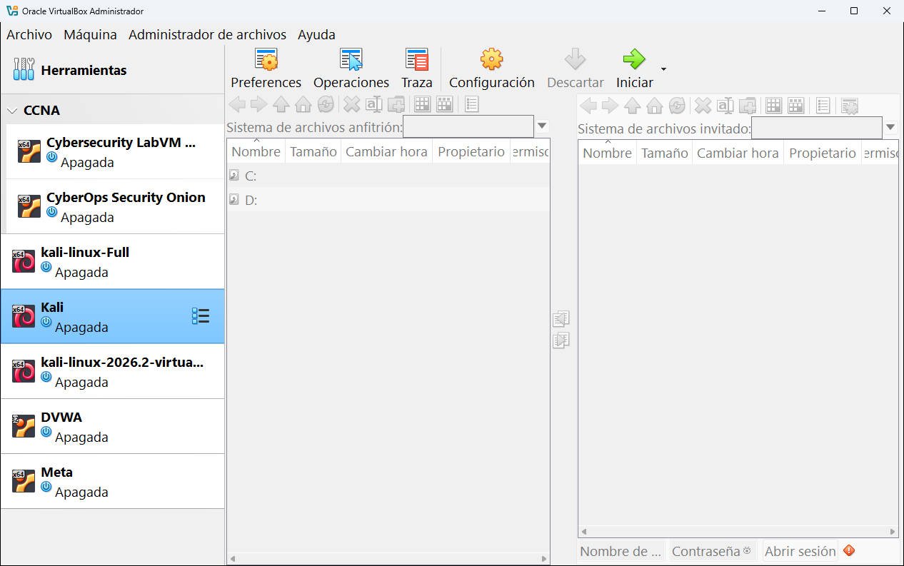
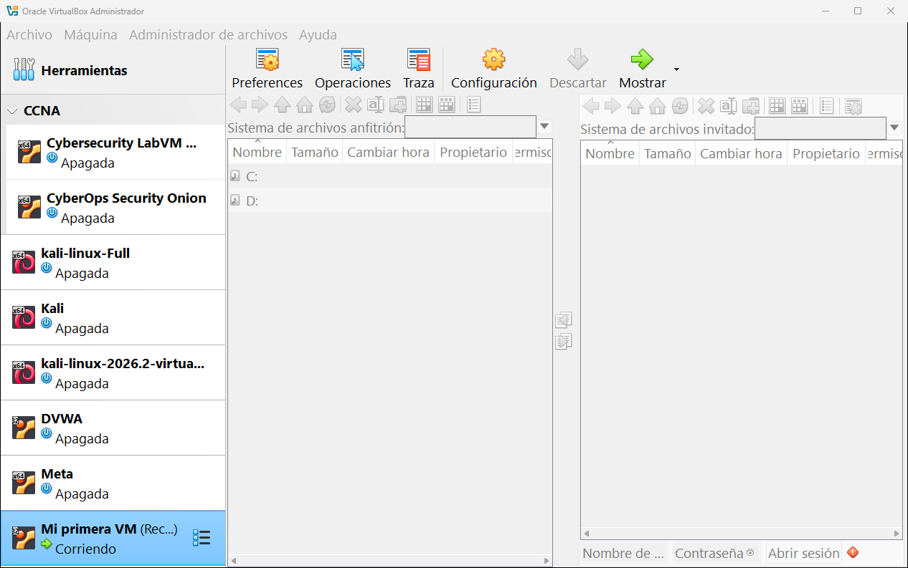

# 9.5 · Administrador de archivos

El **Administrador de archivos** sirve para **copiar archivos entre tu ordenador y la máquina virtual** sin usar carpetas compartidas ni memorias USB. Se parece a un explorador de archivos con dos paneles: tu ordenador a la izquierda y la máquina a la derecha.

> [!IMPORTANT]
> Para usarlo hacen falta dos cosas: que la máquina esté **encendida** y que tenga instalados los **complementos del invitado**. Además necesitas el **usuario y la contraseña** de una cuenta del sistema invitado.

## Las partes de la pantalla

| Zona | Qué es |
|---|---|
| **Sistema de archivos anfitrión** (izquierda) | Los discos y carpetas de **tu ordenador**. Aquí se ven las unidades `C:` y `D:`. |
| **Sistema de archivos invitado** (derecha) | Las carpetas de **la máquina virtual**. Está vacío hasta que inicias sesión. |
| **Flechas del centro** | Copian lo seleccionado de un lado al otro. |
| **Barra de iconos de cada panel** | Atrás, adelante, subir de carpeta, carpeta personal, actualizar, borrar, renombrar, crear carpeta, copiar, ver como lista o iconos, propiedades... |
| **Nombre de usuario**, **Contraseña** y **Abrir sesión** (abajo a la derecha) | Para entrar en la máquina con una cuenta de su sistema. |

Los botones de arriba son **Preferences** (opciones de visualización), **Operaciones** (un panel con el progreso de las copias) y **Traza** (un panel con los mensajes y errores).

## Cómo copiar un archivo

1. Arranca la máquina y espera a que el sistema haya iniciado del todo.
2. Abajo a la derecha escribe el **nombre de usuario** y la **contraseña** de una cuenta del sistema invitado, y pulsa **Abrir sesión**.
3. Navega en cada panel hasta las carpetas de origen y de destino.
4. Selecciona el archivo y pulsa la **flecha** que apunta hacia el otro lado.
5. Mira el panel **Operaciones** para ver cuándo termina.

## Si no tiene los complementos del invitado

Así se ve con **Mi primera VM** encendida: la sesión no se puede abrir y aparece un **icono rojo de aviso** junto a **Abrir sesión**, porque el CD "live" que arranca no trae los complementos del invitado.

Si te pasa esto, instala los complementos (ver el [capítulo 10](../10-usar-una-maquina.md#los-complementos-del-invitado)) o usa otra forma de pasar archivos: [carpetas compartidas](../08-configuracion/09-carpetas-compartidas.md), una memoria [USB](../08-configuracion/08-usb.md) o la red.

---

<!-- nav -->

[⬅️ 9.4 · Actividad](04-actividad.md) &nbsp;·&nbsp; [🏠 Índice](../../README.md) &nbsp;·&nbsp; [10 · Usar una máquina virtual ➡️](../10-usar-una-maquina.md)

