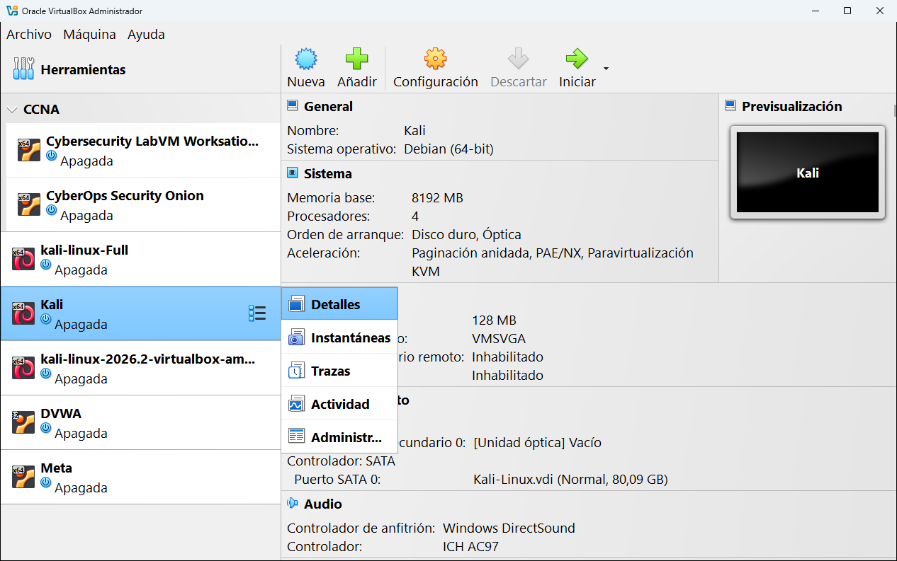

# 9 · Las herramientas de una máquina

Cada máquina tiene sus propias herramientas, que se muestran en la parte derecha de la ventana principal. Para cambiar de una a otra:

1. Selecciona la máquina en la lista.
2. Pulsa el icono de **lista** que aparece a la derecha de su nombre.
3. Elige la herramienta:

También están en **Máquina** → **Herramientas**.

| Herramienta | Para qué sirve | ¿Necesita la máquina encendida? |
|---|---|---|
| [Detalles](01-detalles.md) | Ver de un vistazo cómo está configurada la máquina. | No |
| [Instantáneas](02-instantaneas.md) | Guardar "fotos" del estado de la máquina para volver atrás. | No |
| [Trazas](03-trazas.md) | Leer los registros (*logs*) de lo que ha hecho la máquina. | No |
| [Actividad](04-actividad.md) | Gráficas de uso de CPU, memoria, red y disco. | Sí |
| [Administrador de archivos](05-administrador-de-archivos.md) | Copiar archivos entre tu ordenador y la máquina. | Sí, y con los complementos del invitado |

> [!NOTE]
> VirtualBox recuerda la última herramienta que usaste. Si al seleccionar otra máquina ves sus instantáneas en lugar de sus detalles, es por eso.

---

<!-- nav -->

[⬅️ 8.10 · Interfaz de usuario](../08-configuracion/10-interfaz-de-usuario.md) &nbsp;·&nbsp; [🏠 Índice](../../README.md) &nbsp;·&nbsp; [9.1 · Detalles ➡️](01-detalles.md)

