# 10 · Usar una máquina virtual

Ya tienes una máquina creada. En este capítulo la **encendemos**, vemos su **ventana** con todos sus menús, aprendemos a usar la **tecla anfitrión** y, sobre todo, a **apagarla bien**.

**En este capítulo:**
- [Arrancar la máquina](#arrancar-la-máquina)
- [La ventana de la máquina](#la-ventana-de-la-máquina)
- [La tecla anfitrión](#la-tecla-anfitrión)
- [La barra de estado](#la-barra-de-estado)
- [Los menús de la ventana](#los-menús-de-la-ventana)
- [Información de sesión](#información-de-sesión)
- [Los complementos del invitado](#los-complementos-del-invitado)
- [Apagar una máquina correctamente](#apagar-una-máquina-correctamente)

---

## Arrancar la máquina

Selecciónala en la lista y pulsa **Iniciar** (o haz doble clic sobre ella). Se abre una ventana nueva con la pantalla de la máquina. Las otras formas de arrancar (sin pantalla o desacoplada) están en el [capítulo 3](03-ventana-principal.md#4--la-barra-de-botones).

Mientras está encendida, en la ventana principal su estado pasa a **Corriendo**, la previsualización muestra su pantalla en directo y el botón **Iniciar** cambia a **Mostrar** (trae su ventana al frente):

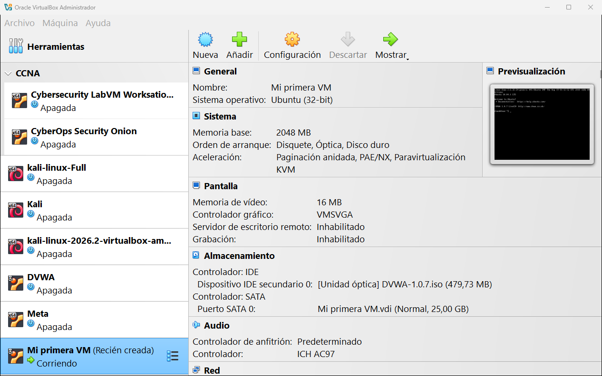

### El primer arranque

**Mi primera VM** arranca desde la ISO de DVWA. Lo primero que aparece es el cargador del CD, esperando en `boot:`. Basta con pulsar **Intro** dentro de la máquina para que siga:

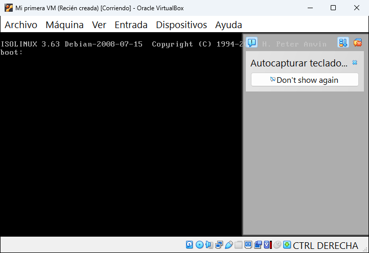

A la derecha se ve el **centro de notificaciones** de VirtualBox. Ahí aparecen avisos como **Autocapturar teclado...** o **Integración de ratón...**, que explican cómo se comporta el teclado y el ratón. Cada aviso tiene un botón **Don't show again** (no volver a mostrar) y se cierra con la **x** azul:


> [!TIP]
> Lee estos avisos al menos una vez: explican justo lo que se cuenta en [La tecla anfitrión](#la-tecla-anfitrión). Después puedes pulsar **Don't show again**.

## La ventana de la máquina

Al terminar de arrancar, DVWA muestra su línea de comandos, lista para usar:

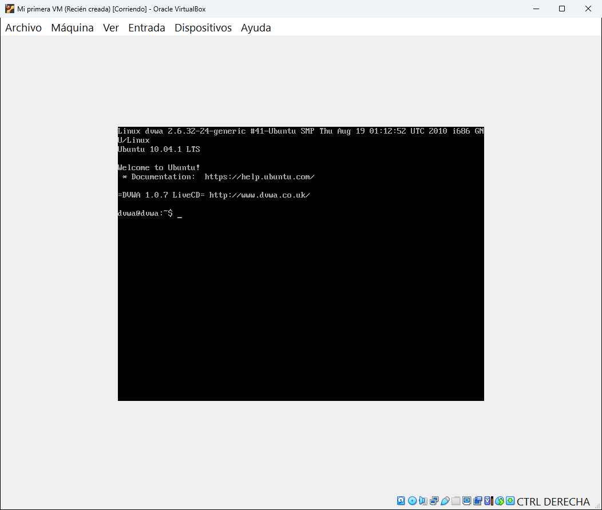

| Parte | Qué es |
|---|---|
| **Barra de título** | El nombre de la máquina, la última instantánea entre paréntesis y el estado entre corchetes: `Mi primera VM (Recién creada) [Corriendo] - Oracle VirtualBox`. |
| **Barra de menús** | **Archivo**, **Máquina**, **Ver**, **Entrada**, **Dispositivos** y **Ayuda**. |
| **Pantalla del invitado** | Lo que muestra el sistema de dentro. Aquí es pequeña (640 x 480) y está centrada porque el sistema no tiene complementos del invitado. |
| **Barra de estado** | Los iconos de abajo a la derecha (ver [La barra de estado](#la-barra-de-estado)). |

## La tecla anfitrión

Cuando haces clic dentro de la máquina, ella **captura el teclado** (y, en sistemas sin complementos del invitado, también **el ratón**). Desde ese momento todo lo que escribes va a la máquina y el ratón no puede salir de su ventana.

> [!IMPORTANT]
> Para **recuperar el teclado y el ratón**, pulsa una vez la **tecla anfitrión**: por defecto es **Ctrl derecha**. Su nombre aparece siempre abajo a la derecha de la ventana (`CTRL DERECHA`). Se puede cambiar en [Preferencias → Entrada](04-preferencias.md#entrada).

La tecla anfitrión (en los menús aparece como **Host**) también sirve para atajos. Se mantiene pulsada y se pulsa la otra tecla:

| Atajo | Qué hace |
|---|---|
| **Host + F** | Pantalla completa (y volver) |
| **Host + L** | Modo fluido |
| **Host + C** | Modo escalado |
| **Host + A** | Ajustar el tamaño de la ventana a la pantalla del invitado |
| **Host + E** | Captura de pantalla de la máquina |
| **Host + T** | Tomar una instantánea |
| **Host + S** | Abrir la configuración |
| **Host + N** | Información de sesión |
| **Host + P** | Pausar y reanudar |
| **Host + R** | Reiniciar (de golpe) |
| **Host + H** | Enviar la señal de apagado (apagado ACPI) |
| **Host + Q** | Cerrar la máquina (abre la ventana de cerrar) |
| **Host + Supr** | Enviar **Ctrl + Alt + Supr** a la máquina |

> [!NOTE]
> **¿Por qué no pulsar Ctrl + Alt + Supr directamente?** Porque esa combinación la "atrapa" siempre tu Windows, nunca llega a la máquina. Para enviarla a la máquina (por ejemplo, para iniciar sesión en un Windows invitado) usa **Host + Supr** o el menú **Entrada** → **Teclado** → **Insertar Ctrl-Alt-Del**.

## La barra de estado

Los iconos de abajo a la derecha informan del estado de cada dispositivo. Si pasas el ratón por encima te dicen más, y con clic derecho (o doble clic) abren un menú para cambiar ese dispositivo sin apagar la máquina.

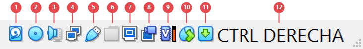

| Nº | Icono | Qué indica |
|:-:|---|---|
| 1 | **Discos duros** | Los discos conectados. Parpadea cuando la máquina lee o escribe. |
| 2 | **Discos ópticos** | La unidad de CD/DVD y si tiene una ISO puesta. Desde aquí puedes cambiarla. |
| 3 | **Audio** | Si la salida y la entrada de audio están activas. |
| 4 | **Red** | Las tarjetas de red. Parpadea con el tráfico. Permite "desenchufar el cable". |
| 5 | **USB** | Los dispositivos USB. Desde aquí conectas una memoria USB a la máquina. |
| 6 | **Carpetas compartidas** | Las carpetas compartidas (en gris porque no hay ninguna). |
| 7 | **Pantalla** | La memoria de vídeo y la aceleración 3D. |
| 8 | **Grabación** | Si se está grabando la pantalla en vídeo. |
| 9 | **Características** | El motor de virtualización. **V** significa que usa la virtualización del procesador (VT-x/AMD-V), lo normal. Si aparece una **tortuga verde**, la máquina usa la capa de Hyper-V de Windows y va más lenta (ver [Problemas frecuentes](13-problemas-frecuentes.md#la-máquina-va-muy-lenta-o-aparece-una-tortuga-verde)). |
| 10 | **Ratón** | Si el ratón está capturado por la máquina o se mueve libremente. |
| 11 | **Teclado** | Si el teclado está capturado por la máquina. |
| 12 | **Tecla anfitrión** | Recordatorio de cuál es la tecla anfitrión. |

## Los menús de la ventana

### Menú Archivo

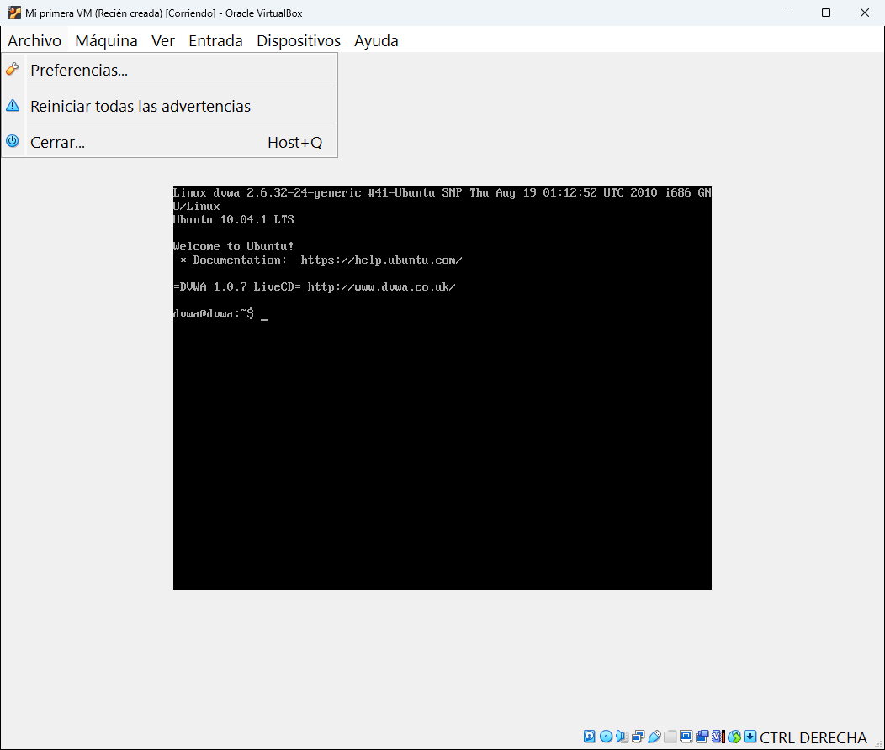

**Preferencias...** abre las [preferencias de VirtualBox](04-preferencias.md), **Reiniciar todas las advertencias** vuelve a mostrar los avisos ocultos y **Cerrar...** (**Host + Q**) abre la ventana para [apagar la máquina](#apagar-una-máquina-correctamente).

### Menú Máquina

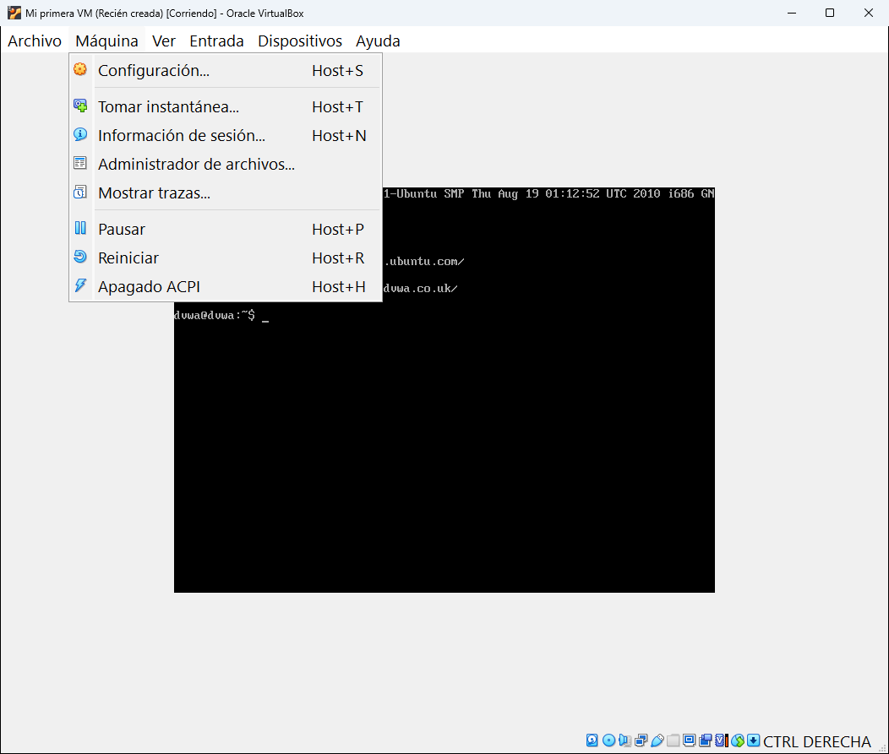

| Opción | Atajo | Qué hace |
|---|---|---|
| **Configuración...** | Host + S | Abre la configuración. Con la máquina encendida, muchas opciones aparecen bloqueadas. |
| **Tomar instantánea...** | Host + T | Guarda una [instantánea](09-herramientas-de-la-maquina/02-instantaneas.md) con la máquina encendida (incluida la memoria). |
| **Información de sesión...** | Host + N | Muestra datos de la máquina en marcha (ver [más abajo](#información-de-sesión)). |
| **Administrador de archivos...** | | Abre el [administrador de archivos](09-herramientas-de-la-maquina/05-administrador-de-archivos.md). |
| **Mostrar trazas...** | | Abre las [trazas](09-herramientas-de-la-maquina/03-trazas.md). |
| **Pausar** | Host + P | Congela la máquina. Vuelve a pulsar para continuar. |
| **Reiniciar** | Host + R | Reinicia de golpe, sin avisar al sistema. Puede perder datos no guardados. |
| **Apagado ACPI** | Host + H | Pulsa el "botón de encendido" virtual: el sistema invitado se apaga ordenadamente. |

### Menú Ver

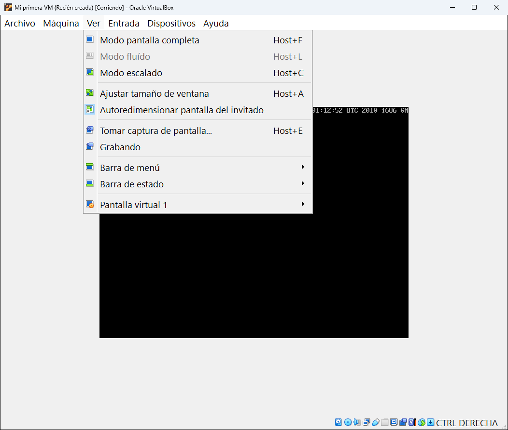

| Opción | Atajo | Qué hace |
|---|---|---|
| **Modo pantalla completa** | Host + F | La máquina ocupa todo el monitor. Abajo aparece una minibarra con los menús. |
| **Modo fluído** | Host + L | Las ventanas de los programas de la máquina aparecen **mezcladas con las de tu Windows**, sin el fondo de escritorio. Necesita los complementos del invitado. |
| **Modo escalado** | Host + C | La pantalla de la máquina se estira o encoge para llenar la ventana, tenga el tamaño que tenga. |
| **Ajustar tamaño de ventana** | Host + A | Ajusta la ventana al tamaño exacto de la pantalla de la máquina. |
| **Autoredimensionar pantalla del invitado** | | Al cambiar el tamaño de la ventana, cambia la resolución de la máquina para que encaje. Necesita los complementos del invitado. |
| **Tomar captura de pantalla...** | Host + E | Guarda una imagen de la pantalla de la máquina. |
| **Grabando** | | Empieza o para la [grabación](08-configuracion/03-pantalla.md#grabación) en vídeo. |
| **Barra de menú** y **Barra de estado** | | Muestran u ocultan esas barras. |
| **Pantalla virtual 1** | | Cambia la resolución de la máquina (de 640x480 a 1920x1200) o su escalado (de 100 % a 200 %). |

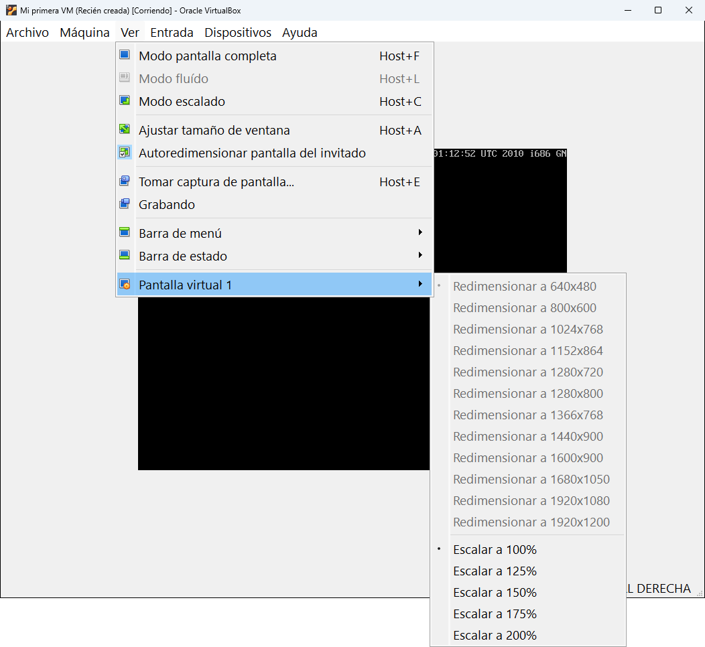

### Menú Entrada

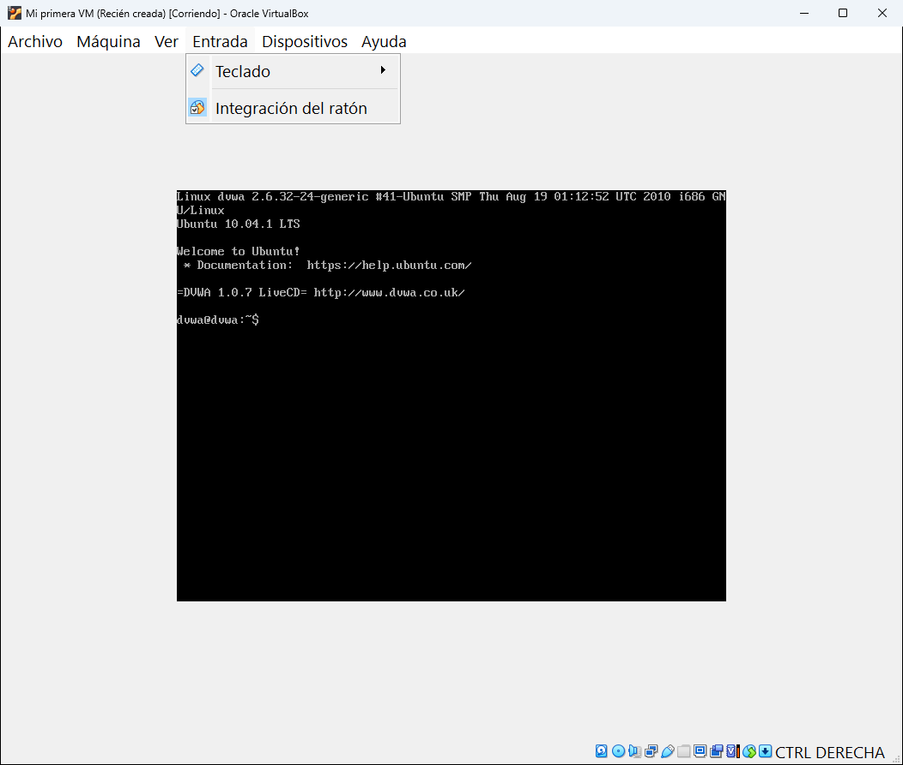

**Teclado** tiene las teclas especiales que no puedes pulsar directamente porque las captura tu Windows, y un **Teclado software** (teclado en pantalla). **Integración del ratón** activa o desactiva que el ratón entre y salga solo de la máquina.

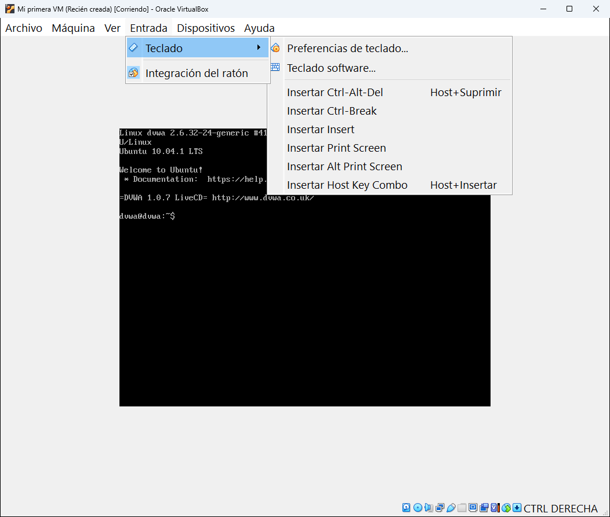

### Menú Dispositivos

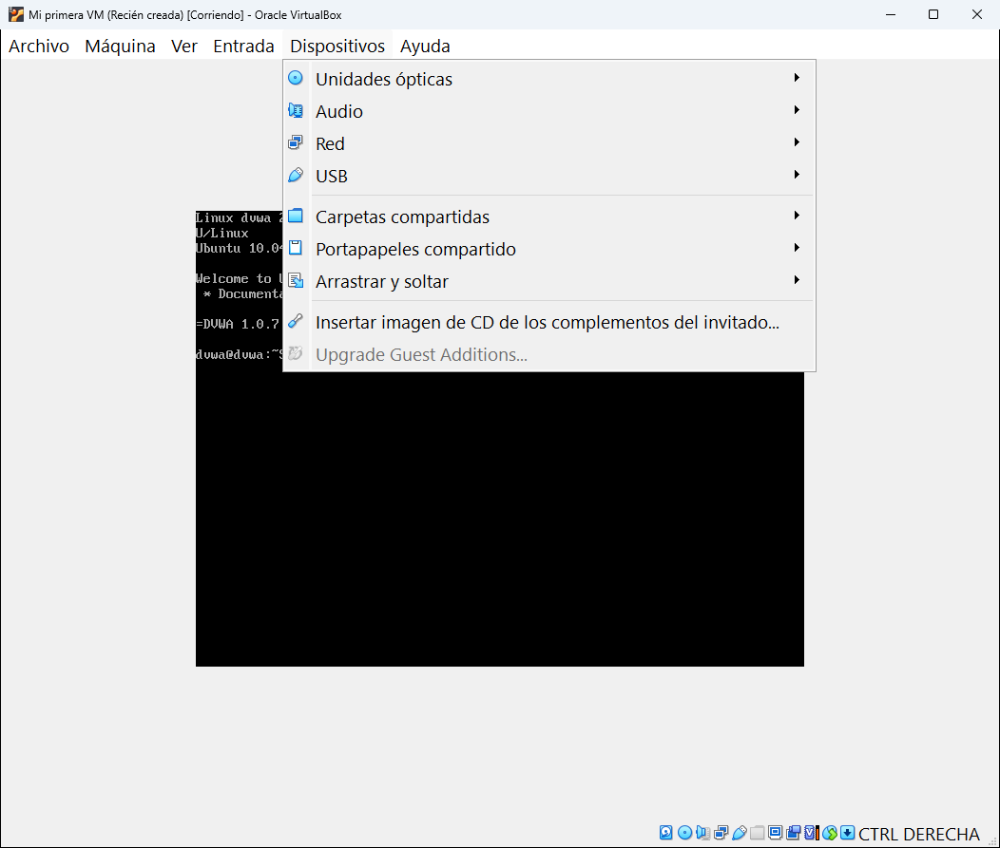

| Opción | Qué hace |
|---|---|
| **Unidades ópticas** | Mete, cambia o saca una ISO **sin apagar** la máquina. |
| **Audio** | Activa o desactiva la salida y la entrada de audio. |
| **Red** | **Preferencias de red...** abre la configuración de red, **Conectar adaptador de red** "enchufa" o "desenchufa" el cable. |
| **USB** | Lista los USB de tu ordenador: haz clic en uno para pasarlo a la máquina. |
| **Carpetas compartidas** | Añade carpetas compartidas con la máquina encendida. |
| **Portapapeles compartido** | Copiar y pegar entre tu ordenador y la máquina (ver abajo). |
| **Arrastrar y soltar** | Arrastrar archivos entre los dos. |
| **Insertar imagen de CD de los complementos del invitado...** | Mete en la unidad de CD el disco con los [complementos del invitado](#los-complementos-del-invitado). |
| **Upgrade Guest Additions...** | Actualiza los complementos del invitado si ya estaban instalados. |

Los submenús de **Unidades ópticas**, **Red** y **Portapapeles compartido**:

| Unidades ópticas | Red | Portapapeles compartido |
|:-:|:-:|:-:|
| 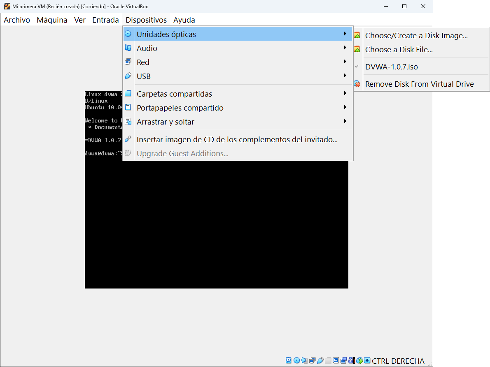 | 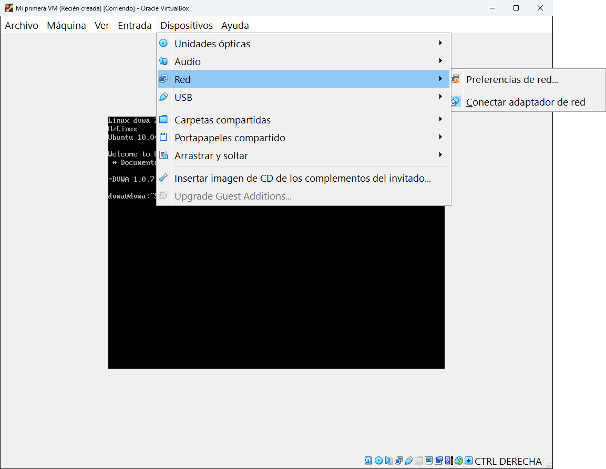 | 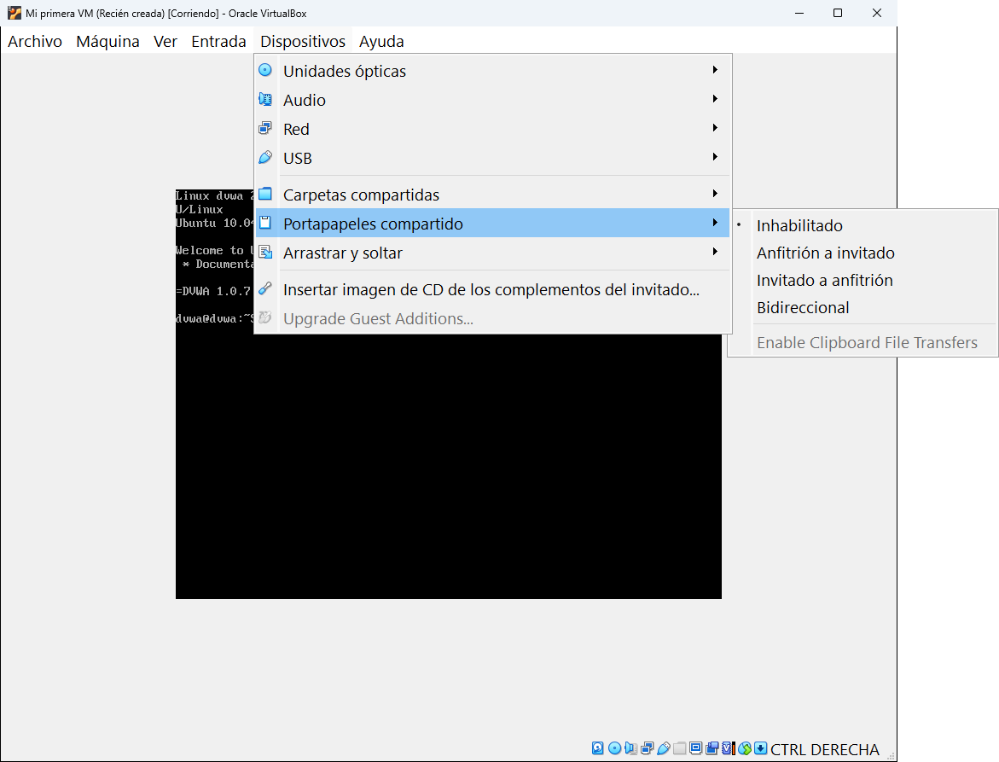 |

El portapapeles tiene las mismas cuatro opciones que en [General → Avanzado](08-configuracion/01-general.md#avanzado) (**Inhabilitado**, **Anfitrión a invitado**, **Invitado a anfitrión**, **Bidireccional**) y una más, **Enable Clipboard File Transfers**, para copiar y pegar también archivos.

### Menú Ayuda

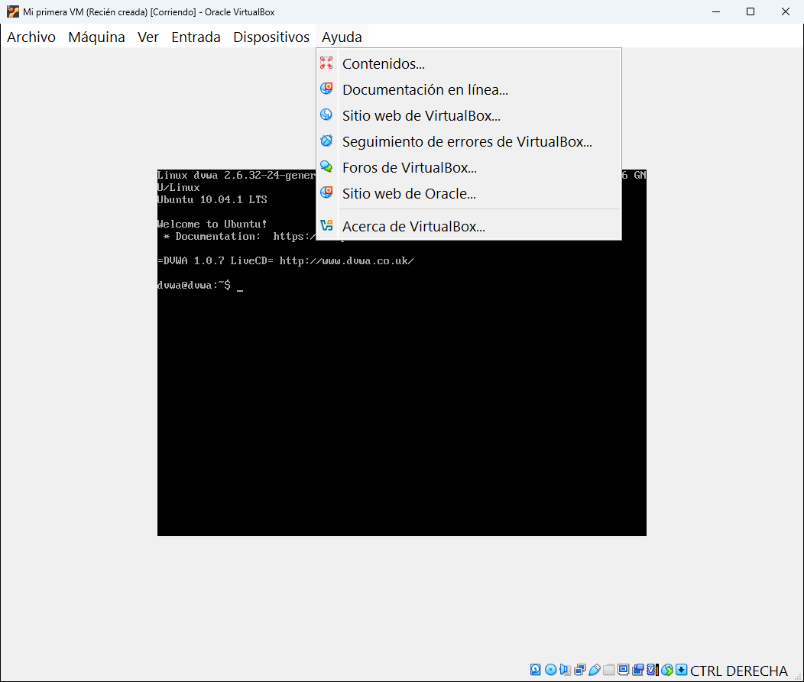

Da acceso al manual (**Contenidos...**, también con la tecla **F1**), a la documentación en línea, a las webs de VirtualBox y de Oracle, a los foros y a **Acerca de VirtualBox...**, que muestra la versión instalada.

## Información de sesión

**Máquina** → **Información de sesión...** (**Host + N**) abre una ventana con tres pestañas.

**Detalles de configuración**: la misma ficha que la herramienta [Detalles](09-herramientas-de-la-maquina/01-detalles.md). Esta captura es de la máquina **DVWA**, las de las otras dos pestañas son de **Mi primera VM**.

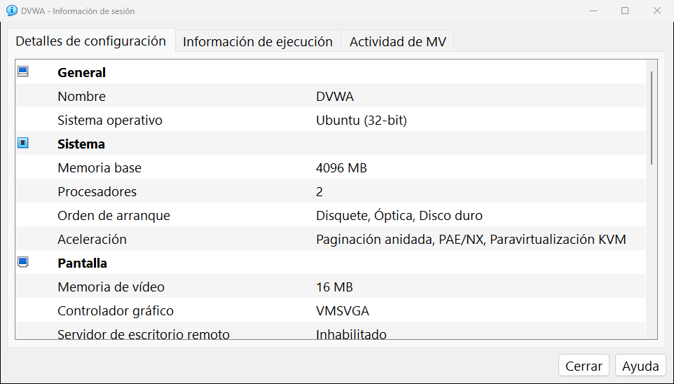

**Información de ejecución**: datos de la máquina en marcha.

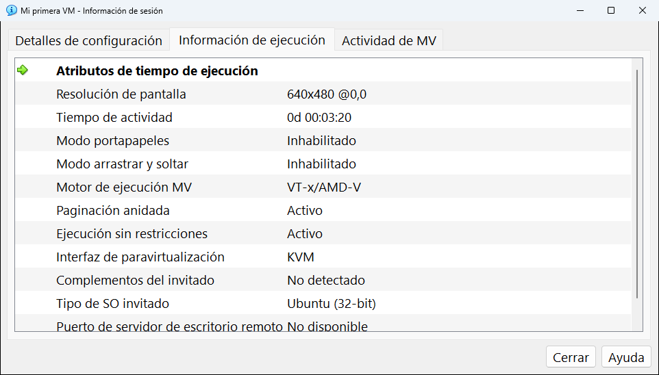

| Dato | Qué significa | En la captura |
|---|---|---|
| **Resolución de pantalla** | La resolución actual del invitado. | 640x480 |
| **Tiempo de actividad** | Cuánto tiempo lleva encendida. | |
| **Modo portapapeles** y **Modo arrastrar y soltar** | Cómo están configurados ahora. | Inhabilitado |
| **Motor de ejecución MV** | Cómo se ejecuta la máquina. | VT-x/AMD-V (lo mejor) |
| **Paginación anidada** y **Ejecución sin restricciones** | Funciones de aceleración del procesador. | Activo |
| **Interfaz de paravirtualización** | La que se está usando. | |
| **Complementos del invitado** | Si están instalados y su versión. | **No detectado** |
| **Tipo de SO invitado** | El configurado. | Ubuntu (32-bit) |

**Actividad de MV**: las mismas gráficas que la herramienta [Actividad](09-herramientas-de-la-maquina/04-actividad.md).

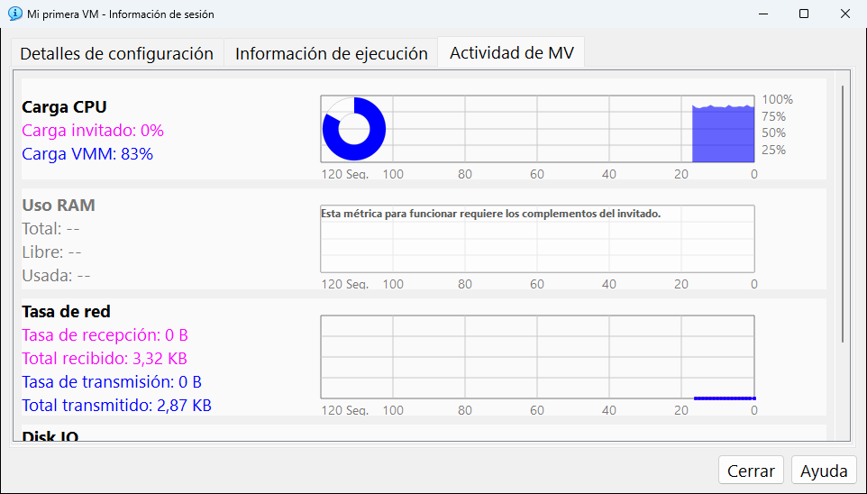

## Los complementos del invitado

Los **complementos del invitado** (*Guest Additions*) son unos controladores que se instalan **dentro** de la máquina virtual para que se lleve bien con VirtualBox. Sin ellos la máquina funciona, pero con muchas limitaciones. **Instálalos siempre que puedas.**

| Sin complementos | Con complementos |
|---|---|
| Pantalla pequeña y fija | La resolución se ajusta sola al tamaño de la ventana |
| El ratón se queda atrapado | El ratón entra y sale libremente |
| No hay portapapeles ni arrastrar y soltar | Copiar y pegar y arrastrar archivos entre los dos |
| No funcionan las carpetas compartidas | Carpetas compartidas |
| Sin modo fluido ni aceleración 3D | Modo fluido y aceleración 3D |
| La memoria aparece como N/A en Actividad | Estadísticas completas |
| No funciona el administrador de archivos | Administrador de archivos |

### En un invitado Windows

1. Con la máquina encendida y Windows iniciado, ve a **Dispositivos** → **Insertar imagen de CD de los complementos del invitado...**
2. Dentro de la máquina, abre el Explorador de archivos y entra en la unidad de CD (**VirtualBox Guest Additions**).
3. Ejecuta `VBoxWindowsAdditions.exe`, acepta todo y **reinicia** la máquina.

### En un invitado Linux

Muchas distribuciones los traen en sus propios paquetes. En **Kali** y **Debian**:

```bash
sudo apt update
sudo apt install -y virtualbox-guest-x11
sudo reboot
```

Si tu distribución no los tiene, instálalos desde el CD de VirtualBox:

1. **Dispositivos** → **Insertar imagen de CD de los complementos del invitado...**
2. Dentro de la máquina, abre un terminal e instala lo necesario para compilar:

   ```bash
   sudo apt install -y build-essential dkms linux-headers-$(uname -r)
   ```

3. Ejecuta el instalador del CD (la carpeta donde aparece el CD puede cambiar según el sistema, busca la que empieza por `VBox_GAs`):

   ```bash
   sudo sh /media/$USER/VBox_GAs_*/VBoxLinuxAdditions.run
   ```

4. Reinicia la máquina.

> [!NOTE]
> Las máquinas que arrancan desde un CD "live", como **Mi primera VM** con DVWA, **no pueden** guardar los complementos: al apagarlas se pierde todo lo instalado. Por eso en esta guía algunas funciones aparecen como "no detectado". En una máquina instalada en su disco no pasa.

## Apagar una máquina correctamente

Cierra la ventana de la máquina (la **X** de arriba a la derecha) o usa **Archivo** → **Cerrar...** (**Host + Q**). VirtualBox pregunta qué quieres hacer:

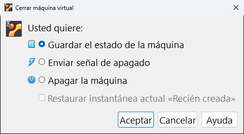

| Opción | Qué hace | Es como... | Cuándo usarla |
|---|---|---|---|
| **Guardar el estado de la máquina** | Guarda todo el contenido de la memoria en el disco y cierra. La próxima vez arranca **exactamente donde estaba**, con los programas abiertos. La máquina queda en estado **Guardada**. | Hibernar un portátil | Cuando quieres seguir más tarde donde lo dejaste. |
| **Enviar señal de apagado** | Pide al sistema invitado que se apague ordenadamente (señal ACPI). | Pulsar un momento el botón de encendido | **La opción normal.** El sistema cierra sus programas y se apaga bien. |
| **Apagar la máquina** | Corta la "corriente" de golpe. | Desenchufar el ordenador | Solo si el sistema se ha colgado y no responde a la señal de apagado. Puede perder datos o dañar el sistema. |

La casilla **Restaurar instantánea actual** (aquí «Recién creada») solo se activa con **Apagar la máquina**: apaga y, a continuación, vuelve a esa instantánea. Es la forma más rápida de "deshacer" todo lo que has hecho en un ejercicio.

> [!TIP]
> También puedes apagar el sistema **desde dentro**, como en un ordenador normal (menú de inicio → Apagar, o el comando `sudo poweroff` en Linux). Cuando el sistema se apaga, la ventana de la máquina se cierra sola.

> [!WARNING]
> No dejes máquinas en estado **Guardada** durante mucho tiempo ni actualices VirtualBox con máquinas guardadas: al cambiar de versión, el estado guardado puede no servir y tendrás que [descartarlo](03-ventana-principal.md#menú-máquina), perdiendo lo que no estuviera guardado dentro de la máquina.

---

<!-- nav -->
<div align="center">

[⬅️ 9.5 · Administrador de archivos](09-herramientas-de-la-maquina/05-administrador-de-archivos.md) &nbsp;·&nbsp; [🏠 Índice](../README.md) &nbsp;·&nbsp; [11 · Las redes explicadas ➡️](11-redes-explicadas.md)

</div>
