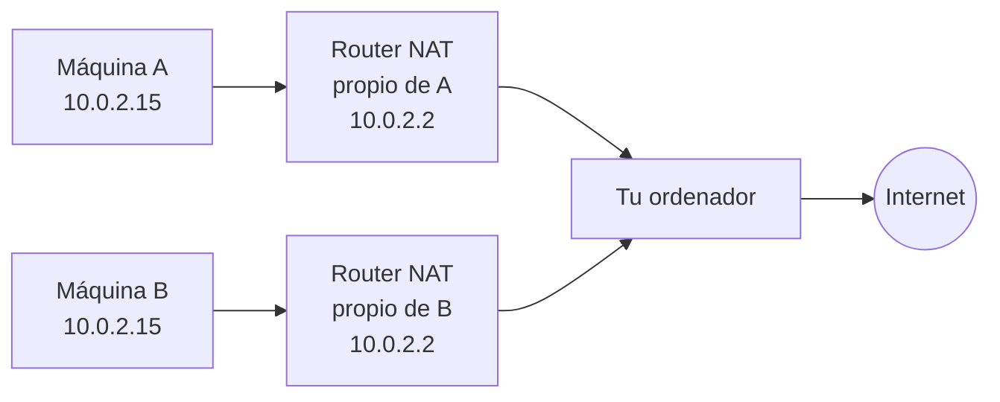
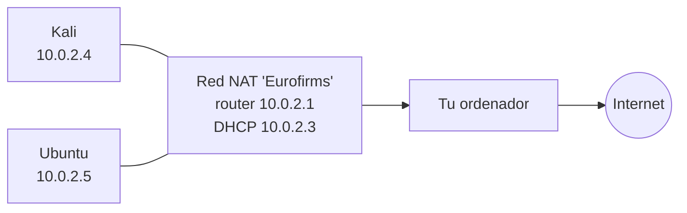
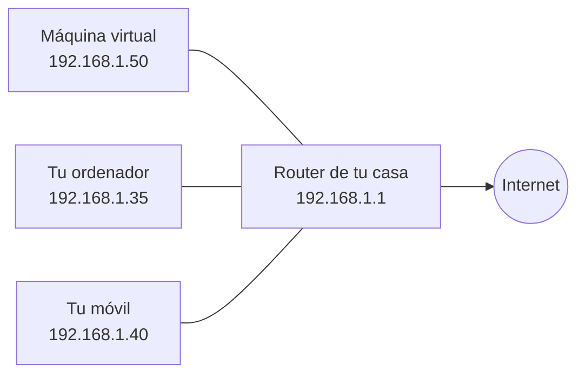
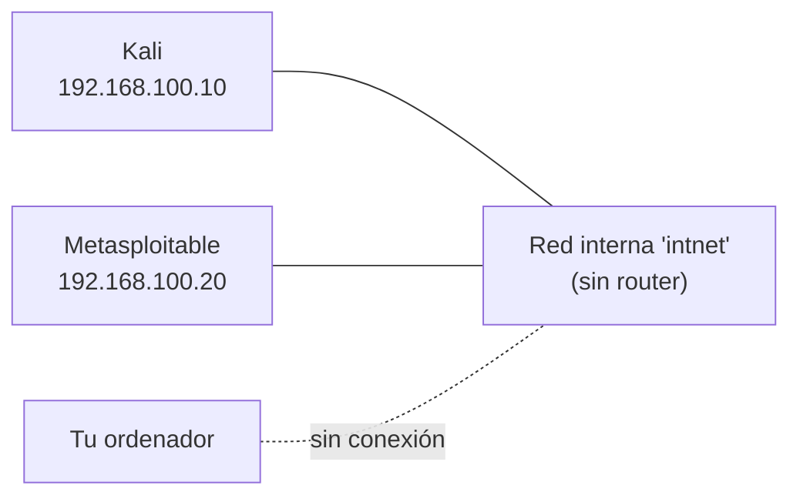
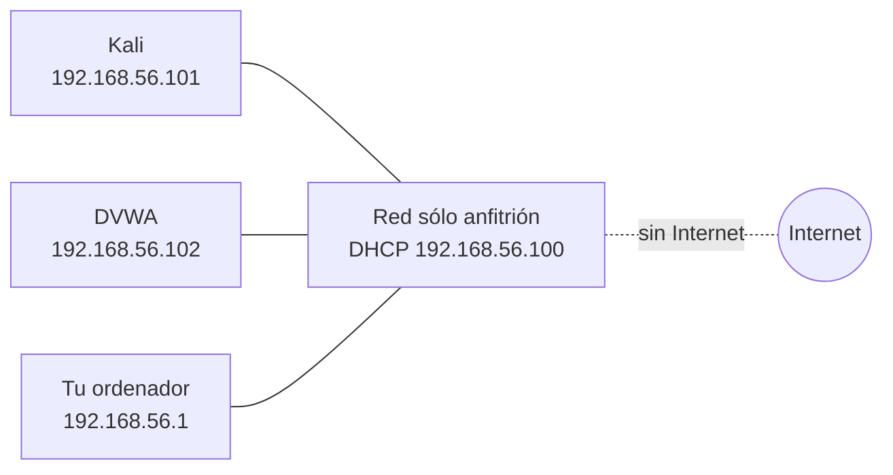
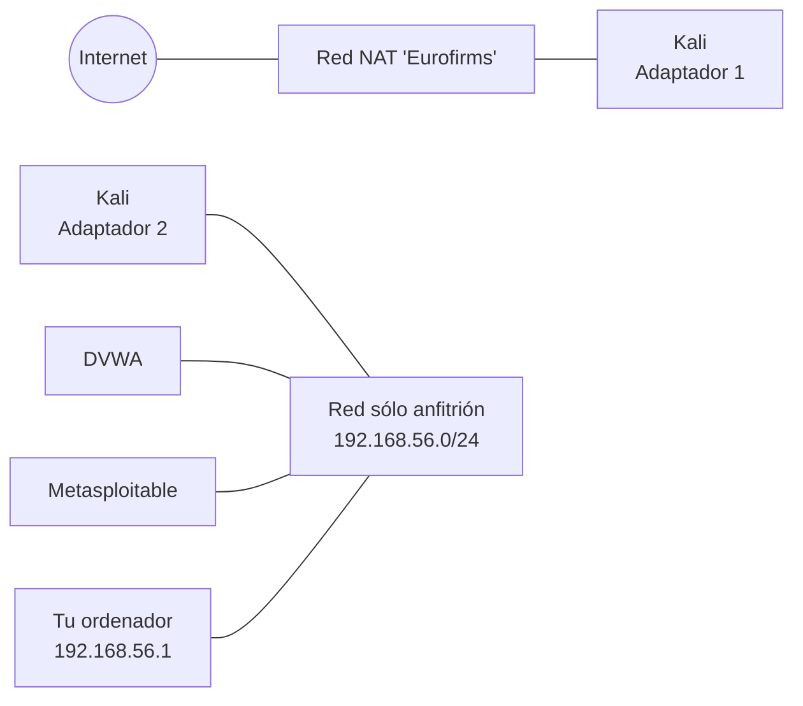

# 11 · Las redes explicadas

Elegir bien el tipo de red es lo que más dudas genera al empezar con VirtualBox. Este capítulo explica cada modo con un esquema, con qué puede hablar la máquina en cada caso y cuándo usarlo.

El modo se elige en la configuración de cada máquina, en [Red → Conectado a](08-configuracion/06-red.md#conectado-a-los-ocho-tipos-de-red). Las redes compartidas (solo-anfitrión, NAT, en la nube) se crean en la herramienta [Red](05-herramientas-globales/03-red.md).

**En este capítulo:**
- [Primero, cuatro palabras](#primero-cuatro-palabras)
- [La tabla resumen](#la-tabla-resumen)
- [NAT](#nat)
- [Red NAT](#red-nat)
- [Adaptador puente](#adaptador-puente)
- [Red interna](#red-interna)
- [Adaptador sólo anfitrión](#adaptador-sólo-anfitrión)
- [Los demás modos](#los-demás-modos)
- [Ejemplo: un laboratorio de ciberseguridad](#ejemplo-un-laboratorio-de-ciberseguridad)
- [Cómo saber la IP de una máquina](#cómo-saber-la-ip-de-una-máquina)

---

## Primero, cuatro palabras

| Palabra | Qué es |
|---|---|
| **Dirección IP** | El "número de teléfono" de un equipo en una red, por ejemplo `192.168.1.35`. |
| **Router** (o puerta de enlace) | El equipo que conecta una red con otra, normalmente con Internet. En casa es la caja del operador. |
| **DHCP** | Un servicio que da una IP automáticamente a cada equipo que se conecta. |
| **NAT** | Una técnica por la que varios equipos salen a Internet usando la misma IP. Desde fuera solo se ve esa IP, así que nadie puede entrar en los equipos de dentro. |

## La tabla resumen

Qué puede comunicarse con qué en cada modo (según la documentación oficial de VirtualBox):

| Modo | Máquina → tu ordenador | Tu ordenador → máquina | Máquina ↔ otras máquinas | Máquina → Internet y red local | Red local → máquina |
|---|:-:|:-:|:-:|:-:|:-:|
| **NAT** | ✅ | Solo con reenvío de puertos | ❌ | ✅ | Solo con reenvío de puertos |
| **Red NAT** | ✅ | Solo con reenvío de puertos | ✅ | ✅ | Solo con reenvío de puertos |
| **Adaptador puente** | ✅ | ✅ | ✅ | ✅ | ✅ |
| **Red interna** | ❌ | ❌ | ✅ | ❌ | ❌ |
| **Sólo anfitrión** | ✅ | ✅ | ✅ | ❌ | ❌ |

> [!TIP]
> **¿Cuál elijo?**
> - Solo necesito Internet en la máquina → **NAT**.
> - Varias máquinas que se vean entre ellas **y** con Internet → **Red NAT**.
> - Un laboratorio aislado, sin Internet → **Red interna** o **Sólo anfitrión**.
> - La máquina tiene que verse desde otros ordenadores de mi red → **Adaptador puente**.

---

## NAT

Es el modo **por defecto**. Cada máquina tiene su propio router virtual privado, dentro de VirtualBox, y sale a Internet a través de la conexión de tu ordenador.

- Las direcciones son siempre las mismas: la máquina tiene la `10.0.2.15`, su router la `10.0.2.2` y el DNS la `10.0.2.3`.
- Como cada máquina tiene su propio router, **dos máquinas en NAT no se ven entre sí**, aunque las dos tengan la misma IP.
- Para entrar desde tu ordenador en la máquina (por ejemplo, por SSH) hay que crear un **reenvío de puertos** con el botón del mismo nombre en [Configuración → Red](08-configuracion/06-red.md).

**Úsalo para:** cualquier máquina que solo necesite navegar, descargar actualizaciones, etc.

## Red NAT

Como NAT, pero **varias máquinas comparten el mismo router virtual**, así que están en la misma red y **se ven entre sí**. La red se crea antes en la herramienta [Red](05-herramientas-globales/03-red.md#redes-nat) y luego se elige por su nombre (en esta guía, `Eurofirms`).

**Úsalo para:** laboratorios donde las máquinas tienen que hablar entre ellas **y** tener Internet.

## Adaptador puente

La máquina se conecta **directamente a tu red real** (la del router de casa o de clase), como si fuera un ordenador más enchufado al mismo router. Recibe una IP de ese router, del mismo rango que tu ordenador.

En la configuración, en **Nombre** se elige **qué tarjeta de red de tu ordenador** se usa (la de cable o la Wi-Fi).

**Úsalo para:** que otros equipos de tu red puedan acceder a la máquina (un servidor web de pruebas, por ejemplo).

> [!WARNING]
> En modo puente la máquina está **expuesta a toda tu red**. Nunca conectes así una máquina vulnerable (como Metasploitable o DVWA) en la red de tu casa, tu trabajo o tu centro: cualquiera en esa red podría atacarla y usarla para entrar. Además, muchas redes de empresa o de centros educativos no permiten conectar equipos que no conocen.

## Red interna

Una red **solo entre máquinas virtuales**. Ni tu ordenador ni Internet pueden verlas. Todas las máquinas que tengan el mismo **nombre** de red interna (por defecto `intnet`) están conectadas al mismo "switch" virtual.

> [!IMPORTANT]
> Una red interna **no tiene servidor DHCP**: las máquinas no reciben IP solas. Tienes que ponerles una **IP fija** a mano dentro de cada sistema (por ejemplo `192.168.100.10` y `192.168.100.20`, con máscara `255.255.255.0`).

**Úsalo para:** laboratorios totalmente aislados, por ejemplo para analizar malware.

## Adaptador sólo anfitrión

Una red privada entre **tus máquinas y tu ordenador**, sin Internet. VirtualBox crea en tu Windows una tarjeta de red virtual (`VirtualBox Host-Only Ethernet Adapter`) con la IP `192.168.56.1`, y un DHCP que reparte IPs a partir de la `192.168.56.101`.

**Úsalo para:** laboratorios en los que quieres entrar en las máquinas desde tu ordenador (por ejemplo, abrir en tu navegador la web de DVWA en `http://192.168.56.102`) sin exponerlas a ninguna red.

## Los demás modos

| Modo | Qué hace |
|---|---|
| **Controlador genérico** | Para usos avanzados: conectar máquinas de distintos ordenadores con túneles UDP o redes VDE. |
| **Red en la nube [EXPERIMENTAL]** | Conecta la máquina con una red de Oracle Cloud Infrastructure. Ver [Cloud](05-herramientas-globales/04-cloud.md). |
| **No conectado** | La tarjeta existe pero sin cable, como si estuviera desenchufada. Útil para aislar una máquina un momento sin cambiar nada más. |

---

## Ejemplo: un laboratorio de ciberseguridad

La máquina **Kali** de esta guía tiene **dos tarjetas de red** (ver [Configuración → Red](08-configuracion/06-red.md)):

- **Adaptador 1** en la **Red NAT** `Eurofirms`: le da Internet para actualizar e instalar herramientas.
- **Adaptador 2** en **Sólo anfitrión**: la conecta con las máquinas vulnerables y con tu ordenador.

Las máquinas vulnerables (DVWA, Metasploitable) tienen **una sola tarjeta**, en **Sólo anfitrión**: Kali puede atacarlas, tú puedes verlas desde tu navegador, pero **ellas no tienen Internet** y nadie de fuera puede llegar a ellas.

## Cómo saber la IP de una máquina

Dentro de la máquina, abre un terminal y escribe:

| Sistema | Comando |
|---|---|
| Linux | `ip a` (o `ifconfig` en sistemas antiguos) |
| Windows | `ipconfig` |

Busca la línea `inet` (Linux) o `Dirección IPv4` (Windows) de cada tarjeta.

---

<!-- nav -->

[⬅️ 10 · Usar una máquina virtual](10-usar-una-maquina.md) &nbsp;·&nbsp; [🏠 Índice](../README.md) &nbsp;·&nbsp; [12 · Tipos de archivo ➡️](12-tipos-de-archivo.md)

